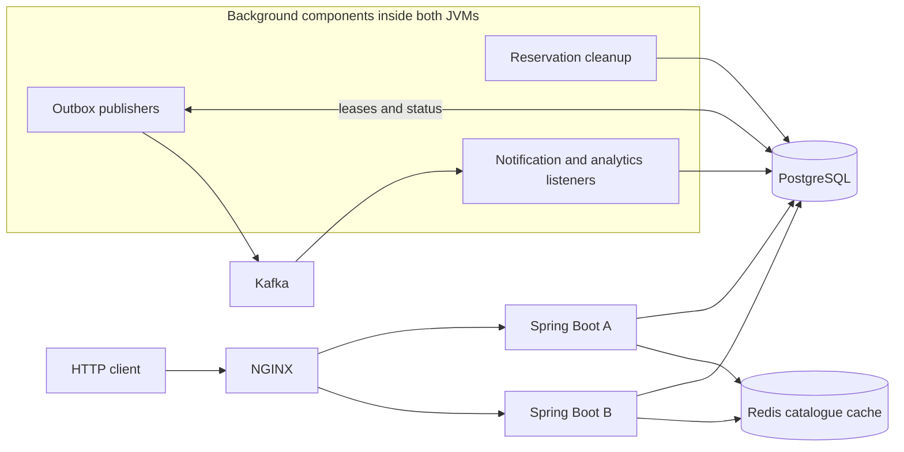

# Tbooker — Movie Ticket Booking Backend

A Java 21 / Spring Boot backend that explores a deceptively hard problem: **how do
multiple users and application instances safely compete for the same seat?**
Tbooker combines PostgreSQL reservation transactions, verified mock payments,
Redis catalogue caching, and durable Kafka events in a modular monolith. It is a
backend engineering portfolio project; there is no frontend or real money movement.

**Start here:** [5–10 minute demo](docs/DEMO.md) · [Design diagrams](docs/DIAGRAMS.md) ·
[Performance summary](docs/PERFORMANCE_SUMMARY.md) · [Resume and interview guide](docs/RESUME.md)

## What it demonstrates

- Five-minute seat holds with owner-only view, cancellation and confirmation;
  row locks, conditional updates and SQL constraints protect allocation across JVMs.
- BCrypt registration, signed JWT login, stateless Spring Security, and owner-scoped queries.
- UPI/Card **mock** payment strategies, persistent receipts, idempotent initiation,
  independently verified results, and recovery of paid-but-unconfirmed reservations.
- Cache-aside Redis for public catalogue DTOs, after-commit invalidation, finite TTLs,
  and PostgreSQL fallback. **Seat availability is always read from PostgreSQL.**
- A transactional outbox, leased publishers, Kafka retry/dead-letter handling, and
  idempotent notification/analytics database projections.
- Two identical application containers behind NGINX, shared durable state,
  reproducible Docker builds, CI, request correlation and operational metrics.

The retained two-JVM contention test sent **100 simultaneous hold requests: one
201, ninety-nine 409s**, followed by one permanent booking. The Maven regression
suite has **263 passing tests**. See [verification evidence](docs/TESTING.md) for
scope, dates, commands and limitations; performance targets are reported separately.

## Architecture



One Maven application uses Controller → Service → Repository layering, constructor
injection and DTOs. There are no independently deployed business microservices.
PostgreSQL owns inventory, payment and event state; Redis is disposable. Kafka
availability does not gate booking commits. Both replicas run background work;
database locks/leases and consumer groups coordinate them.

[HLD](docs/HLD.md) · [LLD](docs/LLD.md) · [Database](docs/DATABASE.md) ·
[Design decisions](docs/DECISIONS.md) · [Five walkthrough diagrams](docs/DIAGRAMS.md)

## Technology

| Area | Implementation |
| --- | --- |
| Application | Java 21, Spring Boot 3.5.16, Maven wrapper 3.9.16 |
| Persistence | Spring Data JPA, PostgreSQL 17, Flyway V1–V7, UTC `Instant` timestamps |
| Security | Spring Security resource server, Nimbus JWT, BCrypt cost 12 |
| Cache and events | Spring Cache / Redis 7.4, Spring Kafka / Kafka 3.9, PostgreSQL outbox |
| Verification | JUnit 5, Spring Boot Test, Mockito, PostgreSQL/Redis/Kafka Testcontainers, Python Compose checks, k6 |
| Operations | Multi-stage Dockerfile, Docker Compose, NGINX, Actuator/Micrometer, GitHub Actions |

Container versions and digests are fixed in [Compose](compose.scaled.yaml) and the
[Dockerfile](Dockerfile). These pins need deliberate maintenance; see the
[dependency review](docs/SECURITY.md#dependency-review-and-unresolved-advisories).

## Quick start: the complete stack

Prerequisites: Git, Docker Engine/Desktop with Compose v2, access to image/Maven
registries, and roughly **6–8 GiB available Docker memory** for build/startup.
The application is built inside Docker; a host JDK is only needed for Maven tests
or host development. Run commands in the repository root.

```bash
git clone https://github.com/Avnish666/Tbooker.git
cd Tbooker
# For an existing clone, keep your existing .env.
cp -n .env.example .env
```

Edit `.env`: set a private `DB_PASSWORD` and a random Base64 `JWT_SECRET` generated
locally with `openssl rand -base64 32`. Uncomment `SPRING_PROFILES_ACTIVE=dev` on a
**dedicated development database** to seed one movie, theatre, screen, show and
A1–A8 seats. Sample users have no passwords; register your own account.

```bash
docker compose -f compose.scaled.yaml config --quiet
docker compose -f compose.scaled.yaml up -d --build --wait --wait-timeout 240
docker compose -f compose.scaled.yaml ps
curl --fail http://127.0.0.1:8080/actuator/health/readiness
curl --fail http://127.0.0.1:8080/api/shows

# Stop containers and network, keeping PostgreSQL and Kafka volumes:
docker compose -f compose.scaled.yaml down
```

The default URL is **http://127.0.0.1:8080**. Only NGINX is host-facing in this
stack; PostgreSQL, Redis, Kafka and both JVMs use the private Compose network.
Flyway runs during application startup and serializes migrations through the
shared database. Persistent volumes survive `down`; do not use `down -v` on data
you want to keep. Changing `.env` does not change an existing database password.

| Configuration | Required value or default |
| --- | --- |
| `DB_PASSWORD` | Required private local database password; blank fails validation |
| `JWT_SECRET` | Required Base64 encoding of at least 32 random bytes; identical in both replicas |
| `DB_NAME` / `DB_USERNAME` | `tbooker` / `tbooker` |
| `JWT_ISSUER` / `JWT_AUDIENCE` / `JWT_TTL` | `tbooker` / `tbooker-api` / `PT15M` |
| `SPRING_PROFILES_ACTIVE` | Unset: schema only; `dev`: repeatable sample catalogue |
| `LB_BIND_ADDRESS` / `LB_PORT` | `127.0.0.1` / `8080` |
| `CATALOGUE_CACHE_ENABLED` / `MESSAGING_ENABLED` | Both `true`; optional infrastructure can fail without authorizing stale inventory |
| `PAYMENTS_MOCK_UPI_OUTCOME` / `PAYMENTS_MOCK_CARD_OUTCOME` | `SUCCESS`; mock-only alternatives `FAILED`, `PENDING` |

[`.env.example`](.env.example) lists all supported settings, including pool limits,
timeouts, cache TTLs, consumer groups and worker timings. Keep `.env` private and
untracked. Scaled Compose overrides host-oriented connection settings with
`postgres:5432`, `redis:6379`, `kafka:19092`, and app port 8080. Use
`config --quiet`, not rendered environment dumps, when checking configuration.

For one application on your host, install **JDK 21**, use the base Compose file
for infrastructure, and export your own trusted, shell-compatible `.env`:

```bash
docker compose up -d --wait postgres redis kafka
set -a
source .env
set +a
./mvnw spring-boot:run
```

Choose this workflow or the scaled stack; their default HTTP ports overlap.
[Deployment guide](docs/DEPLOYMENT.md) covers exact rebuild/log/health commands,
resources, migration safety, common errors and persistence. The
[runbook](docs/RUNBOOK.md) covers incidents and recovery.

## API and request lifecycle

| Purpose | Routes | Access |
| --- | --- | --- |
| Register / login | `POST /api/auth/register`, `POST /api/auth/login` | Public |
| Catalogue | `GET /api/movies`, `/api/theatres`, `/api/shows`, and their `/{id}` routes | Public |
| Live availability | `GET /api/shows/{showId}/seats` | Public, uncached |
| Hold | `POST /api/shows/{showId}/reservations` with `{"showSeatId":5}` | JWT owner |
| View / cancel hold | `GET`, `DELETE /api/reservations/{id}` | JWT owner |
| Mock payment | `POST /api/reservations/{id}/payments` with `{"method":"UPI"}` and `Idempotency-Key` | JWT owner |
| Confirm / retrieve booking | `POST /api/reservations/{id}/confirmation`, `GET /api/reservations/{id}/booking` | JWT owner |
| Histories | `GET /api/bookings`, `/api/payments`, and their `/{id}` routes | Own records only |

Registration always creates `USER`. Login calls `PasswordEncoder.matches` directly
and issues an HS256 token; it does not use an `AuthenticationManager` or
`UserDetailsService`. The resource-server filter validates the signature, issuer,
audience, lifetime and identity/role claims before controllers receive a `Jwt`.
Ownership comes from `sub`, never a client `userId`. See [security](docs/SECURITY.md).

Creating a hold locks its show-seat row, samples database time **after** lock
acquisition, expires any obsolete hold, and commits the new five-minute hold.
The database transaction ends immediately. Confirmation requires an active owned
hold and persisted verified payment success; it atomically commits the seat,
booking, reservation/payment links and outbox event. Cleanup timing cannot extend
the deadline. Confirmed seats are permanent in the supported workflow.

Payment initiation commits an attempt before invoking a Spring-managed UPI/Card
strategy. The mock provider persists a receipt; verification reloads that receipt
independently. Financial success commits before a separate booking transaction.
**Successful payment normally confirms automatically**; explicit confirmation is
also safe to retry. Retry initiation with the **same key and same request** after
an uncertain response. Success with failed booking remains visible for retry or
reconciliation; there is no automatic refund or payment reconciliation worker.

The old `POST /api/shows/{showId}/bookings` creation path rejects unpaid direct
booking with `409`. There are no catalogue mutation handlers, payment callback
HTTP endpoints or confirmed-booking cancellation APIs. See [API contracts and
errors](docs/API.md) and [copyable end-to-end commands](docs/DEMO.md).

## Caching, messaging and replicas

Catalogue caches contain typed DTOs, with TTLs from 30 seconds to 10 minutes.
JPA catalogue changes trigger invalidation after commit; direct SQL bypasses that
listener, so TTL bounds stale metadata. Redis errors fall back to PostgreSQL.
Misses are not coalesced across requests or replicas; fallback can amplify load.

Booking and `BookingConfirmed` outbox insertion share one database commit.
Publishers claim bounded batches with `SKIP LOCKED`, persist expiring leases and
send outside the transaction. A crash after broker acknowledgment can cause a
redelivery. Separate notification and analytics consumer groups each commit a
unique processed-event marker together with their database projection before the
Kafka offset advances. Delivery is **at least once**, with idempotent effects in
these projections. Notifications are mock database records, not emails or SMS.

NGINX balances across two JVMs with passive failure detection. Automatic upstream
replay is disabled; an in-flight request can fail when its backend dies. Clients
must inspect state and use supported idempotent retries. PostgreSQL and Kafka are
single nodes here, so two JVMs do not make the entire system highly available.
[Messaging details](docs/MESSAGING.md) · [Multi-instance behavior](docs/SCALING.md)

## Verification and measured performance

```bash
# JDK 21 and a working Docker daemon; no running development stack required:
./mvnw clean verify
# Optional real two-JVM tests, each in its own disposable Compose project:
python3 verification/multi_instance.py --output /tmp/tbooker-multi-instance.json
python3 verification/deployment.py --output /tmp/tbooker-deployment.json
```

Testcontainers starts real PostgreSQL, Redis and Kafka containers. Missing Docker
must fail visibly, not silently skip integration coverage. The
[testing guide](docs/TESTING.md) maps each test family to source and records results:
263 Maven tests, 14 distributed scenarios and 8 deployment/recovery checks passed
in the retained Phase 12D evidence. Phase 12E re-verification is recorded there too.

[GitHub Actions CI](.github/workflows/ci.yml) runs wrapper `clean verify` on PRs to
`main` and pushes to `main`, using Java 21, Docker and Maven caching. It uploads
Surefire/Failsafe reports on failure and uses read-only repository permissions.
[The merged Phase 12D run passed](https://github.com/Avnish666/Tbooker/actions/runs/38573607657).
A green run covers Maven tests and packaging; it does not run the separate Compose
fault suite or benchmarks and is not production certification.

The [Phase 12C performance summary](docs/PERFORMANCE_SUMMARY.md) retains both good
and poor outcomes. At a fixed **15 mixed workflows/s** (nine HTTP calls each),
two JVMs achieved **134.68 vs 111.56 HTTP requests/s**, with mean per-run HTTP p95
**158.42 vs 1,857.50 ms**: **20.72% more throughput, 91.47% lower p95**, using twice
the application CPU/memory/pool budget. Across 38 short local trials, **21 met
performance targets and 17 missed**, while post-load database invariants passed
in every trial. These are historical measurements, not capacity promises.

## Repository map

```text
src/main/java/com/example/Tbooker/
  controller/  service/  repository/  entity/  dto/  exception/
  config/      payment/  cache/       event/   messaging/
src/main/resources/       application configuration, Flyway SQL, dev seed
src/test/                 JUnit and Testcontainers suites
verification/             disposable Compose failure tests and retained reports
performance/              k6 workloads, analysis, raw data and charts
deploy/nginx/              routing and proxy configuration
docs/                     design, API, security, deployment and evidence
.github/workflows/ci.yml   pull-request and main-branch verification
```

## Limits and next steps

No frontend, real payments/refunds, email/SMS, catalogue administration, multi-seat
atomic booking, refresh/logout/revocation, rate limiting, or production TLS setup.
JWT validation does not reload users or roles from the database. One database,
one broker and one proxy remain failure points. There is no backup/restore drill,
automatic reconciliation/refund workflow, outbox archival or DLT replay tooling.

The [security review](docs/SECURITY.md) retains unresolved dependency advisory
matches (27 matches across 9 runtime artifacts as of 2026-10-14), scope analysis,
and operational gaps. Local benchmarks are short, share one host with the load
generator and predate Phase 12D timeout changes. The [roadmap](docs/ROADMAP.md)
prioritizes explicit future work; these capabilities are not claimed complete.
