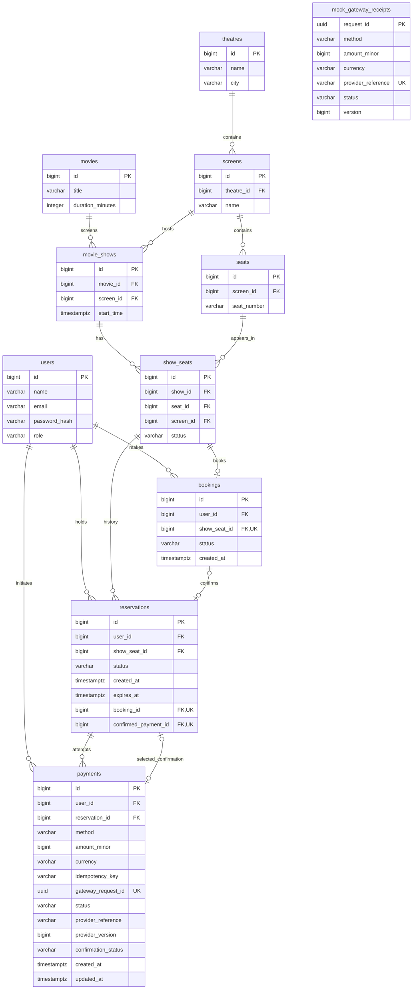
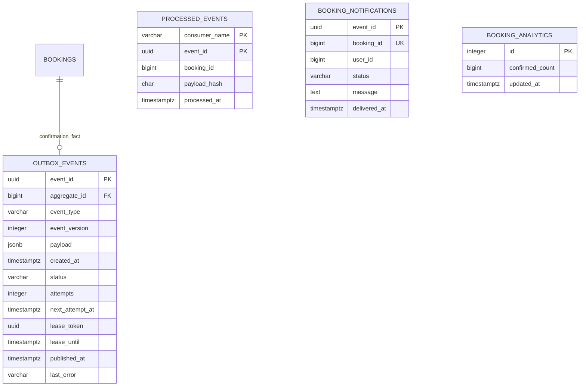

# Database design

PostgreSQL is the source of truth for catalogue inventory, reservations, payments, and bookings. Domain
tables are in schema `tbooker`; Flyway history is in `public.flyway_schema_history`.
The SQL migrations, linked below, are authoritative for schema changes.

## Relationships

The diagram shows cardinalities; composite keys and expression indexes are
specified below. Each physical seat belongs to one screen. Each show belongs to
one movie and one screen. A `ShowSeat` is inventory for one physical seat at one
show, so A1 can be booked for one show and remain available for another.

## Column dictionary

Every column in the base-table dictionary below is `NOT NULL` except
`users.password_hash`, which remains null for legacy accounts. The ten domain
tables use the same primary-key definition: `id BIGINT GENERATED BY DEFAULT AS IDENTITY PRIMARY KEY`, mapped to
Java `Long` with `GenerationType.IDENTITY`. Identity values may have gaps after
rollbacks or conflict handling and are not fixed sample-data identifiers.
The eleventh table, `mock_gateway_receipts`, instead uses a UUID primary key and
has no JPA entity. Nullable reservation/payment columns are documented in their
V5/V6 sections below. Other defaults exist only where explicitly listed.

| Table / JPA entity | Column | PostgreSQL type | Meaning / restriction |
| --- | --- | --- | --- |
| `users` / `User` | `name` | `VARCHAR(120)` | Name; `btrim(name) <> ''`. |
| | `email` | `VARCHAR(254)` | `btrim(email) <> ''`; unique on `lower(email)`. |
| | `password_hash` | `VARCHAR(60)` | Nullable for legacy users; otherwise BCrypt format. Never returned by an API. |
| | `role` | `VARCHAR(20)` | Default `USER`; constrained to `USER` or `ADMIN`. |
| `movies` / `Movie` | `title` | `VARCHAR(200)` | `btrim(title) <> ''`; titles need not be unique. |
| | `duration_minutes` | `INTEGER` | Must be greater than zero. |
| `theatres` / `Theatre` | `name` | `VARCHAR(200)` | `btrim(name) <> ''`; not globally unique. |
| | `city` | `VARCHAR(120)` | `btrim(city) <> ''`; stored as a string. |
| `screens` / `Screen` | `theatre_id` | `BIGINT` | FK to `theatres.id`. |
| | `name` | `VARCHAR(100)` | `btrim(name) <> ''`; unique within a theatre. |
| `seats` / `Seat` | `screen_id` | `BIGINT` | FK to `screens.id`. |
| | `seat_number` | `VARCHAR(20)` | `btrim(seat_number) <> ''`; unique within a screen. |
| `movie_shows` / `MovieShow` | `movie_id` | `BIGINT` | FK to `movies.id`. |
| | `screen_id` | `BIGINT` | FK to `screens.id`. |
| | `start_time` | `TIMESTAMP WITH TIME ZONE` | Absolute show start instant. |
| `show_seats` / `ShowSeat` | `show_id` | `BIGINT` | Show component of the composite FK described below. |
| | `seat_id` | `BIGINT` | Physical-seat component of the composite FK. |
| | `screen_id` | `BIGINT` | Shared screen value in both composite FKs. |
| | `status` | `VARCHAR(20)` | Default `AVAILABLE`; check permits `AVAILABLE`, `HELD`, or `BOOKED`. |
| `bookings` / `Booking` | `user_id` | `BIGINT` | FK to `users.id`. |
| | `show_seat_id` | `BIGINT` | FK to `show_seats.id`; unique across bookings. |
| | `status` | `VARCHAR(20)` | Check permits only `CONFIRMED`; supplied by the application. |
| | `created_at` | `TIMESTAMP WITH TIME ZONE` | Creation instant supplied by the application; no database default. |

`users` avoids the SQL `USER` keyword. Email uniqueness ignores case but does not
trim or normalize stored data or validate email syntax. The text checks reject
values empty after PostgreSQL's default `btrim`; they are not comprehensive
validation of all Unicode whitespace. Registration validates email syntax and
normalizes its case in the service. Payment data is in separate tables; there are no plaintext passwords. V4 adds `ck_users_role` and `ck_users_password_hash`; the latter checks
the BCrypt storage format, while password verification belongs to the encoder.

## Keys, constraints, and indexes

Primary keys and unique constraints create PostgreSQL indexes automatically.
Foreign keys alone do not. The following are the explicit non-primary indexes
and unique constraints for catalogue/bookings (V5/V6 additions are documented below; V4 adds no indexes):

| Name | Definition | Purpose |
| --- | --- | --- |
| `uq_users_email` | Unique expression index on `users(lower(email))` | Reject case-only email duplicates. |
| `uq_screens_theatre_name` | Unique `(theatre_id, name)` | Scope screen names to a theatre; supports theatre lookups. |
| `uq_seats_screen_number` | Unique `(screen_id, seat_number)` | Scope seat numbers to a screen. |
| `uq_seats_id_screen` | Unique `(id, screen_id)` | Referenced key for same-screen inventory enforcement. |
| `uq_movie_shows_screen_start` | Unique `(screen_id, start_time)` | Reject identical starts on a screen. |
| `uq_movie_shows_id_screen` | Unique `(id, screen_id)` | Referenced key for same-screen inventory enforcement. |
| `ix_movie_shows_movie` | Index `(movie_id)` | Support movie references/lookups. |
| `ix_movie_shows_start_id` | Index `(start_time, id)` | Match show-list ordering. |
| `uq_show_seats_show_seat` | Unique `(show_id, seat_id)` | One inventory row per show and physical seat; supports show filtering. |
| `ix_show_seats_seat_screen` | Index `(seat_id, screen_id)` | Support physical-seat composite references/lookups. |
| `uq_bookings_show_seat` | Unique `(show_seat_id)` | At most one booking per inventory row. |
| `ix_bookings_user` | Index `(user_id)` | Support user references/lookups. |
| `uq_bookings_id_owner_seat` | Unique `(id, user_id, show_seat_id)` | Supports the reservation-to-booking composite FK. |
| `uq_reservations_held_seat` | Unique `(show_seat_id)` WHERE `status = 'HELD'` | At most one stored hold, including an expired hold awaiting transition. |
| `ix_reservations_expiry` | Index `(expires_at, show_seat_id)` WHERE `status = 'HELD'` | Orders expired-hold cleanup candidates. |
| `ix_reservations_user` | Index `(user_id)` | Supports owner references. |
| `ix_reservations_seat` | Index `(show_seat_id)` | Supports history and seat references. |
| `reservations.booking_id` | Unique nullable booking ID | A confirmed booking links to at most one historical reservation. |

The conditional booking update identifies a row by its primary key; there is no
separate status index. Seat-list ordering includes a join to physical seat
numbers, so the show inventory index does not imply a sort-free query. Index
choices have not been backed by production traffic measurements.

### Same-screen invariant

`show_seats.screen_id` is deliberate redundancy beyond the public API model.
Two composite foreign keys must agree on it:

- `fk_show_seats_show_screen`: `(show_id, screen_id)` references
  `movie_shows(id, screen_id)`.
- `fk_show_seats_seat_screen`: `(seat_id, screen_id)` references
  `seats(id, screen_id)`.

Consequently, a show cannot reference a seat from another screen even through
direct SQL. The parent composite unique constraints make these references legal.
JPA maps the show and seat as lazy associations and the supporting screen ID as
a scalar column. Its constructor also checks screen equality. The API does not
expose this extra inventory column.

### Booking integrity and lifecycle limits

`fk_bookings_user` and `fk_bookings_show_seat` require existing resources.
`uq_bookings_show_seat` is unconditional: even a future status would not permit a
second booking for the same inventory row. Current status checks are named
`ck_show_seats_status` and `ck_bookings_status`.

All foreign keys use default `NO ACTION` behavior with no delete cascades. There
are also no JPA remove cascades. Referenced catalogue data cannot be silently
deleted with its bookings.

The service transaction maintains `BOOKED` plus one confirmed booking together.
The schema does not contain a trigger requiring those two facts to agree. Direct
SQL could leave a booked seat without a booking or an available seat with one;
uniqueness prevents duplicate bookings but does not repair that inconsistency.
See [BOOKING.md](BOOKING.md) for the atomic update and rollback mechanics.

Scheduling rejects equal `(screen_id, start_time)` values, not overlapping show
intervals. No database constraint rejects a show in the past. Confirmed-booking
cancellation and rebooking still need a later schema and lifecycle decision;
reservation cancellation and expiration are implemented separately in V5.

## UTC and precision

`MovieShow.startTime`, `Booking.createdAt`, and reservation/payment timestamps use Java `Instant` and PostgreSQL
`timestamptz` (`TIMESTAMP WITH TIME ZONE`). PostgreSQL represents an instant rather
than retaining the original time-zone name; display depends on the session zone.
Hibernate JDBC time zone is UTC, and Hikari initializes application connections
with `SET TIME ZONE 'UTC'`. API instants serialize with a `Z` UTC suffix.

Historical immediate-booking timestamps were assigned by the application clock.
Current holds, payment preparation, and reservation confirmations use PostgreSQL
`clock_timestamp()` sampled after acquiring the seat lock. The five-minute TTL
is `expires_at = created_at + 300 seconds`. Deadline checks use `expires_at > now`;
equality is expired. Neither clock value is a global transaction-ordering sequence.

## Flyway lifecycle

| Migration | Responsibility |
| --- | --- |
| [V1__create_application_schema.sql](../src/main/resources/db/migration/V1__create_application_schema.sql) | Create schema `tbooker`. |
| [V2__create_show_catalogue.sql](../src/main/resources/db/migration/V2__create_show_catalogue.sql) | Create the seven catalogue tables, checks, relationships, and indexes. |
| [V3__create_bookings.sql](../src/main/resources/db/migration/V3__create_bookings.sql) | Add bookings and their integrity constraints. |
| [V4__add_user_credentials_and_roles.sql](../src/main/resources/db/migration/V4__add_user_credentials_and_roles.sql) | Add BCrypt hashes and USER/ADMIN roles without changing existing IDs or bookings. |
| [V5__add_seat_reservations.sql](../src/main/resources/db/migration/V5__add_seat_reservations.sql) | Add HELD inventory, reservation history, partial uniqueness, and booking-link integrity; retain existing confirmed bookings. |
| [V6__add_mock_payments.sql](../src/main/resources/db/migration/V6__add_mock_payments.sql) | Persist attempts, owner-scoped idempotency, provider proof, separate confirmation state, and mock receipts; preserve unpaid historical bookings. |
| [V7__add_booking_events.sql](../src/main/resources/db/migration/V7__add_booking_events.sql) | Add transactional outbox, durable consumer deduplication, mock notifications, and the booking-count baseline; requires quiescing old booking writers during upgrade. |
| [R__sample_catalogue.sql](../src/main/resources/db/dev/R__sample_catalogue.sql) | Opt-in development sample data. |

Flyway applies pending migrations at startup and validates applied checksums.
Hibernate uses `ddl-auto: validate`; Flyway clean is disabled. Add a new versioned
migration for schema changes and never edit an applied shared migration. V1
expects a database without an existing `tbooker` schema; automatic baselining is
not configured.

Repeated `Flyway.migrate()` calls on an unchanged database apply no migrations
and preserve history and rows. This does not mean the versioned SQL files can be
manually replayed: their DDL is deliberately managed by Flyway history. The
integration suite checks repeated migration calls after a successful booking.

## Development data

V4 leaves existing users with `password_hash = NULL` and `role = 'USER'`. They
retain their bookings but cannot log in. There is no default password or public
credential-enrollment endpoint for those accounts. The development seed also
creates credential-less sample users; register a new user for authenticated API
examples. Operator-controlled ADMIN promotion and identity limitations are in
[SECURITY.md](SECURITY.md#migration-and-admin-provisioning).

Only the `dev` profile adds `classpath:db/dev` to migration locations. A fresh
development database receives:

| Resource | Sample |
| --- | --- |
| Movie | `The Sample Adventure`, 120 minutes |
| Theatre | `Sample Cinema`, `Bengaluru` |
| Screen | `Screen 1` |
| Physical seats | A1 through A8 |
| Show | `2030-01-01T18:00:00Z` on the sample screen |
| Show seats | Eight initially `AVAILABLE` inventory rows |
| Users | Alex Sample (`alex@example.test`), Priya Sample (`priya@example.test`) |

The seed uses natural lookups and `ON CONFLICT DO NOTHING` to reuse sample rows;
it does not reset availability or overwrite existing bookings. Flyway serializes
migration execution and reruns a repeatable migration when its checksum changes.
Replaying this seed SQL is also tested for duplicate-free, status-preserving
behavior; it is not a catalogue repair or synchronization job.

Normal startup seeds nothing. Use a dedicated development database: removing the
`dev` location from a database that already records its repeatable migration can
fail migration validation. IDs are generated, so inspect API/SQL results instead
of relying on the illustrative IDs in examples. See [local setup](../README.md#local-setup).

## Reservation storage and integrity (V5)

| Column | SQL type | Invariant |
| --- | --- | --- |
| `id` | identity `BIGINT` | Stable reservation identity, never reused for a replacement hold. |
| `user_id` | `BIGINT NOT NULL` | FK to user; API always supplies the JWT subject. |
| `show_seat_id` | `BIGINT NOT NULL` | FK to one show's inventory, not the physical seat. |
| `status` | `VARCHAR(20) NOT NULL` | `HELD`, `CONFIRMED`, `CANCELLED`, or `EXPIRED`. |
| `created_at` | `timestamptz NOT NULL` | Database time at successful hold decision. |
| `expires_at` | `timestamptz NOT NULL` | Later than creation; service assigns a fixed five-minute deadline. |
| `booking_id` | nullable unique `BIGINT` | Present if and only if state is `CONFIRMED`. |

`fk_reservations_booking_owner_seat` references
`bookings(id, user_id, show_seat_id)`: a linked booking must belong to the same
user and seat. `ck_reservations_status`, `ck_reservations_times`, and
`ck_reservations_booking` protect state/timestamp/link validity. No cascade delete
is introduced. JPA maps a nullable one-to-one booking and mandatory many-to-one
user/seat references; the composite FK is explicitly owned by Flyway.

A seat can have many expired/cancelled reservation rows, but only one stored
`HELD` row and at most one permanent booking. No partial index uses `now()`:
time passes without automatically changing index membership. An expired stored
hold is first marked `EXPIRED` under the inventory lock, then the replacement
is inserted in that transaction. The existing `uq_bookings_show_seat` stays
unconditional because no confirmed-booking cancellation exists.

Service transactions maintain correspondence between inventory, active holds,
and bookings. Constraints do not make arbitrary direct SQL obey the complete
cross-table state machine. Expiry-aware reads may return `AVAILABLE` / `EXPIRED`
before cleanup persists those states. See [HLD](HLD.md#reservation-lifecycle-and-expiration)
for transitions and [LLD](LLD.md#reservation-confirmation-sequence) for locking.
V4-to-V5 migration tests compare existing users, bookings, and inventory before
and after upgrade; repeat application through Flyway is a no-op.

## Payment storage and integrity (V6)

`Payment` maps `tbooker.payments` with lazy required user/reservation associations.
Its request identity/price columns are immutable through JPA. Updates use
conditional SQL inside short service transactions; there is no entity save path
that trusts a client status. `Reservation.confirmedPaymentId` is a nullable scalar
mapped to a composite database FK, avoiding a bidirectional entity graph.

| Column | Type / nullability | Rule |
| --- | --- | --- |
| `id` | identity BIGINT PK | Java Long. |
| `user_id`, `reservation_id` | BIGINT NOT NULL | Required owner and reservation. |
| `method` | VARCHAR(20) NOT NULL | UPI or CARD. |
| `amount_minor` | BIGINT NOT NULL | Positive server-assigned snapshot. |
| `currency` | VARCHAR(3) NOT NULL | Fixed INR. |
| `idempotency_key` | VARCHAR(100) NOT NULL | Regex `[A-Za-z0-9._:-]{1,100}`; owner-scoped unique. |
| `gateway_request_id` | UUID NOT NULL | Unique durable provider operation identity. |
| `status` | VARCHAR(20) NOT NULL | PENDING default; SUCCESS or FAILED after verification. |
| `provider_reference` | VARCHAR(100), nullable | Verified provider reference; unique per method when non-null. |
| `provider_version` | BIGINT NOT NULL | Default 0; nonnegative monotonic verified version in service logic. |
| `confirmation_status` | VARCHAR(30) NOT NULL | NOT_READY default, PENDING, CONFIRMED, RECONCILIATION_REQUIRED. |
| `created_at`, `updated_at` | TIMESTAMPTZ NOT NULL | Database time, represented by Java Instant. |

| Constraint/index | Purpose |
| --- | --- |
| `uq_payments_owner_key(user_id,idempotency_key)` | One stored attempt for a user's key; INSERT ON CONFLICT handles simultaneous retries. |
| Unique `gateway_request_id` | Prevent separate local attempts sharing a provider operation. |
| `uq_payments_provider_reference(method,provider_reference)` | Prevent one provider receipt being attached to multiple attempts for that method. |
| `uq_payments_pending_reservation` WHERE status='PENDING' | At most one in-flight attempt per reservation. |
| `fk_payments_reservation_owner(reservation_id,user_id)` | Require payment owner to match reservation owner; backed by `uq_reservations_id_owner`. |
| `uq_payments_id_reservation_owner` | Supporting key for reservation confirmation link. |
| Unique `reservations.confirmed_payment_id` and `fk_reservations_confirmed_payment(confirmed_payment_id,id,user_id)` | Link a selected payment to exactly its own reservation/owner; cannot reuse it for another reservation. |
| `ck_reservations_confirmed_payment` | A non-null payment link requires CONFIRMED reservation state. |
| `ck_payments_confirmation` | SUCCESS must have PENDING, CONFIRMED or RECONCILIATION_REQUIRED; non-success must have NOT_READY. |
| `ck_payments_verified` | Only an unverified PENDING may have null reference/version 0; verified results require a reference and positive version. |
| `ix_payments_reservation(reservation_id,id)` | Attempt lookup and successful proof selection. |
| `ix_payments_owner_history(user_id,created_at DESC,id DESC)` | Owner-scoped history ordering. |
| `ix_payments_reconciliation(confirmation_status,id)` WHERE status='SUCCESS' | Locate success awaiting confirmation/reconciliation. |

V6 does not require payment links for historical confirmed reservations and does
not insert fake payments. The supported service path requires verified SUCCESS
for every new booking. Database checks cannot independently authenticate a
provider or force every cross-table business fact: privileged direct SQL can
still falsify financial state or bypass the supported service workflow.

There is intentionally **no unique SUCCESS per reservation**. Under the inventory
lock, new attempts are rejected while PENDING/SUCCESS exists, but a provider may
later correct a previously FAILED attempt. If another attempt already confirmed
the booking, both financial successes must be recorded and the extra one flagged
for reconciliation. The unconditional booking uniqueness still allows only one
permanent booking. Constraints preserve financial facts rather than hiding a
possible extra charge.

`mock_gateway_receipts` is a simulated provider ledger: UUID `request_id` PK,
method/amount/currency, unique non-null reference, PENDING/SUCCESS/FAILED status,
and positive version. All columns are NOT NULL. It intentionally has no FK to
payments, so provider receipt durability is independent of the booking transaction.
Both live in the same PostgreSQL instance, not independent failure domains.
`MockGatewayStore` inserts with ON CONFLICT(request_id) DO NOTHING and verifies
that the stored command parameters match before returning the receipt.

Cleanup never deletes payments, receipts, bookings, or reservation history.
Retention, archival, refunds, and separate migration/runtime database privileges
remain future operations work. Tests verify fresh V1–V6 migration, V5-to-V6
preservation, constraint violations, and repeat migration with paid bookings.

## Phase 9 cache boundary

No SQL migration or domain schema change is needed for Redis metadata caching.
V1–V6 and the development repeatable migration remain unchanged. Movie/theatre
list repositories order by primary key; the show entity graph still fetches its
movie, screen, and theatre in one query. Seat availability keeps its PostgreSQL
expiry-aware native projection. No query index was added without evidence.

Redis is disposable derived data, not another relational authority. It stores
six public DTO caches with versioned keys and finite TTLs (see [HLD](HLD.md#redis-catalogue-cache)).
JPA Movie/Theatre/Screen/MovieShow lifecycle events invalidate affected entries
after commit. Flyway, native SQL, and bulk JPQL bypass those callbacks; use the
explicit change event within application writer transactions when needed, or
accept expiry-based refresh. Never infer seat ownership or availability from a
cached show. All inventory, reservation, payment, and booking constraints and
transaction boundaries are unchanged.

## V7 messaging schema

V7 adds four JDBC-managed tables; Hibernate's existing JPA mappings are unchanged.

`outbox_events.aggregate_id` references the permanent booking. Unique
`(aggregate_id,event_type)` permits one logical confirmation regardless of UUID
or schema version. V1/type checks and payload identity checks bind the JSON to its
row; explicit `IS TRUE` also rejects JSON null identities. State checks require
lease token/deadline only for IN_FLIGHT, and publication time only for PUBLISHED.
Partial indexes support due PENDING rows and expired IN_FLIGHT leases. No cascade
removes pending events when a source booking is referenced for deletion.

`processed_events` uses `(consumer_name,event_id)` as its primary key and
`(consumer_name,booking_id)` uniqueness to reject a second identity for one booking.
A SHA-256 hash detects changed contents under the same ID. Logical consumer names
are fixed in `BookingEventProcessor`, independent of configurable Kafka group IDs.
The insert handles conflicts on either unique key, then reads the event marker
and verifies its hash; it never silently accepts a different event ID for an
already-processed booking. READ_COMMITTED makes the committed winning marker
visible after a concurrent insert finishes waiting.
Mock notifications store `MOCK_DELIVERED` only; that status denotes a committed
mock row. Analytics has a checked singleton key and a non-negative count.

Consumer tables intentionally have no source-booking/outbox foreign keys: they
store consumed facts and must support retained Kafka/DLT replay without a source
lookup. Only the outbox links to the authoritative booking. Deduplication and the
consumer's state update are one PostgreSQL transaction. All timestamps are
`timestamptz`/UTC; eligibility and lease decisions use `clock_timestamp()`.

V7 seeds analytics from existing bookings once, without inventing historical
events or notifications. Quiesce writes while applying V7 and replacing older
binaries; old code cannot participate in outbox capture. Repeated migrations do
not reset counts or markers. Current migration version is 7; historical V3–V6
upgrade tests remain targeted at their original versions. No retention cleanup
is implemented; see [MESSAGING.md](MESSAGING.md) for operational consequences.

## Phase 11 shared writer

No new migration or table is introduced. Both app containers use the same schema,
Flyway history, inventory rows, leases, and deduplication constraints. Default
Hikari capacity is 20 per JVM (40 combined); the local PostgreSQL limit is 160.
The 100-contender correctness runner uses 60 per JVM to force actual simultaneous
row-lock waiters. Benchmarks retain the default 20. Extra pools increase database
pressure; they do not increase ownership capacity for a hot seat.
