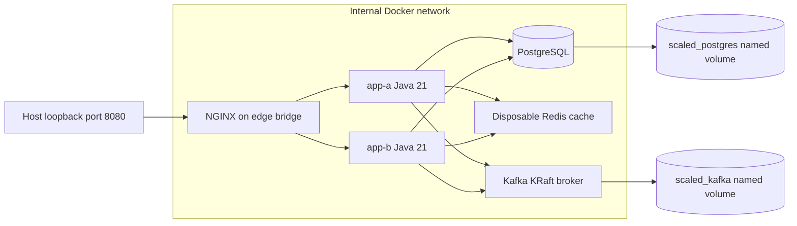

# Reproducible local deployment — Phase 12B

This is a Docker Compose deployment of the existing modular monolith, intended
for development and review. It is not a production HA or public Internet setup.
No Java installation is needed to **run** the stack. Tests outside the image need
a Java 21 JDK; the Docker image build deliberately packages without running tests.
Run `./mvnw clean verify` separately or review the CI result for the exact commit.

## Prerequisites and first startup

Use Docker Engine/Desktop with Linux containers, Compose v2.24 or later (the
verification runners use v2.40's `compose volumes`), and BuildKit. Docker needs
access to Docker Hub and Maven Central for a cold build. Budget 6–8 GiB for Docker
plus host/build overhead and several CPU cores. Runtime container memory limits
sum to 3.25 GiB; this is a development budget, not a measured production minimum.
Python 3 is required only for the separate recovery runners.

From a fresh clone, at the repository root:

```bash
cp .env.example .env
# Edit .env: choose DB_PASSWORD and set JWT_SECRET.
# Generate a Base64 JWT key locally with: openssl rand -base64 32
# For sample shows/seats only, uncomment SPRING_PROFILES_ACTIVE=dev.
docker compose -f compose.scaled.yaml config --quiet
docker compose -f compose.scaled.yaml up -d --build --wait --wait-timeout 240
docker compose -f compose.scaled.yaml ps
curl --fail http://localhost:8080/actuator/health/readiness
curl --fail http://localhost:8080/api/shows
```

Copy the example only when `.env` does not already exist. Keep it private (for
example, `chmod 600 .env` on Unix); `.gitignore` excludes it. Do not paste resolved
`docker compose config`, `docker inspect` environment output, or shell traces
into issue reports: these can reveal secrets. Use `config --quiet` to validate.
Compose reads `.env` automatically; Spring Boot on the host does not.

The default URL is `http://localhost:8080`; change `LB_PORT` if occupied.
Without `dev`, Flyway initializes the schema but the catalogue is empty. There
are no catalogue mutation handlers yet. Development seed accounts have no login
password: register a new user through `/api/auth/register`, then log in. See
[API.md](API.md) for reservation, mock payment, and booking requests. No real
payment credentials are needed. A hold alone is not a confirmed booking.

## Architecture and persistent state



Only NGINX publishes a host port. Both replicas, PostgreSQL, Redis, and Kafka use
an internal Docker network with no external route; NGINX additionally joins the
edge bridge. Docker administrators remain trusted. The applications run as UID
10001 with a read-only filesystem, writable `/tmp`, dropped capabilities, and
`no-new-privileges`. Mock providers need no outbound Internet access.

PostgreSQL stores accounts, holds, bookings, payment receipts, outbox leases,
deduplication markers, and projections. Kafka retains its logs and offsets on a
named volume. Redis is deliberately ephemeral: losing its metadata cache is a
cache miss, not lost inventory or payment state. Redis needs no persistent volume.
Volumes are namespaced by the Compose project. Keep the same directory/project
name on restart; changing it creates another stack with different volumes.

`Dockerfile` builds the checked-in source using its Maven wrapper in a Java 21
builder, then copies only the executable JAR into a smaller Java 21 runtime.
`.dockerignore` permits only build inputs; `.env`, Git, tests, local artifacts,
and logs do not enter the build context. The builder's Maven download cache is
separate from the final image. No host `target/` artifact is needed.

Base and service images have tag-plus-digest pins; Maven and Spring dependency
versions are managed by the wrapper/POM. Update pins intentionally and repeat
regression/deployment checks for security updates. Reproducible inputs/build steps
do not claim byte-identical JARs or images: build timestamps are not normalized.

## Environment contract

`DB_PASSWORD` and `JWT_SECRET` are mandatory and intentionally blank in
`.env.example`. Compose rejects missing/blank values with `Set DB_PASSWORD` or
`Set JWT_SECRET`. Startup also rejects malformed JWT Base64/keys shorter than
32 bytes. Use the same signing key, issuer, and audience across both replicas.
Changing the signing key invalidates existing tokens; there is no rotation flow.

| Settings | Scaled deployment meaning |
| --- | --- |
| `DB_NAME`, `DB_USERNAME`, `DB_PASSWORD` | Database, bootstrap role, and password; defaults for names are `tbooker`, password has no default. |
| `DB_POOL_SIZE` | 20 connections per replica; total 40 versus PostgreSQL's configured 160. |
| `JWT_SECRET`, `JWT_ISSUER`, `JWT_AUDIENCE`, `JWT_TTL` | Required Base64 key; defaults `tbooker`, `tbooker-api`, `PT15M` (supported 1–60 minutes). |
| `SPRING_PROFILES_ACTIVE` | Empty normally; `dev` enables repeatable sample catalogue migration on a dedicated development database. |
| `LB_BIND_ADDRESS`, `LB_PORT` | `127.0.0.1`, `8080`; the sole host-facing endpoint. Changing the address can expose plaintext authenticated traffic; no TLS is configured. |
| `REDIS_CONNECT_TIMEOUT`, `REDIS_COMMAND_TIMEOUT` | `200ms` each; cache failures fall back to PostgreSQL. |
| `CATALOGUE_CACHE_ENABLED` | `true`; disable with `false`. Seat availability is never cached. |
| `CACHE_METADATA_TTL`, `CACHE_METADATA_LIST_TTL` | `PT10M`, `PT5M`. |
| `CACHE_SHOW_TTL`, `CACHE_SHOW_LIST_TTL` | `PT1M`, `PT30S`. |
| `PAYMENTS_MOCK_AMOUNT_MINOR` | `10000` minor currency units; mock only. |
| `PAYMENTS_MOCK_UPI_OUTCOME`, `PAYMENTS_MOCK_CARD_OUTCOME` | `SUCCESS`; can also be `FAILED` or `PENDING`, for new mock receipts only. |
| `MESSAGING_ENABLED`, `MESSAGING_SCHEDULING_ENABLED` | `true`; worker switches, not switches for durable booking event capture. |
| `BOOKING_EVENTS_TOPIC`, `BOOKING_EVENTS_DLT` | `tbooker.booking-confirmed.v1`, same name plus `.DLT`. |
| `BOOKING_NOTIFICATION_GROUP`, `BOOKING_ANALYTICS_GROUP` | `tbooker-notifications-v1`, `tbooker-analytics-v1`; distinct projection groups, shared across replicas. |
| `BOOKING_TOPIC_PARTITIONS`, `BOOKING_TOPIC_REPLICAS` | `3`, `1`; a single broker cannot support a larger replication factor. |
| `BOOKING_CONSUMER_RETRIES` | `3` before attempted DLT publication. |
| `OUTBOX_BATCH_SIZE`, `OUTBOX_LEASE` | `20`, `PT30S`. |
| `OUTBOX_RETRY_INITIAL`, `OUTBOX_RETRY_MAX` | `PT1S`, `PT1M`. |
| `OUTBOX_POLL_MS`, `RESERVATION_CLEANUP_MS` | `1000`, `30000`; scheduler delays in milliseconds. |
| `KAFKA_DELIVERY_TIMEOUT_MS`, `KAFKA_REQUEST_TIMEOUT_MS`, `KAFKA_MAX_BLOCK_MS` | `5000`, `2000`, `1000`; bounded producer waits. |

Connection addresses inside the scaled stack are deliberately fixed to Docker
service names: `postgres:5432`, `redis:6379`, `kafka:19092`; app HTTP port is 8080.
The example's `DB_HOST`/`DB_PORT`, `SERVER_PORT`, `REDIS_HOST`/`REDIS_PORT`,
`KAFKA_BOOTSTRAP_SERVERS`/`KAFKA_PORT` configure the **host Java workflow** only.
`REDIS_USERNAME`/`REDIS_PASSWORD` are for an external secured Redis in that host
workflow; the private Compose Redis has no auth. Do not export those values to
try to rewire the scaled stack. Its service addresses are explicitly supplied.
`INSTANCE_ID`, Hikari pool names, JVM heap limits, forwarding, UTC database/JDBC
settings, and shutdown settings are managed by Compose/application configuration.

No production secrets are built into the image. Environment values are visible
to Docker administrators; `.env` is not a secret manager. NGINX access logging
omits tokens, request bodies, and query strings. Do not enable HTTP wire debugging
or inject secrets into `JAVA_TOOL_OPTIONS`, which Java prints at startup.

## Database initialization and migration strategy

On an empty PostgreSQL volume, both instances run the same Flyway migration set
before Hibernate validates and readiness can pass. Flyway's PostgreSQL migration
lock serializes migration execution against their shared `public.flyway_schema_history`.
Versioned migrations apply in V1–V7 order, then (only with `dev`) the repeatable
sample migration runs. Both replicas must use the same image and profile. There
is no separate manual schema creation or migration command.

On restart Flyway validates checksums and skips applied versions. The repeatable
sample runs only when its checksum changes and uses conflict-aware inserts; it
does not reset booked seats. Switching away from `dev` does not delete sample
rows. Hibernate is `validate`, open-in-view is off, and Flyway clean is disabled.
Never edit an applied versioned migration, use `clean`, or delete volumes to fix
a checksum/password problem on a database that matters.

For a schema-changing release, stop both app writers, take and verify a backup,
build the same new image for both, and start both again. PostgreSQL/Flyway locking
is the startup guard, not a promise of safe mixed-version rolling upgrades. V7
specifically requires quiescing older booking writers so they cannot bypass
outbox capture. An unsuccessful migration blocks app readiness; inspect the
failure and restore or apply a reviewed forward fix. There are no down migrations,
automated repair, backup, or restore scripts. An old binary is safe to restore
only if it is compatible with the migrated schema. Named volumes are not backups.
The local bootstrap database role also runs Flyway and the application and has
elevated privileges; separate migration/runtime roles remain production work.

## Daily commands

Run from the repository root with the same `.env` and Compose project each time:

```bash
# Validate without printing secrets; build and start/update containers.
docker compose -f compose.scaled.yaml config --quiet
docker compose -f compose.scaled.yaml up -d --build --wait --wait-timeout 240
# Health and recent logs (inspect before sharing).
docker compose -f compose.scaled.yaml ps
docker compose -f compose.scaled.yaml logs --tail 100 app-a app-b nginx
curl --fail http://localhost:8080/nginx-health
curl --fail http://localhost:8080/actuator/health/readiness
curl --fail http://localhost:8080/actuator/health/messaging
# Restart a JVM without rebuilding; this does not reload changed .env values.
docker compose -f compose.scaled.yaml restart app-b
# Rebuild and recreate both JVMs after source/configuration changes.
docker compose -f compose.scaled.yaml up -d --build --wait app-a app-b
# Stop/remove containers and networks, retaining PostgreSQL/Kafka volumes.
docker compose -f compose.scaled.yaml down
# Start again using those volumes and the existing image.
docker compose -f compose.scaled.yaml up -d --wait --wait-timeout 240
```

Do not add `--volumes`/`-v` to shutdown commands on developer data. Deleting a
volume requires an explicit decision to lose its data. Stop the two app writers
before a planned database outage. All six services use `restart: unless-stopped`;
this restarts exited processes, not merely unhealthy containers, and respects
manual stops. Apps get 35 seconds to stop, with a 30-second graceful phase.

## Health, recovery, and troubleshooting

- `/nginx-health` proves the proxy process responds, not that a backend/database
  is ready. `/actuator/health/readiness` includes PostgreSQL; `/api/v1/health` is
  only an HTTP liveness response. Docker runs readiness probes for each app.
- Apps require PostgreSQL **healthy** at Compose startup. Redis/Kafka need only
  be **started**, preserving backend restart while either optional service is
  unhealthy. `up --wait` checks the whole requested stack and can still fail
  because an optional service is unhealthy. After startup, Compose does not
  continuously enforce dependencies or restart apps when PostgreSQL restarts.
  `up` also tries to start Docker-paused dependencies and fails until they are
  unpaused; for an existing JVM use `restart app-b`. To recreate just that backend
  during an optional-service outage, use `up -d --no-deps --no-build app-b`, then
  check its readiness. This does not make PostgreSQL optional.
- PostgreSQL outage interrupts database operations; Hikari reconnects after
  recovery. NGINX can return 504 before the pool times out. Committed rows survive
  a process/container restart on the same volume; disk/volume loss is different.
- Redis outage adds timeout latency then database fallback. Kafka outage leaves
  durable outbox work pending. After recovery publishers reclaim leases and
  consumers deduplicate replay. Neither service decides inventory ownership.
- NGINX retains passive failure detection and `proxy_next_upstream off`. It can
  return 502/503/504 while detecting/retrying a failed peer on later requests;
  it never automatically replays a payment or booking request. An ambiguous
  response needs an owner/key-based retry. See [SCALING.md](SCALING.md).
- `Set DB_PASSWORD`/`Set JWT_SECRET`: fill the private `.env`. PostgreSQL password
  errors after changing it: initialized volumes retain their original credentials;
  changing the environment does not alter PostgreSQL roles. Restore the matching
  configuration or perform a deliberate database password rotation.
- Empty `/api/shows`: normal without the opt-in `dev` profile. On a dedicated
  sample database, enable it and recreate both replicas with `up -d`.
- Port already allocated: change `LB_PORT` or stop the conflicting host process.
  Out-of-memory/slow startup: allocate more Docker resources and inspect `ps`
  and bounded logs. First build time is additional to the startup wait timeout.
- Build network/TLS errors: configure your network's trusted proxy/CA. Do not
  disable certificate checking. Optional BuildKit secrets `build_ca` (PEM CA)
  and `maven_settings` (Maven settings XML) support restricted build networks;
  use Docker's predefined proxy build arguments. For example, `docker build
  --build-arg https_proxy --build-arg http_proxy --secret id=build_ca,src=/path/ca.crt
  --secret id=maven_settings,src=/path/settings.xml -t tbooker:local .`, then
  `docker compose -f compose.scaled.yaml up -d --no-build --wait`.
  These inputs affect the builder only; neither settings nor its trust store is
  copied into the runtime image. Ensure proxy hostnames resolve inside the builder.

The original `compose.yaml` remains independent and publishes PostgreSQL, Redis,
and Kafka on loopback for `./mvnw spring-boot:run`. Follow the README's host setup;
do not combine the two Compose files. No TLS, Redis ACL, broker authentication,
multi-node Kafka/PostgreSQL failover, key rotation, or backup automation is added.

## Verification

```bash
./mvnw clean verify
python3 verification/deployment.py --output /tmp/tbooker-deployment.json
python3 verification/multi_instance.py --output /tmp/tbooker-multi-instance.json
```

The Python runners create UUID-named projects, private temporary credentials,
and fresh volumes. They never attach to existing developer deployments; cleanup
removes only their own resources. The deployment runner checks ordered migrations,
real login across both replicas, paid bookings, restart persistence, database
reconnection, and optional-service outages while restarting a backend. The
existing distributed suite checks contention, passive failover/no replay,
publisher crash recovery, and Kafka group membership. These tests are separate
from the Maven/CI suite. Use a new output path to preserve prior evidence.

See [TESTING.md](TESTING.md) for actual execution results and limits. A passing
local smoke test is not a GitHub-hosted deployment, a benchmark, or production HA
certification. No new benchmark or business feature is part of Phase 12B.
