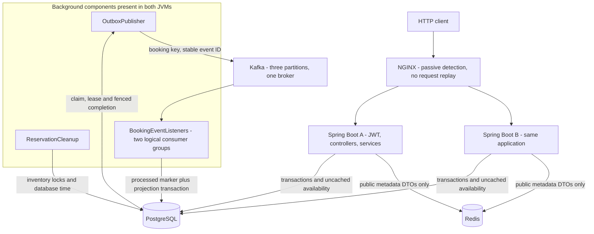
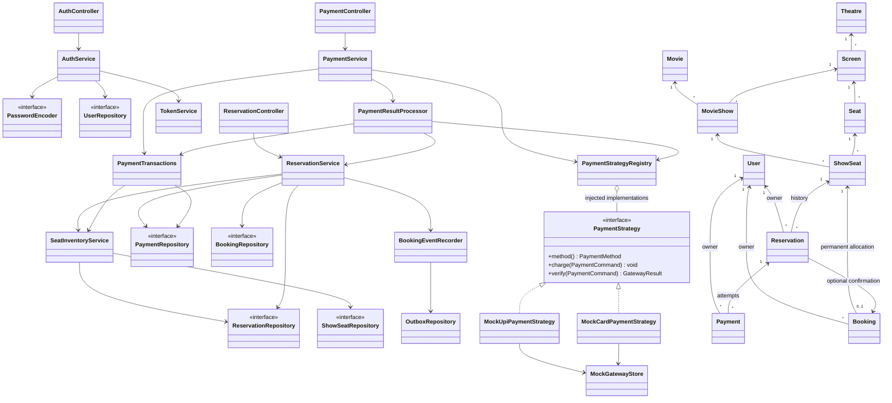
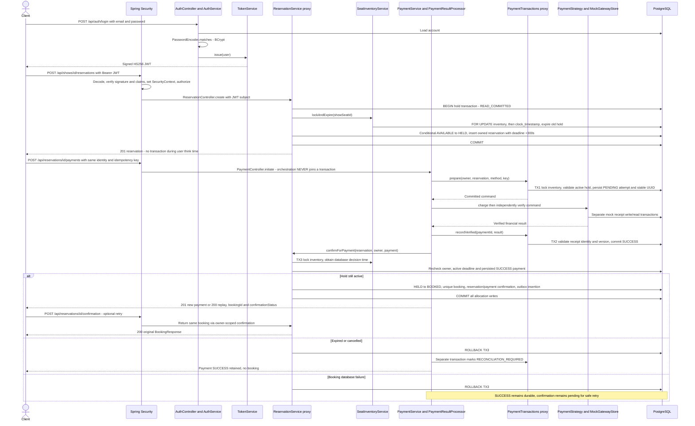
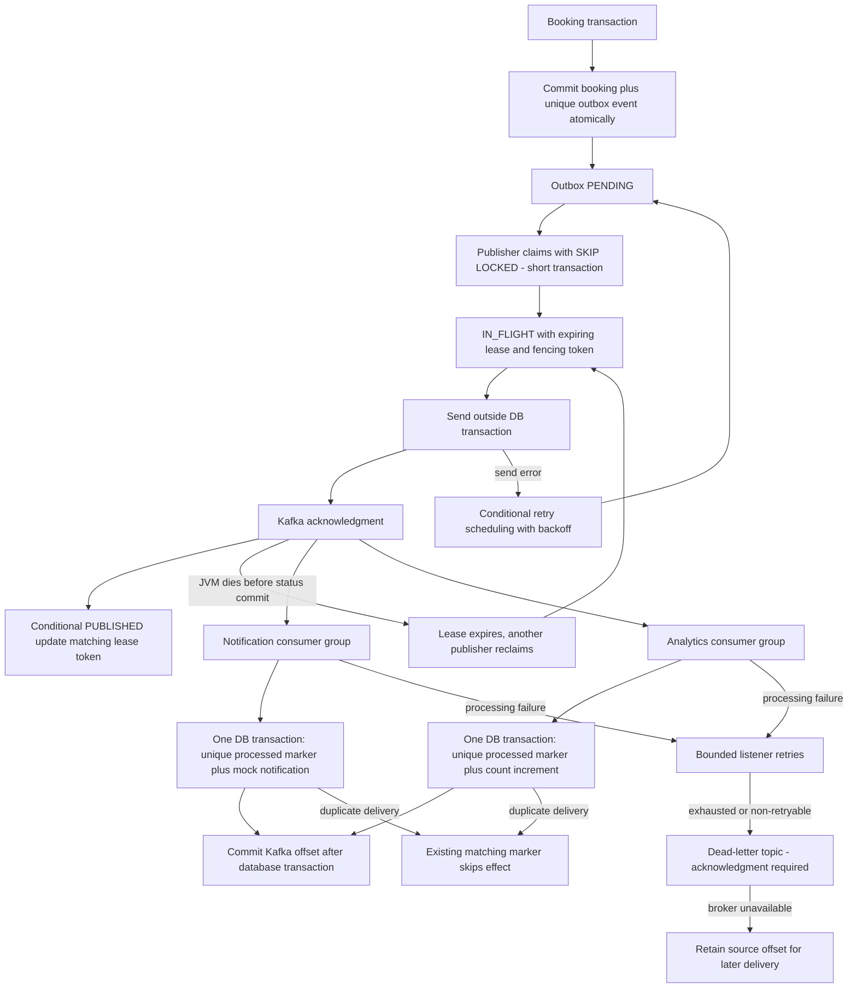
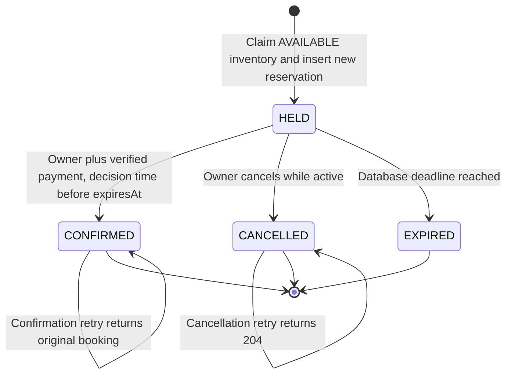

# Architecture walkthrough

These five diagrams summarize the implemented system at Phase 12E. Follow the
linked source and detailed [HLD](HLD.md), [LLD](LLD.md), [schema](DATABASE.md) and
[decisions](DECISIONS.md) for the full contracts. Services are concrete Spring
beans unless explicitly marked as interfaces. Arrows omit incidental dependencies.

## 1. High-level architecture

[Scaled Compose](../compose.scaled.yaml) deploys six containers. Workers run inside
the application containers, not in additional services. PostgreSQL and Kafka have
named volumes; Redis is disposable. The shared database owns all correctness
state. The private network exposes only NGINX on host loopback by default.
[NGINX configuration](../deploy/nginx/nginx.conf) disables automatic replay;
failed requests can reach the client before passive detection excludes a backend.

## 2. Low-level class design

Repository interfaces shown here extend Spring Data `JpaRepository`; Spring creates
their implementations. `OutboxRepository` and `MockGatewayStore` are concrete JDBC
collaborators. The complete [LLD](LLD.md) includes catalogue/cache/event classes
and schema relationships. No generic `ReservationService` interface exists.

Patterns actually used:

- **Strategy and registry:** [PaymentStrategy](../src/main/java/com/example/Tbooker/payment/PaymentStrategy.java)
  is implemented by UPI/Card Spring beans. The registry validates its injected
  list and selects by method; it is not a separate Abstract Factory hierarchy.
- **Repository, DTO and service layer:** HTTP mapping, use-case policy and
  persistence are separated; entities never become API response bodies.
- **Dependency injection and proxy interception:** constructor dependencies enable
  substitution; Spring proxies apply transactions and caching at bean boundaries.
- **Cache-aside, transactional outbox and idempotent consumer:** distributed
  reliability patterns, detailed in diagrams below and [MESSAGING](MESSAGING.md).

SRP separates payment orchestration from transaction stages and gateway behavior.
DIP/OCP are concrete at the `PaymentStrategy`, `PasswordEncoder` and repository
interfaces; adding a provider also requires deliberate enum/config/schema work.
State enums describe transitions; the project does not implement the GoF State
pattern or a general Saga framework.

## 3. Authentication, hold, payment and booking sequence

The [controllers](../src/main/java/com/example/Tbooker/controller) map requests
through Spring MVC after the filter chain. Login does not use an
`AuthenticationManager` or `UserDetailsService`; protected routes use the built-in
`BearerTokenAuthenticationFilter`, `JwtAuthenticationProvider` and `NimbusJwtDecoder`.
[AuthService](../src/main/java/com/example/Tbooker/service/AuthService.java),
[ReservationService](../src/main/java/com/example/Tbooker/service/ReservationService.java)
and [PaymentResultProcessor](../src/main/java/com/example/Tbooker/service/PaymentResultProcessor.java)
are the relevant policy boundaries. Gateway code is a durable local simulation,
not a remote provider. There is no transaction spanning gateway work or five-minute holds.

## 4. Transactional outbox and recovery

[OutboxPublisher](../src/main/java/com/example/Tbooker/messaging/OutboxPublisher.java)
can publish an event more than once after uncertain acknowledgment. Fencing
protects state updates from stale workers; it cannot undo a Kafka send. Producer
idempotence does not make a database plus broker transaction exactly once.
[BookingEventProcessor](../src/main/java/com/example/Tbooker/service/BookingEventProcessor.java)
commits a deduplication marker and its projection together; a crash before offset
commit can then safely redeliver. Notification and analytics use separate groups
and separate logical marker identities. DLT messages require operator review;
there is no automatic DLT replay or real notification delivery.

## 5. Reservation state machine

These are **reservation** states. The associated `ShowSeat` has `AVAILABLE → HELD →
BOOKED`; active cancellation or expiry releases `HELD → AVAILABLE`. A new hold
creates a new reservation ID; terminal history is not reactivated. Nothing here
cancels a confirmed booking or releases a booked seat.

All writers lock the same inventory row first. The decision clock is read **after
waiting for that lock**, so confirmation and expiration cannot both win. If
confirmation passes its deadline check under lock, its commit may occur after the
wall-clock deadline and still be valid. Reads report logical expiration even
before the scheduler persists it. A rejected write can roll back its attempted
cleanup; the next successful hold or cleanup batch normalizes storage. See
[SeatInventoryService](../src/main/java/com/example/Tbooker/service/SeatInventoryService.java)
and [ReservationCleanup](../src/main/java/com/example/Tbooker/config/ReservationCleanup.java).
