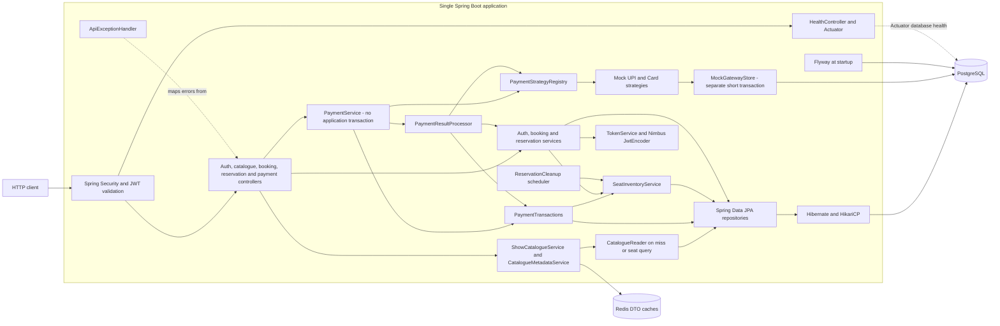
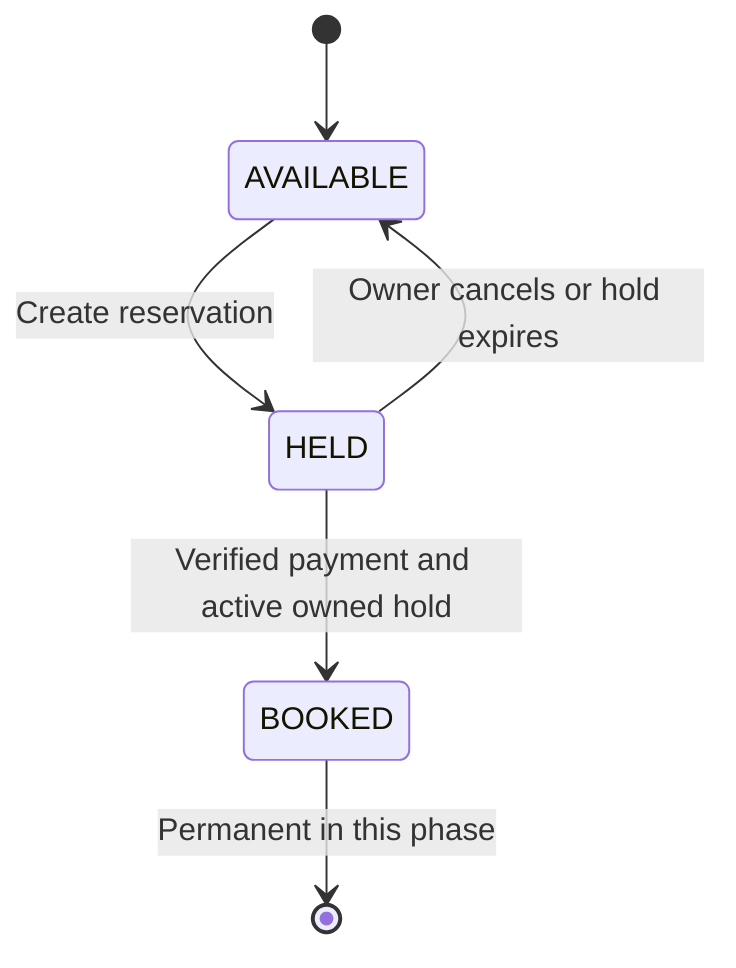
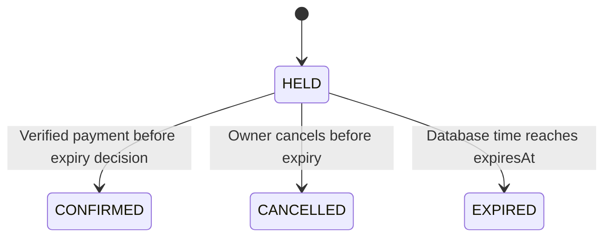
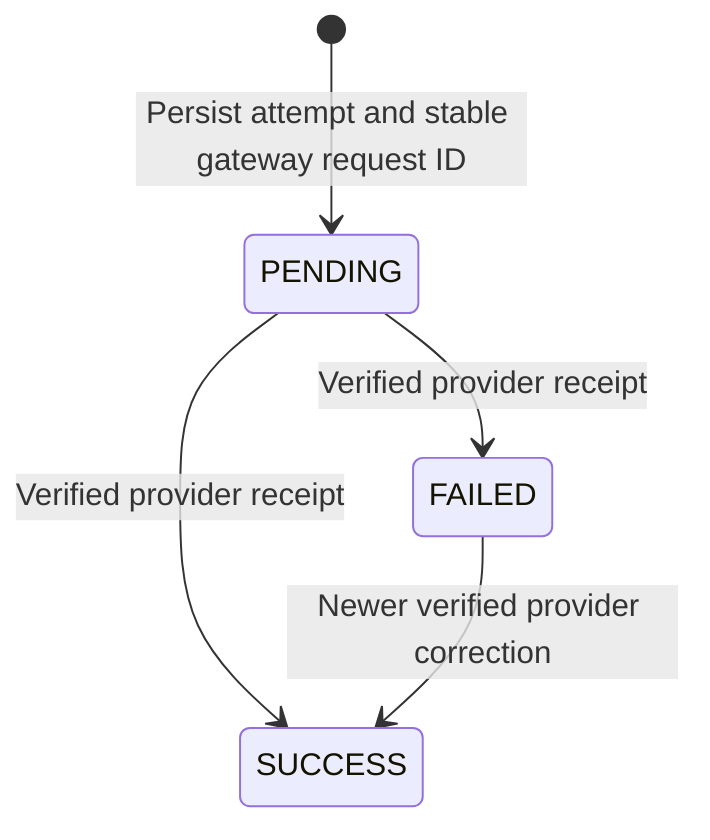

# High-level design

This document describes the implemented backend through Phase 9. Proposed
extensions are explicitly marked as future work. See [LLD](LLD.md) for classes,
[database design](DATABASE.md) for constraints, and [API](API.md) for contracts.

## Requirements and scope

The application lets a client list shows, inspect a show and its seat inventory,
hold it for five minutes, and confirm it through a verified mock payment. Users register,
log in, and read only their own bookings. A physical seat can be
booked independently for different shows. Missing resources, invalid requests,
and already-booked seats have distinct HTTP responses.

The central correctness requirement is that two requests cannot both commit a
booking for the same show-seat row. Seat availability and its booking must commit
or roll back together. Other requirements are repeatable schema migrations,
UTC timestamps, DTO-based HTTP contracts, and PostgreSQL integration tests.

Authentication uses BCrypt and JWT with USER/ADMIN roles. Mock UPI/Card payments
are implemented. There is no real payment provider,
confirmed-booking cancellation, catalogue administration, search, filtering, or
pagination. ADMIN authorization is configured for future catalogue mutations,
but no mutation handlers exist. Public deployment also needs the security and
operational controls described in [SECURITY.md](SECURITY.md).
Local catalogue throughput/latency measurements and their workload limits are
recorded in [PERFORMANCE.md](PERFORMANCE.md). No production availability SLA or
capacity target has been established.

## Current architecture

Tbooker is one Spring Boot application, one Maven module, and one PostgreSQL
database plus an optional Redis metadata cache. It follows a modular monolith direction, with catalogue and booking
responsibilities separated into services. The current code is organized by
technical layer; domain module boundaries are not enforced by separate modules
or an architecture framework.

For local development, Docker Compose runs PostgreSQL and Redis; the Java
application runs on the host. There is no application Dockerfile, deployed load
balancer, message broker, or separate worker in the repository.

## Main components

| Component | Implemented responsibility |
| --- | --- |
| Spring MVC controllers | Bind paths and JSON, validate inputs, return DTOs and HTTP statuses. |
| Spring Security | Validate bearer tokens, create the principal, and apply public/USER/ADMIN route rules. |
| `AuthService` / `TokenService` | Register BCrypt credentials, verify login, and issue short-lived signed JWTs. |
| `ShowCatalogueService` / `CatalogueMetadataService` | Cache public metadata DTOs through Spring Cache; delegate misses and uncached inventory. |
| `CatalogueReader` | Read/map database entities in short read-only transactions. |
| `CatalogueChangeListener` / `CatalogueCacheInvalidator` | Publish JPA lifecycle events and evict affected metadata after commit. |
| `CatalogueCacheErrors` | Observe cache failures and allow database fallback. |
| `BookingService` | Read own bookings; reject the retired immediate-booking write path with `409`. |
| Spring Data repositories | Fetch catalogue data, execute the conditional SQL update, and persist bookings. |
| `ReservationService` | Create, view, confirm, and cancel owner-scoped reservations. |
| `SeatInventoryService` / `ReservationCleanup` | Coordinate seat locks and database-time expiration; run bounded cleanup batches. |
| `PaymentService` / `PaymentTransactions` | Orchestrate attempts outside transactions; persist owner-scoped idempotency, outcomes, and read DTOs in short transactions. |
| `PaymentResultProcessor` | Verify canonical provider receipts, persist outcomes, and attempt payment-gated confirmation or flag reconciliation. |
| `PaymentStrategyRegistry` / mock strategies | Select injected UPI/Card behavior; use durable mock receipts with stable operation IDs. |
| PostgreSQL | Store ten domain tables plus the mock provider ledger; enforce identities, relationships, checks, and uniqueness. |
| Flyway | Apply versioned schema changes and, only under `dev`, repeatable sample data. |
| `ApiExceptionHandler` | Translate domain exceptions and selected database failures into Problem Details. |
| Health endpoints | Lightweight HTTP health plus Actuator liveness and database-aware readiness. |

Hibernate validates the Flyway-managed schema; it does not generate DDL.
Open-in-view is disabled, so DTO construction happens inside service transactions.
Entity graphs fetch the relationships required by catalogue responses.

## Request flows

For show/movie/theatre metadata, the controller calls a cache-annotated service.
A Redis hit returns the DTO without a database transaction. On a miss or cache
failure, `CatalogueReader` reads repositories and constructs DTOs before its
short transaction ends; Spring then caches the successful result. Show lists
are ordered by start time and ID, movie/theatre lists by ID. Lists are unpaged.
The seat route always queries PostgreSQL and orders by seat number and ID; its
expiry-aware snapshot is not a reservation or a guarantee of allocation.

For booking creation, Spring Security validates the token and the controller
uses its subject as the owner. The client creates a hold with `showSeatId`, then
initiates payment with `method` and an `Idempotency-Key`. A preparation transaction
checks ownership/expiry under the inventory lock and stores a PENDING attempt.
The selected strategy executes outside that transaction and verifies a durable
mock receipt. A second transaction records the financial outcome. Only verified
SUCCESS triggers a third transaction that checks the active hold again and
commits inventory, booking, reservation, and confirmation status together.
Payment creation returns `201`; a replay returns `200` with the current stored
payment state. A payment resource can be SUCCESS while confirmation is PENDING
or RECONCILIATION_REQUIRED; clients must inspect both fields. See the
[booking sequence](LLD.md#booking-sequence).

Registration stores a BCrypt hash and returns a user DTO; login verifies the hash
and issues a JWT. Booking reads combine the authenticated owner ID with the
requested booking ID, returning `404` for foreign records. ADMIN has no override
for ownership. See the [security flow](SECURITY.md#spring-security-filter-chain).

## Database choice and consistency

PostgreSQL fits the relational model and the need to coordinate two writes in
one transaction. Foreign keys prevent dangling references, composite foreign
keys prevent cross-screen inventory, and unique constraints protect identifiers
within their intended scope. PostgreSQL is also used by Testcontainers, so tests
exercise the database's actual locking and SQL semantics.

Availability lives on `ShowSeat`, not `Seat`. This makes `(show, physical seat)`
the inventory unit. A booking references exactly one such unit. The current
application uses one writable database and synchronous transactions; no replicas
are configured. Payment outcome and booking confirmation deliberately commit
separately, so a successful payment may temporarily await confirmation or require
reconciliation.

## Concurrency protection

A read-then-save check without a database lock can let two requests both see an
available seat. Every supported inventory mutation now locks the same show-seat
row with `SELECT ... FOR UPDATE`, then uses conditional updates and checks their
row counts in a short `READ COMMITTED` transaction. This serializes
hold creation, payment preparation/results, confirmation, cancellation, and expiration across
application instances sharing PostgreSQL. Locks last only for the database work,
never for the five-minute reservation period.

A hold inserts a `HELD` reservation and changes inventory to `HELD`. Confirmation
requires the reservation owner, persisted verified payment `SUCCESS`, and
`expires_at > decisionTime`; it changes inventory
to `BOOKED`, inserts one confirmed booking, and links it to the reservation. A
partial unique index permits at most one stored `HELD` row per show seat; the
existing unconditional booking unique constraint still prevents duplicate
permanent bookings. All these changes commit or roll back together.

`decisionTime` comes from PostgreSQL `clock_timestamp()` **after** acquiring the
seat lock. Transaction-start `CURRENT_TIMESTAMP` would incorrectly allow a
request that waited beyond expiry. A confirmation accepted before the deadline
may commit after it; the decision under the lock is the boundary. Expiration
and confirmation cannot both commit for the same reservation. Retrying a
confirmed reservation returns its original booking, including after its former
deadline. Hold creation is not retry-idempotent; payment initiation uses a stored
owner-scoped idempotency key. The legacy immediate-booking endpoint now rejects
valid creation requests with `409`, preventing a payment bypass.

## Reservation lifecycle and expiration

Inventory and historical reservations are separate state machines:

Reservation terminal states never return to `HELD`; another hold creates a new
ID. There is no confirmed-booking cancellation endpoint. Ownership always comes
from the JWT subject; foreign reservation IDs return `404`, also for ADMIN.

`ReservationCleanup` runs in the application every 30 seconds by default. Each
transaction processes at most 100 expired inventory rows using `FOR UPDATE OF s
SKIP LOCKED`. Concurrent schedulers skip busy rows; later runs handle backlog.
`reservations.cleanup.enabled=false` disables it; `reservations.cleanup.delay-ms`
changes the delay. No external worker or Redis is needed.

Correctness does not require punctual cleanup: hold creation expires the previous
hold under the same seat lock before claiming it.
Confirmation always tests the deadline. Public seat reads show an expired hold
as `AVAILABLE`; an owner's reservation read shows `EXPIRED`, even if the stored
state is still `HELD`. Reads do not mutate data. A rejected confirmation/cancel
rolls back its transaction, including any attempted expiration; cleanup or the
next successful claim persists that transition.

The scheduler only normalizes persisted state. Its delay/backlog can affect
storage freshness, but cannot extend confirmation rights or prevent a new
claim. Monitor backlog in a future operations phase. Bounded batches and
`SKIP LOCKED` avoid making cleanup wait behind a busy seat; no claim about tested
multi-node throughput or clock failover is made.

## Potential bottlenecks and current limitations

| Area | Implication |
| --- | --- |
| A popular seat | Updates serialize on its row. More application instances cannot make that seat accept multiple bookings. |
| Connection and HTTP worker pools | Waiting requests consume resources. Production pool sizing has not been tuned; the concurrency test's 24-connection pool is test-only. |
| Long database transactions | No booking-specific lock or statement timeout is configured. A connection-acquisition timeout does not bound an active SQL wait. |
| Unpaged catalogue reads | Result size, DTO allocation, serialization, and sorting grow with the catalogue. Existing indexes do not eliminate every join or sort. |
| Booking lookups | Resource checks add database round trips before the update and insert. No latency claim is made. |
| Registration and login | BCrypt costs CPU; registration holds a database transaction during hashing. Rate limiting and production sizing are not implemented. |
| Single database | It is the common write dependency. Backups, failover, recovery procedures, and production monitoring are not configured here. |
| Client retries | Payments recover through the original owner/key and confirmation through reservation ID. Hold creation still has no idempotency/recovery lookup. |
| Payment history and recovery | Unpaged reads grow with history. No automatic reconciliation worker, refunds, provider timeout policy, or operational alerts exist. |

There is also no rule rejecting bookings for past shows, and scheduling only
rejects equal start times on the same screen, not overlapping time ranges.

## Scaling considerations — future work

Measure query plans, traffic, lock waits, connection usage, and response latency
before selecting optimizations. Add pagination and filters before relying on
caching to cover unbounded catalogue reads. Tune indexes and bounded timeouts
using those measurements and define retry/error semantics alongside them.

The database-mediated booking guard does not depend on a Java process lock.
Multiple application instances could therefore share the same PostgreSQL writer,
but load balancing, aggregate connection budgeting, migration rollout, and
multi-instance failure tests would be necessary before claiming that deployment
is verified. Read replicas could serve appropriately stale catalogue data later;
booking validation and claims must retain an authoritative write path.

Extract services only when independent ownership, deployment, or scaling needs
justify the additional consistency and operational work. The present booking
transaction benefits from keeping inventory and bookings in one database.

## Security considerations

JWT validation is stateless, so future application replicas would not need a
shared session store. They would need synchronized clocks and the same trusted
issuer/audience/key configuration. HS256 verification shares signing authority;
separate services may later justify asymmetric keys. Role checks protect routes,
while owner-scoped repository queries protect individual booking records.

Tokens are signed, not encrypted, and have no immediate revocation flow. Role
changes remain stale until token expiry; no refresh or key-rotation protocol is
implemented. TLS termination, login abuse controls, secret management, and audit
operations are required deployment work. See [SECURITY.md](SECURITY.md) for the
filter chain, key configuration, and explicit limitations.

## Redis catalogue cache

Redis provides a shared, disposable cache across application instances. It stores
public DTOs only: no JPA entities, authentication state, user records, payments,
bookings, reservations, or seat availability. PostgreSQL remains authoritative.
This is cache-aside with eventual consistency for catalogue metadata; it is not
a distributed transaction or a linearizable read model.

| Cache | Key suffix | Default TTL | Reason |
| --- | --- | --- | --- |
| `movies`, `theatres` | `all` | 5 minutes | Read-heavy aggregate metadata with fewer invalidation opportunities. |
| `movie`, `theatre` | decimal ID | 10 minutes | Slowly changing descriptive data. |
| `shows` | `all` | 30 seconds | Broad aggregate, more likely to change. |
| `show` | decimal ID | 1 minute | Schedule metadata changes need a shorter stale window. |

Keys start with `tbooker:catalogue:v1:<cache>::`; bump the version when incompatible
DTO schemas change. Each cache uses an explicit Jackson DTO/list type, including
UTC `Instant` values, with no polymorphic class names or Java serialization.
TTLs are configurable, positive, and capped at one day; hits do not renew them.
These initial TTL choices are trade-offs, not measured freshness requirements.
Missing resources/errors are not cached. Empty lists are cached.

JPA insert/update/delete callbacks on Movie, Theatre, Screen, and MovieShow publish
an in-process `CatalogueChanged` event during the write transaction. Its
`AFTER_COMMIT` listener evicts the affected movie/theatre detail and list, the
aggregate show list, and only related show details. A fresh short read transaction
finds affected show IDs; unrelated details remain cached. Rollback produces no
invalidation. Calls made inside an existing database transaction bypass the cache
so they cannot serve cached pre-write state or publish uncommitted data. There
are no new catalogue write endpoints; this wiring covers JPA-based changes.

Native SQL, bulk JPQL, and Flyway bypass entity callbacks. Such writers can
publish the explicit change event inside their transaction or rely on expiry.
The event is not durable: a crash after commit, failed eviction, or a racing old
reader repopulating after eviction can leave stale metadata until its finite TTL
expires (measured from the last cache fill, not strictly from database commit).
No scheduler is needed for Redis TTL expiry. Redis is never used as a seat lock.

Cache get/put/evict failures, including malformed cached JSON, log a warning and
increment Micrometer `catalogue.cache.errors` counters tagged by cache/operation.
Counters are registered in-process; no metrics HTTP endpoint or exporter is
configured in this phase. Only health remains publicly exposed from Actuator.
Reads fall back to the existing database path; cache failure never means a domain
write succeeded. Connect and command timeouts default to 200 ms. A miss during an
outage can incur both get and put timeouts. There is no circuit breaker or miss
coalescing, so widespread cache failure increases database pressure and logs.
Actuator readiness checks PostgreSQL, not Redis. Cached reads do not imply the
application is ready while its authoritative database is down.

Availability is deliberately uncached. Five-minute holds can expire while cleanup
is delayed, so the public query evaluates persisted expiry against database time.
Every allocation still locks inventory, checks database time after the lock, and
uses conditional updates and constraints. Cache staleness cannot grant a seat.

Use a dedicated Redis per environment. Local Compose binds loopback, disables
persistence, and limits memory to 128 MiB with `allkeys-lru`; early eviction simply
causes a miss. Managed deployments still need network isolation, ACL/TLS settings,
monitoring, and capacity planning. Redis loss is recoverable through database reads.
An unpaged list can still exhaust memory/CPU; caching does not fix payload size.
After-commit dependency lookups need an additional database connection while the
writer's resources are being released; future write-heavy administration must
budget the connection pool accordingly.

## Kafka — future work

**Kafka:** Future notifications or analytics could consume booking events after
commit. A transactional outbox would insert an event in the same database
transaction as the booking; a separate publisher would deliver it to Kafka.
This avoids a database-plus-broker dual write in the request transaction. Such a
design must handle at-least-once delivery, idempotent consumers, ordering needs,
retries, and replay. No outbox table, publisher, topic, or consumer exists today.

Real provider integration needs authenticated callbacks, provider idempotency,
timeout/uncertain-result handling, reconciliation automation, and refund policy.
The mock demonstrates transaction separation without certifying these capabilities. See [decisions](DECISIONS.md)
and the [roadmap](ROADMAP.md) for the boundaries of future phases.

## Payment consistency, retries, and recovery

SUCCESS is financially terminal in this phase: delayed failures cannot undo a
charge, and refunds would require a separate workflow. A newer FAILED-to-SUCCESS
correction is recorded even if a different attempt has since confirmed the seat;
the extra success is marked RECONCILIATION_REQUIRED, never discarded to satisfy
a misleading unique-success rule.

| Financial outcome | Confirmation state | Meaning |
| --- | --- | --- |
| PENDING / FAILED | NOT_READY | No verified success eligible for booking. |
| SUCCESS | PENDING | Outcome committed; confirmation not yet committed or database retry needed. |
| SUCCESS | CONFIRMED | Booking, inventory, reservation link, and payment confirmation committed together. |
| SUCCESS | RECONCILIATION_REQUIRED | Hold expired/cancelled or another payment confirmed it; manual investigation/refund policy is needed. |

`UNIQUE(user_id, idempotency_key)` arbitrates retries even across reservations.
Reusing a key with another reservation or method returns `409`; identical retries
reuse the stored amount and gateway request UUID. One PENDING attempt per
reservation is also database-enforced. Under the seat lock, the service rejects
a new key if a PENDING or SUCCESS attempt already exists. Failed attempts can be
retried with a new key while the hold is active.

The mock provider ledger deduplicates by gateway UUID. Gateway invocation itself
can occur more than once; this is **not exactly-once external payment execution**.
`PaymentResultProcessor.process(id)` treats notifications as hints and retrieves
the receipt independently. Matching operation ID, amount, currency, reference,
and monotonically increasing version are required. Older results are ignored,
equal-version contradictions fail verification, and SUCCESS cannot regress.
There is no public callback or client-supplied success field.

A crash before the gateway call leaves a durable PENDING attempt; the original
key resumes it. A crash after the mock receipt commits leaves recoverable proof.
A crash after financial SUCCESS commits but before booking commits leaves
SUCCESS/PENDING; retry the key, or retry reservation confirmation while active.
The internal processor can re-verify persisted attempts for reconciliation.
There is **no automatic payment reconciliation scheduler or public operator API**.
GETs are read-only and never advance payments. A configured PENDING mock receipt
stays pending until trusted provider state changes; clients cannot resolve it.

Late success must not steal a replacement hold. Confirmation rechecks expiry and
ownership under the same inventory lock as cancellation/cleanup. If it cannot
confirm, the financial SUCCESS remains durable and reconciliation is flagged.
No automatic refund or hold extension is implemented. A PENDING retry may finish
an already-started operation after expiry; the system cannot make gateway timing
atomic with the hold deadline.

The mock ledger is in the **same PostgreSQL database**, with separate transactions.
It models durable failure boundaries, not real independent provider storage,
network partitions, payment security certification, or production readiness.
Multiple app instances would share the same database constraints and locks, but
multi-instance deployment/failover has not been tested.
