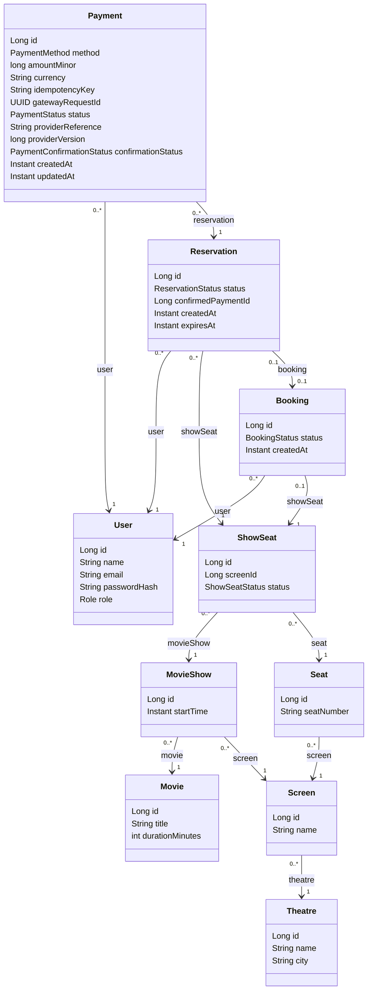
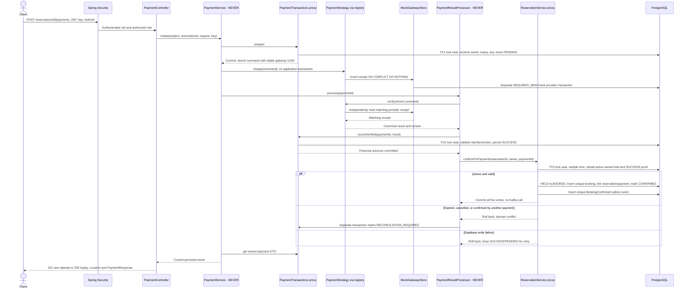
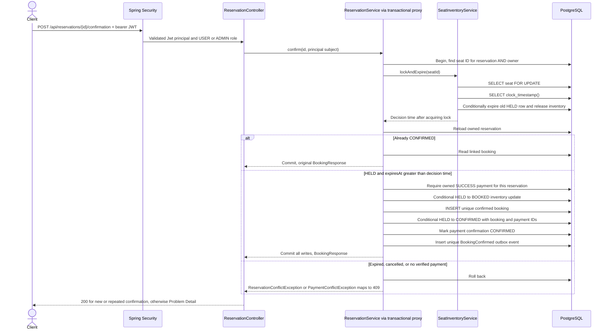
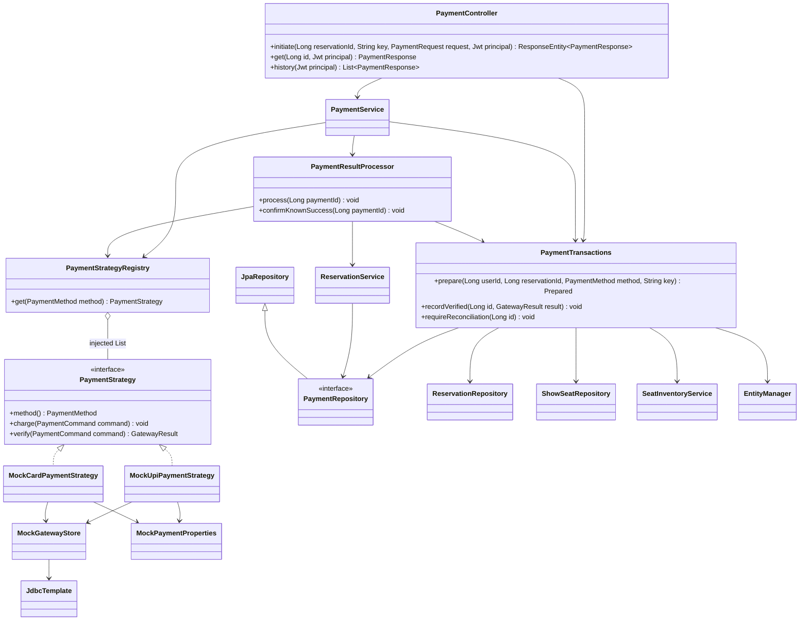
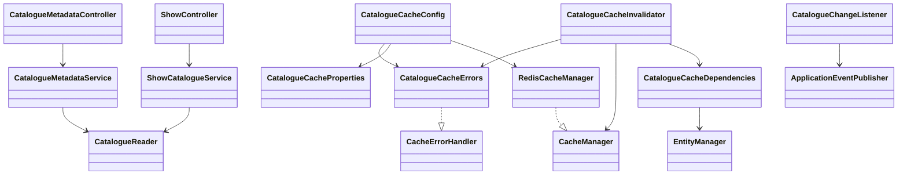
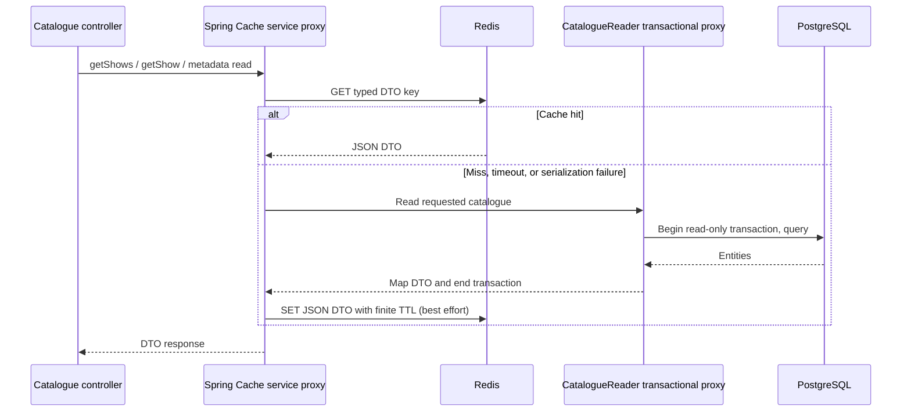
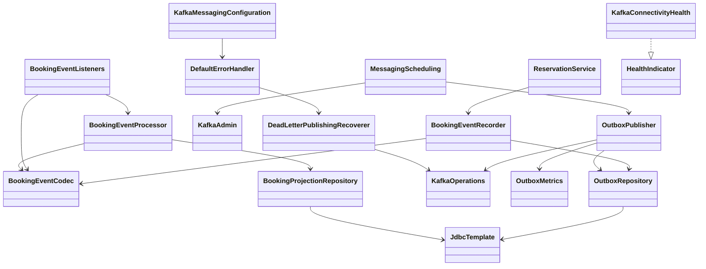
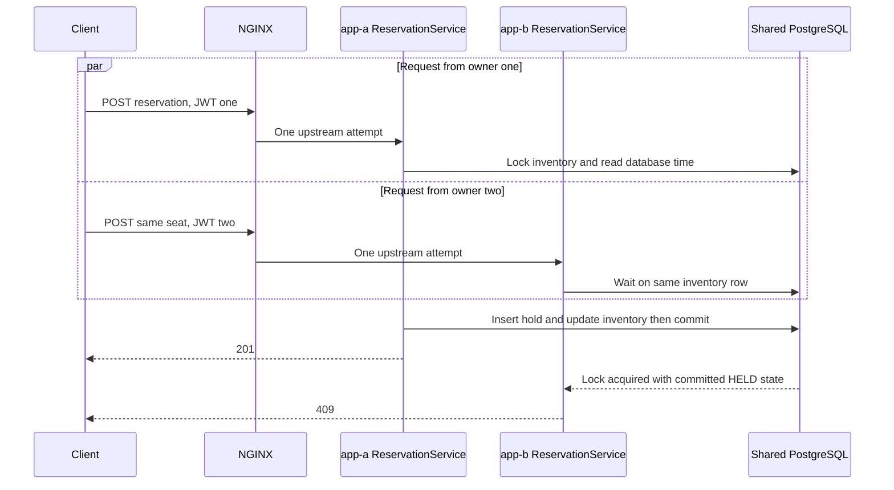

# Low-level design

The implementation lives under `com.example.Tbooker`. It uses controllers,
concrete service classes, Spring Data repository interfaces, JDBC repositories,
JPA entities, DTO records, centralized exceptions, Spring Security configuration,
a payment Strategy interface, and Kafka producers/listeners.
[HLD](HLD.md) describes deployment and scope;
[DATABASE](DATABASE.md) defines the physical schema.

## Class diagram and interfaces

The following diagram shows application dependencies. `JpaRepository` is a
framework interface; Spring Data generates the repository implementations.

```mermaid
classDiagram
    class ShowController {
        +getShows() List~ShowResponse~
        +getShow(Long showId) ShowResponse
        +getShowSeats(Long showId) List~ShowSeatResponse~
    }
    class BookingController {
        +book(Long showId, BookingRequest request, Jwt principal) ResponseEntity~BookingResponse~
        +getBookings(Jwt principal) List~BookingResponse~
        +getBooking(Long bookingId, Jwt principal) BookingResponse
    }
    class AuthController {
        +register(RegisterRequest request) ResponseEntity~UserResponse~
        +login(LoginRequest request) AuthResponse
    }
    class AuthService {
        +register(RegisterRequest request) UserResponse
        +login(LoginRequest request) AuthResponse
    }
    class TokenService {
        +issue(User user) AuthResponse
    }
    class PasswordEncoder {
        <<interface>>
    }
    class JwtEncoder {
        <<interface>>
    }
    class ShowCatalogueService {
        +getShows() List~ShowResponse~
        +getShow(Long showId) ShowResponse
        +getShowSeats(Long showId) List~ShowSeatResponse~
    }
    class BookingService {
        +book(Long showId, Long userId, BookingRequest request) BookingResponse
        +getBookings(Long userId) List~BookingResponse~
        +getBooking(Long bookingId, Long userId) BookingResponse
    }
    class ReservationController {
        +create(Long showId, ReservationRequest request, Jwt principal) ResponseEntity~ReservationResponse~
        +get(Long id, Jwt principal) ReservationResponse
        +confirm(Long id, Jwt principal) BookingResponse
        +getBooking(Long id, Jwt principal) BookingResponse
        +cancel(Long id, Jwt principal) ResponseEntity~Void~
    }
    class ReservationService {
        +create(Long showId, Long userId, ReservationRequest request) ReservationResponse
        +get(Long id, Long userId) ReservationResponse
        +confirm(Long id, Long userId) BookingResponse
        +cancel(Long id, Long userId) void
        +confirmForPayment(Long id, Long userId, Long paymentId) BookingResponse
        +getBooking(Long id, Long userId) BookingResponse
    }
    class SeatInventoryService {
        +lockAndExpire(Long seatId) Instant
        +expireBatch() int
    }
    class ReservationCleanup {
        +expireReservations() void
    }
    class ReservationRepository {
        <<interface>>
        +findByIdAndUserId(Long id, Long userId) Optional~Reservation~
        +findOwnedSeatId(Long id, Long userId) Optional~Long~
        +expire(Long seatId, Instant now) int
        +confirm(Long id, Long userId, Long bookingId, Long paymentId, Instant now) int
        +cancel(Long id, Long userId, Instant now) int
    }
    class JpaRepository {
        <<interface>>
    }
    class MovieShowRepository {
        <<interface>>
        +findAllByOrderByStartTimeAscIdAsc() List~MovieShow~
        +findById(Long id) Optional~MovieShow~
    }
    class ShowSeatRepository {
        <<interface>>
        +findByMovieShowIdOrderBySeatSeatNumberAscIdAsc(Long showId) List~ShowSeat~
        +bookIfAvailable(Long showId, Long showSeatId) int
        +lockById(Long id) Optional~Long~
        +databaseTime() Instant
        +findAvailabilityByShowId(Long showId) List~Availability~
        +holdIfAvailable(Long id) int
        +releaseHeld(Long id) int
        +bookHeld(Long id) int
        +lockExpiredSeats() List~Long~
    }
    class UserRepository {
        <<interface>>
        +findByEmailIgnoreCase(String email) Optional~User~
        +existsByEmailIgnoreCase(String email) boolean
    }
    class BookingRepository {
        <<interface>>
        +findByUserIdOrderByCreatedAtDescIdDesc(Long userId) List~Booking~
        +findByIdAndUserId(Long id, Long userId) Optional~Booking~
    }
    ReservationController --> ReservationService
    ReservationService --> ReservationRepository
    ReservationService --> ShowSeatRepository
    ReservationService --> MovieShowRepository
    ReservationService --> UserRepository
    ReservationService --> BookingRepository
    ReservationService --> SeatInventoryService
    ReservationService --> BookingEventRecorder
    BookingEventRecorder --> OutboxRepository
    BookingEventRecorder --> BookingEventCodec
    ReservationCleanup --> SeatInventoryService
    SeatInventoryService --> ShowSeatRepository
    SeatInventoryService --> ReservationRepository
    JpaRepository <|-- ReservationRepository
    ShowController --> ShowCatalogueService
    AuthController --> AuthService
    AuthService --> UserRepository
    AuthService --> PasswordEncoder
    AuthService --> TokenService
    TokenService --> JwtEncoder
    BookingController --> BookingService
    ShowCatalogueService --> CatalogueReader
    CatalogueMetadataController --> CatalogueMetadataService
    CatalogueMetadataService --> CatalogueReader
    CatalogueReader --> MovieShowRepository
    CatalogueReader --> ShowSeatRepository
    CatalogueReader --> MovieRepository
    CatalogueReader --> TheatreRepository
    JpaRepository <|-- MovieRepository
    JpaRepository <|-- TheatreRepository
    BookingService --> MovieShowRepository
    BookingService --> ShowSeatRepository
    BookingService --> UserRepository
    BookingService --> BookingRepository
    JpaRepository <|-- MovieShowRepository
    JpaRepository <|-- ShowSeatRepository
    JpaRepository <|-- UserRepository
    JpaRepository <|-- BookingRepository
```

The eight JPA repositories (including the payment repository below) extend `JpaRepository<Entity, Long>`. Inherited operations
used by booking include `existsById`, `findById`, `getReferenceById`, and
`saveAndFlush`. `PaymentStrategy` is the gateway interface; there are no generic service interfaces or repositories for
entities without a current persistence use case of their own.

`HealthController` is intentionally outside this dependency chain: it returns
`HealthResponse("UP")` directly. `ApiExceptionHandler` is a
`@RestControllerAdvice`, applied centrally rather than called by controllers.

## Entity relationships

The arrows below are the actual unidirectional Java associations. Each entity
also has a generated `Long id`; remaining scalar fields are listed to distinguish
the persisted model from the DTOs.

Associations are lazy to-one mappings. `Booking.showSeat` and the optional
`Reservation.booking` are `@OneToOne`; the other arrows are required `@ManyToOne`. There are no parent
collections, cascading removals, or bidirectional object graphs. Entities have protected JPA constructors and getters. Most have public
construction paths; payment attempts are inserted through conditional native SQL.
`Reservation.confirmedPaymentId` is a scalar FK, not a bidirectional JPA association.
Mock receipts use `JdbcTemplate`, with no JPA entity.

`ShowSeat` construction checks that the show and physical seat reference the same
persisted screen, captures the supporting `screenId`, and starts at `AVAILABLE`. The
composite foreign keys also enforce this invariant in PostgreSQL. `Booking`
construction sets `CONFIRMED`. Its user, show-seat, and creation-time columns
are non-updatable in the JPA mapping. A reservation starts `HELD` and can become
`CONFIRMED`, `CANCELLED`, or `EXPIRED`; its owner, seat, and timestamps are immutable
in the JPA mapping. Confirmed bookings still have no cancellation workflow.

## Service responsibilities and transaction boundaries

| Service operation | Responsibility |
| --- | --- |
| `ShowCatalogueService.getShows()` / `getShow()` | Cache show DTO list/detail; delegate misses to `CatalogueReader`. |
| `CatalogueMetadataService` | Cache movie/theatre DTO list/detail via the same reader. |
| `CatalogueReader` | Query and map all catalogue DTOs; seat reads always query PostgreSQL. |
| `getShow(showId)` | Read one show or raise `ShowNotFoundException`. |
| `getShowSeats(showId)` | Verify the show exists; return inventory ordered by physical seat number and show-seat ID. |
| `BookingService.book(showId, userId, request)` | Validate the legacy request, then reject creation with `PaymentConflictException` (`409`). |
| `getBookings(userId)` / `getBooking(bookingId, userId)` | Query only the principal's bookings; return `404` for a foreign or absent detail. |
| `AuthService.register(request)` | Validate uniqueness, hash the password, save a USER account, and return a DTO in a transaction. |
| `AuthService.login(request)` | Read credentials, verify BCrypt, and request a signed token; no long-lived transaction. |
| `ReservationService.create/get/confirm/cancel` | Manage one owner's reservation; confirmation requires verified payment. |
| `ReservationService.confirmForPayment` | Internal entry point: recheck persisted payment and active ownership under the inventory lock; atomically create/link the booking. |
| `ReservationService.getBooking` | Retrieve the confirmed booking for an owned reservation or return `409`. |
| `PaymentService.initiate` | Outside any application transaction, prepare/replay, call selected strategy, verify/process, and return current DTO. |
| `PaymentTransactions.prepare` | Lock inventory; check active owned reservation, key and unresolved attempts; insert PENDING or return matching stored attempt. |
| `PaymentTransactions.recordVerified` | Lock inventory, clear pre-lock JPA state, validate receipt identity and version, persist financial outcome. |
| `PaymentTransactions.get/history/snapshot` | Construct owner-scoped public DTOs or internal command snapshots inside read transactions. |
| `PaymentTransactions.requireReconciliation` | Mark successful unconfirmed payments for review without overwriting concurrent CONFIRMED state. |
| `PaymentResultProcessor.process/confirmKnownSuccess` | Verify independently, commit outcome, then attempt confirmation; keep durable retry/reconciliation status. |
| `SeatInventoryService.lockAndExpire` | Lock inventory and expire the old hold within the caller's transaction (`MANDATORY`). |
| `SeatInventoryService.expireBatch` | Own a bounded `READ_COMMITTED` cleanup transaction, skipping locked seats. |
| `TokenService.issue(user)` | Issue HS256 claims using `JwtEncoder`, `JwtProperties`, and an injected UTC clock. |

`CatalogueReader` has class-level `@Transactional(readOnly = true)`.
The cache facades have no transaction annotation; cache hits need no database
connection. Spring Cache invokes the separate reader proxy on a miss.
`MovieShowRepository` uses an entity graph for `movie`, `screen`, and
`screen.theatre`; the seat-list native query projects seat labels and expiry-aware
availability without exposing entities. These fetch plans support
DTO construction within the transaction while open-in-view stays disabled.
The read-only annotation is not a database authorization boundary.

`BookingService.book` retains legacy request/resource validation but cannot insert
bookings in Phase 8. All new bookings use `ReservationService.confirmLocked`:
verified SUCCESS proof, active owned reservation, conditional HELD-to-BOOKED,
`BookingRepository.saveAndFlush`, conditional reservation confirmation, and
payment confirmation status, and the new outbox event are one READ_COMMITTED
transaction. `BookingEventRecorder.confirmed` joins it with MANDATORY propagation;
confirmation retries return before generating another event. Historical
confirmed bookings are returned without inventing payments.

Native writes flush and clear the persistence context. Queries before a lock
must not authorize a decision after waiting; the owned reservation/payment is
reloaded after locking. `saveAndFlush` surfaces insert constraints, but commit
occurs only when the Spring proxy finishes the entire method.

## Booking sequence

This shows the ordinary successful payment path. Identity and validation failures
stop before orchestration; stored identical-key replays reuse the attempt.

`@Transactional(NEVER)` on the orchestrator, processor, and strategies fails fast
if they are accidentally called within an application transaction. Each database
stage is a separate bean call so Spring interception applies. `MockGatewayStore`
uses REQUIRES_NEW to simulate provider durability; it shares this database and is
not an external network gateway. No lock spans the gateway call or user think time.

`PaymentTransactions.recordVerified` ignores stale versions, rejects different
outcomes at the same version, permits a newer FAILED-to-SUCCESS correction, and
never regresses SUCCESS. `PaymentResultProcessor` catches domain conflicts to mark
reconciliation and catches `DataAccessException` from booking to retain retryable
SUCCESS/PENDING. Other connection/commit failures may return a server error; the
client must inspect persisted state and retry the original key. There is no claim
that a successful external charge and booking are a single atomic transaction.

## DTOs and error handling

DTOs are Java records: `HealthResponse`, `ShowResponse`, `ShowSeatResponse`,
`BookingRequest`, `BookingResponse`, `RegisterRequest`, `LoginRequest`,
`UserResponse`, `AuthResponse`, `ReservationRequest`, `ReservationResponse`,
`PaymentRequest`, and `PaymentResponse`. Internal `PaymentCommand`, `GatewayResult`,
and `PaymentSnapshot` records are not accepted as public input.
Controllers never serialize entities.
`BookingRequest` requires one non-null positive `showSeatId`; show path variables
are positive. Fractional JSON numbers are not coerced into integer IDs.
DTO schemas and examples are in [API.md](API.md).

`ShowNotFoundException` specializes `ResourceNotFoundException`. The advice maps
resource absence to `404`, `InvalidBookingRequestException` to `400`, and
`SeatAlreadyBookedException`, `ReservationConflictException`, and
`PaymentConflictException` to `409`. `GatewayVerificationException` maps to generic
`502`, directing clients to retry their original payment key. It maps a Hibernate constraint violation
to `409` only when both SQLSTATE `23505` and constraint name
`uq_bookings_show_seat` match. The named `uq_reservations_held_seat` unique
violation similarly returns a hold conflict. Other data-integrity violations are logged and
return a generic `500` detail. Spring MVC handles input-validation failures using
its configured Problem Details support.

`DuplicateEmailException` and the named email unique violation map to `409`.
`BadCredentialsException` maps to generic `401` login errors. Filter-chain failures
occur before controller advice: `SecurityProblemHandler` implements Spring's
`AuthenticationEntryPoint` and `AccessDeniedHandler` for `401` and `403`.

## Security interfaces and configuration

`SecurityConfig` declares the stateless filter chain, cost-12 `PasswordEncoder`,
`JwtEncoder`/`JwtDecoder`, signing key, and UTC `Clock` beans. Nimbus supplies the
JWT implementation; the decoder pins HS256 and validates issuer, audience,
required timestamps, subject, and role. `JwtAuthenticationConverter` translates
the validated role to a Spring authority. `JwtProperties` binds the required
environment key and bounded token lifetime.

Controllers obtain a validated `Jwt` through `@AuthenticationPrincipal`.
`BookingService` does not read thread-local authentication itself; it receives
identity from this trusted HTTP boundary and applies owner-scoped repository
queries. Method-security annotations are not used: the filter chain enforces
route roles and the queries enforce record ownership. The full filter flow,
password validation, legacy-account behavior, and limitations are described in
[SECURITY.md](SECURITY.md).

## Dependency injection and SOLID

Spring discovers controllers and services and supplies their dependencies through
constructors into final fields. Spring Data supplies repository proxies, while
Spring Boot configures the datasource, JPA, Flyway, and web infrastructure.
There is no field injection or general service locator. The payment registry is
a bounded map of injected `PaymentStrategy` implementations keyed by enum; it does
not instantiate providers or call `ApplicationContext.getBean`. The `config` package
now defines `SecurityConfig`, validated `JwtProperties`, and `SecurityProblemHandler`.

| Principle | Application and limits |
| --- | --- |
| Single responsibility | Controllers handle HTTP, services coordinate use cases, repositories access persistence, and advice maps errors. |
| Open/closed | The orchestrator selects `PaymentStrategy` without branching on UPI/Card. A new provider still requires an enum/schema change and a bean; this is deliberate bounded extensibility. |
| Liskov substitution | Both strategies honor stable command identity and independent verification contracts; selecting another mock does not change orchestration. |
| Interface segregation | The gateway exposes only selection, charge, and verification; eight entity-specific repositories still inherit the broad `JpaRepository` API. |
| Dependency inversion | Payment orchestration consumes the injected Strategy interface through its registry; services receive repository interfaces instead of constructing persistence implementations. Controllers depend on concrete services, and services use Spring annotations: this is a layered Spring design, not framework-independent ports and adapters. |

## Patterns actually used

- **Chain of Responsibility:** Spring's security filters handle bearer
  authentication and route authorization before MVC.
- **Framework strategies:** the `PasswordEncoder`, `JwtEncoder`, and `JwtDecoder`
  interfaces select BCrypt and Nimbus implementations through injected beans.
- **Service Layer:** services define use cases and transaction boundaries.
- **Repository:** Spring Data interfaces encapsulate queries and persistence access.
- **Data Mapper / Unit of Work:** Hibernate maps entities and tracks persistence
  within a transaction; the native claim explicitly synchronizes its context.
- **DTO:** records keep HTTP contracts separate from lazy entity graphs.
- **Dependency injection and framework proxies:** Spring wires collaborators and
  applies transaction interception; it also generates repository implementations.
- **Centralized exception translation:** controller advice maps known failures
  to HTTP responses.

A custom **Strategy** interface and a Spring-managed **Registry** select gateway
behavior. The registry fills the selection role often served by a factory but
does not construct objects; Spring constructs and injects them. Catalogue lifecycle events use Spring's in-process publisher/listener (Observer)
mechanism; they are not durable events. No custom Singleton is introduced.
Spring bean scope is framework behavior, not an application-designed Singleton
pattern. Future requirements should justify additional abstractions before they
are added. See [DECISIONS.md](DECISIONS.md).

## Reservation confirmation sequence

The scalar owner-scoped lookup avoids loading a stale reservation entity before
waiting on the seat lock. Repository modifying queries flush and clear the JPA
context. The service reloads the reservation after locking and expiration.
All modifying reservation methods use `READ_COMMITTED`; view is read-only.

Unknown/foreign IDs fail `404` before locking. A booking insert, reservation
update, or commit failure prevents a success response; all transaction writes
roll back. Repeated cancellation returns `204` only for an already-cancelled
reservation; it never releases the next owner's hold. Retry safety comes from
the immutable reservation ID and stored booking link, not an in-memory cache.
The shared inventory service is a focused service-layer collaborator, not a
new generic locking framework. Scheduling uses Spring's `@Scheduled` callback
and invokes a separate bean so transaction interception applies.

## Payment Strategy and registry classes

The registry rejects duplicate/missing method implementations at startup and uses
an immutable EnumMap copy. `MockPaymentProperties` supplies the positive server
amount and configured outcomes. Both gateways save one receipt per stable UUID;
changing configuration affects only newly created receipts. No provider is built
with `new` inside a use case.

SRP separates HTTP, orchestration, transactional persistence, gateway behavior,
and booking policy. DIP/OCP apply at the gateway interface, not as a claim that
the entire application is framework-independent. Recovery is an explicit
multi-transaction workflow; no general Saga engine is present. Phase 10 adds a PostgreSQL outbox and Kafka
for downstream booking projections; it does not distribute payment transactions.

## Cache-aside collaborators and execution order

`@Cacheable` is applied by Spring's proxy to facade calls with explicit cache
names and stable `all`/ID keys. `CatalogueCacheConfig` registers exactly six
caches, per-cache typed Jackson serializers, TTLs, statistics, no null caching,
and transaction-aware writes. `CATALOGUE_CACHE_ENABLED=false` selects a
`NoOpCacheManager`. `CatalogueCacheErrors` implements the framework strategy for
get/put/evict/clear failures; it preserves the reader fallback path and emits
metrics/logs. It does not swallow PostgreSQL or application exceptions.

Seat reads skip the cache proxy operation entirely. If a caller already has a
transaction, the cache condition skips both lookup and population; this prevents
uncommitted data escaping via Redis and allows read-your-own-write behavior.
Separate facade/reader beans also avoid Spring proxy self-invocation problems.

`CatalogueChangeListener.changed` is a Spring-injected Hibernate entity listener.
Its lifecycle callback only publishes kind/ID; it performs no queries while
Hibernate flushes. `CatalogueCacheInvalidator.invalidate` runs after commit,
uses `evictIfPresent` for immediate targeted deletion, and obtains related show
IDs from `CatalogueCacheDependencies.affectedShows` in `REQUIRES_NEW`. Failure
cannot undo the already-committed write. Dependency lookup failures are logged;
Redis operation failures use the shared error handler. Rollback discards events.

SRP separates mapping, caching, invalidation, and error policy. DI supplies each
collaborator; the framework CacheManager/CacheErrorHandler interfaces provide
DIP at the infrastructure boundary. Cache-aside, DTO, Repository, Service Layer,
Spring proxy interception, and Observer are the added/reused patterns. No custom
cache abstraction, distributed lock, or singleton framework is invented.

## Booking event classes and responsibilities

| Class/method | Responsibility and boundary |
| --- | --- |
| `BookingConfirmedEvent` | Immutable validated V1 record with UUID identity and UTC fact time. |
| `BookingEventCodec.decode/encode/fingerprint` | Map JSON, validate schema values/key, and hash canonical content without logging raw input. |
| `BookingEventRecorder.confirmed` | Record the event inside an existing booking transaction; no Kafka dependency. |
| `OutboxRepository.append/claim/published/failed` | JDBC persistence, bounded SKIP LOCKED claims, and lease-token conditional updates. |
| `OutboxPublisher.publishBatch` | NEVER propagation, bounded local in-flight work, async send, completion on a dedicated executor; no database transaction during Kafka wait. |
| `BookingEventListeners.notifyBooking/countBooking` | Independent `@KafkaListener` groups; decode then invoke the separate transactional processor proxy. |
| `BookingEventProcessor.notifyBooking/countBooking` | READ_COMMITTED marker plus projection transaction. Offset acknowledgment follows successful return. |
| `BookingProjectionRepository.firstDelivery` | Insert durable marker; identical replay returns false; changed content or another ID for the same booking fails. |
| `KafkaMessagingConfiguration` | Topics, record acknowledgment, bounded retries, and acknowledged DLT recovery. |
| `MessagingScheduling` / `OutboxMetrics` | Poll publisher, retry topic creation, sample backlog, and record process counters/timers. |
| `KafkaConnectivityHealth` | Bounded broker probe, excluded from database-based booking readiness. |

The new repositories use JdbcTemplate because lease updates, conditional markers,
and counter increments are explicit SQL operations; no speculative JPA entities
or generic messaging framework are introduced. Spring Kafka supplies producer,
consumer, error-handler, and lifecycle interfaces. `KafkaOperations` is the
publisher's injected transport interface; `HealthIndicator` is the health strategy.
The recorder keeps Kafka classes out of reservation logic.

Added patterns are Transactional Outbox, Idempotent Consumer, and Publish/Subscribe.
Repository, DTO, Service Layer, constructor DI, and framework transaction proxies
are reused. SRP separates allocation, durable event capture, publication, transport
listeners, and projection changes. No notification Strategy is needed for a single
mock channel; the existing payment Strategy remains unchanged. See the complete
[sequence and recovery model](MESSAGING.md#transaction-boundaries-and-delivery-guarantee).

## Phase 11: the same object graph in independent JVMs

NGINX routes a request to `app-a` or `app-b`. Each replica constructs its own
`SecurityFilterChain`, controllers, services, repository proxies, Hikari pool,
`ReservationCleanup`, `OutboxPublisher`, and Kafka listeners through Spring DI.
No singleton bean or Java monitor coordinates the two processes. Shared database
rows, constraints, leases, and consumer markers provide that coordination.

The diagram shows one possible winner; either JVM can acquire the row first.
The lock is acquired by `SeatInventoryService`, inside the calling service
transaction. `ReservationCleanup` skips locked seats; `OutboxRepository`
claims/fences publication separately from `OutboxPublisher` broker I/O. Consumer
projection processors commit deduplication and effects atomically.

Phase 11 adds deployment and verification, not a new domain pattern. Strategy
(payment), Repository, DTO, Service Layer, DI, transaction proxies, Cache-Aside,
Transactional Outbox, and Idempotent Consumer remain the relevant patterns.
SRP keeps routing in NGINX and eligibility in transactional services. The only
application configuration addition is Micrometer `application`/`instance` tags.
See [SCALING.md](SCALING.md) for process coordination and failure boundaries.

## Phase 12D request and operational responsibilities

| Class / configuration | Responsibility |
| --- | --- |
| `RequestCorrelationFilter.doFilterInternal` | Before security: constrain/generate diagnostic ID, set response header and scope MDC with finally cleanup. |
| `RequestBodyLimitFilter.doFilterInternal` | After security: read at most 16385 bytes, reject oversized bodies, replay bounded input to the synchronous MVC pipeline. |
| `ApiExceptionHandler` | Preserve domain errors, add correlation to handled Problem Details, count conflicts, classify resource/transient DB errors as generic 503. Uses Spring's MVC exception-handler base for standard validation errors. |
| `SecurityProblemHandler` | Preserve generic 401/403, adding the same request correlation. |
| `OperationalFailures.record` | Bounded operation enum, counters for every failure, sanitized warning at most once per operation per JVM per 30 seconds. |
| `SchedulingErrorConfiguration.safeScheduledFailures` | Customize Boot's scheduler error handler so failed ticks remain observable without raw DB exception dumps. Future ticks still run. |
| `CatalogueCacheErrors` | Preserve fallback semantics and per-operation counters, throttle repeated warnings. |
| `PaymentResultProcessor.confirmKnownSuccess` | Existing separate financial/allocation transactions unchanged; record confirmation/reconciliation failures. |
| `application.yaml` / NGINX | SQL/pool budgets, ECS logging and local HTTP percentiles; edge IDs, JSON access logs and existing no-replay policy. |

These use servlet Filter/Decorator, centralized exception handling, constructor
DI and configuration customization at existing extension points. SRP separates
transport/diagnostics from domain eligibility. No new abstract factory, domain
service layer or distributed-lock algorithm is introduced. Metric labels are
bounded operation/cache/route/instance values, never owner/payment/request IDs.
