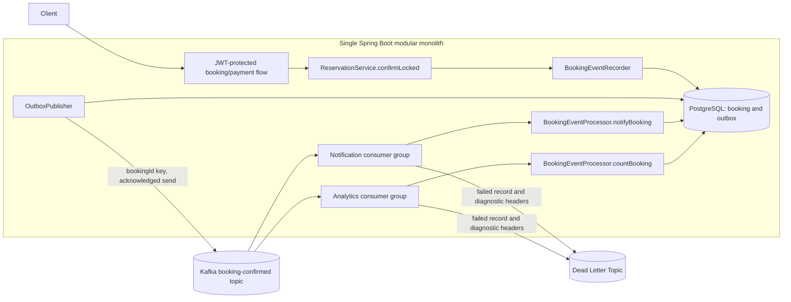
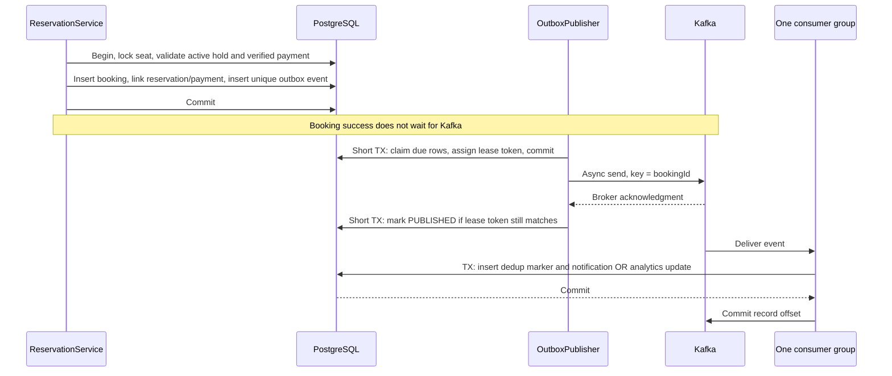

# Booking events and recovery — Phase 10

## Implemented scope

A confirmed booking produces one `BookingConfirmed` V1 fact. PostgreSQL stores it
atomically with allocation; an asynchronous worker publishes it to Kafka. Two
independent consumer groups persist a mock notification and update a booking-count
projection. No real email, new payment gateway, microservice, or public event-write
API is introduced. [The JSON schema](events/booking-confirmed-v1.schema.json)
describes the producer contract; `BookingConfirmedEvent`/`BookingEventCodec` map
and validate the consumer DTO. Jackson normalizes accepted representations before
fingerprinting; this is not an external schema registry or JSON Schema runtime.

The payload contains event ID (UUID), type, version, booking/user/show/show-seat
IDs, and UTC `occurredAt`. It contains no email address, token, password, or payment
credentials. `occurredAt` comes from the booking's database decision timestamp;
outbox `created_at` records insertion time. The Kafka key is decimal `bookingId`.
Consumers reject unsupported versions/types, missing/invalid fields, mismatched
keys, malformed JSON, oversized payloads, and reuse of an event ID with changed
canonical contents. Kafka is a trusted internal boundary: JWT authentication is
not applied to messages. Production broker ACLs and TLS/SASL remain deployment work.

## Architecture and partitioning



Default topic: `tbooker.booking-confirmed.v1`, three partitions. The DLT is
`tbooker.booking-confirmed.v1.DLT`, also three partitions. Default consumer groups
are `tbooker-notifications-v1` and `tbooker-analytics-v1`. Every group independently
receives every event; replicas within a group share partitions. The application
rejects identical notification/analytics group names at startup.

A booking ID remains on one partition, but there is no global ordering across
bookings. Leased retries can also interleave duplicate sends. Only one logical
confirmation event per booking currently exists; this is not a general aggregate
sequence/version-ordering protocol. Increasing partitions later changes key
assignment and requires an ordering/rollout decision.

Topics are declared with seven-day retention and delete cleanup. Source batches
are limited to 64 KiB and DLT batches to 1 MiB, leaving room for failure headers.
The producer emits small V1 DTOs and uses `acks=all`, idempotence, and at most five
in-flight requests per connection. This reduces producer-session retries, not
outbox republishing after a crash. Local Compose is a single KRaft broker/controller
with replication factor one and a persistent `kafka_data` volume. It is not an
HA configuration. KafkaAdmin creates topics without failing application startup
when the broker is down; a scheduled 30-second check retries provisioning.
Existing topic configs are not forcibly rewritten; operators must keep retention,
size limits, partition counts, and DLT configuration aligned during upgrades.

## Transaction boundaries and delivery guarantee

1. `ReservationService.confirmLocked` retains inventory-first locking and paid,
   active ownership checks. It inserts the booking, links reservation/payment,
   and calls `BookingEventRecorder.confirmed` before commit. The recorder's
   `MANDATORY` transaction joins that transaction; JdbcTemplate shares the JPA
   transaction's datasource connection. Any failure rolls back allocation and
   its event together. Financial SUCCESS remains in its earlier transaction.
2. `OutboxRepository.claim` uses `FOR UPDATE SKIP LOCKED`, selecting due PENDING
   events or expired IN_FLIGHT leases. It atomically assigns a new UUID lease
   token, increments attempts, sets the database-time deadline, and commits.
3. `OutboxPublisher.publishBatch` forbids an ambient database transaction. It
   sends asynchronously after claim commit. Neither row locks nor database
   transactions wait for Kafka. Local permits bound in-flight memory/work only;
   PostgreSQL provides cross-instance coordination.
4. After broker acknowledgment, a separate short transaction marks PUBLISHED,
   conditional on the current lease token. Failures reschedule PENDING with
   exponential delays capped at one minute; attempts remain durable and are not
   permanently abandoned after an arbitrary retry count.
5. Each consumer calls a separate transactional processor. It inserts its
   `(consumer_name,event_id)` marker and notification/count change in one
   READ_COMMITTED transaction. Kafka offsets commit only after this method returns
   successfully. The marker includes a canonical payload hash and an additional
   per-consumer booking uniqueness guard.

Marker insertion uses `ON CONFLICT DO NOTHING` across both unique constraints,
then checks the stored event ID and canonical hash in a fresh READ_COMMITTED
statement snapshot. Targeting only the event-ID constraint can let a simultaneous
identical delivery fail against the separate booking unique index. A matching
marker is a harmless replay; a different event ID for the same booking or changed
content is rejected and routed to the DLT.



The logical producer uniqueness constraint is `(aggregate_id,event_type)`; a new
UUID cannot create a second confirmation fact. Confirmation retries return the
existing booking before recording another event. A stale publisher cannot
complete or reschedule a newer claim. An expired lease that has not yet been
reclaimed can still accept its owner's successful acknowledgment safely.

**At-least-once, not exactly-once across PostgreSQL/Kafka:** a crash after broker
acceptance but before PUBLISHED causes resend with the same event ID. A crash
after a consumer database commit but before offset commit causes redelivery.
Durable consumer deduplication makes those repeats harmless to these two database
projections. This does not provide exactly-once real email or external side effects.
`MOCK_DELIVERED` means only that the mock notification row was committed.

## Failure recovery and DLT

| Failure boundary | Persisted state and recovery |
| --- | --- |
| Booking/outbox insert or commit fails | No booking/event commits; verified payment can remain SUCCESS/PENDING for the existing paid retry flow. |
| Kafka absent at startup or runtime | Booking commits its PENDING event; publisher retries and topic provisioning recovers. |
| Publisher dies after claim, before send | IN_FLIGHT lease expires; another instance reclaims using database time. |
| Kafka accepts, publisher dies or state update fails | Lease recovery resends the same event; duplicate publication is expected. |
| Consumer transaction fails | Projection and marker both roll back; offset is not committed. |
| Consumer commits, offset commit fails | Redelivery finds the marker and does not repeat the projection. |
| Malformed/version/key/content conflict | No application retry; copy original bytes to DLT with exception and original topic/partition/offset/group headers. |
| Transient consumer failure | Three retries after the first attempt, using 200/400/800 ms backoff; exhausted failures go to DLT. |
| DLT publication fails | Do not advance the source offset. Retry recovery after Kafka/DLT returns; avoid silently losing the poison record. |

Database integrity failures are considered non-retryable. Other listener failures
use the bounded retry policy. A successful DLT acknowledgment lets the partition
continue to subsequent records. If the DLT itself is unavailable, processing can
remain blocked intentionally until delivery is safe; the system does not drop
records merely to advance offsets. Each group can produce its own DLT copy.

After fixing a transient consumer problem, an authorized operator can replay the
original DLT key and payload to the source topic, retaining its event ID. The
failed group's rolled-back marker permits processing; the already-successful
group deduplicates it. Do not invent a new event ID or alter a fact already
processed. Invalid schemas require investigation/correction consistent with the
source booking. No automatic DLT replay or public operator API is implemented.
Use DLT original-consumer-group headers to identify the failed projection.

Published outbox rows and processed markers are retained. If Kafka retention has
removed records before a consumer catches up, an authorized operator can requeue
specific retained outbox rows for replay (use actual investigated IDs):

```sql
BEGIN;
UPDATE tbooker.outbox_events
SET status='PENDING', published_at=NULL, lease_token=NULL, lease_until=NULL,
    next_attempt_at=clock_timestamp(), last_error=NULL
WHERE event_id = '<investigated-event-uuid>'::uuid AND status='PUBLISHED';
COMMIT;
```

Replays preserve the payload and event ID. Resetting consumer offsets alone cannot
recreate broker-expired data. Do not delete deduplication records while replay is
possible. There is no automatic archival/pruning/reconciliation job in this phase.

## Configuration, operations, and observability

Normal startup enables messaging. `MESSAGING_ENABLED=false` disables Kafka workers,
listeners, and topic creation, **not outbox recording**; events accumulate safely.
`MESSAGING_SCHEDULING_ENABLED=false` disables polling/provisioning/metric sampling
for controlled integration tests, while explicit publishers and listeners remain.
The producer default delivery/request/max-block timeouts are 5000/2000/1000 ms.
Lease is 30 seconds, batch capacity 20, retry initial/max 1/60 seconds. Use `.env.example`
for topic/group/broker settings. Keep delivery timeout above request timeout plus
linger and lease comfortably above normal send/ack duration. Short leases increase
duplicates; oversized batches and timeouts increase backlog/connection pressure.

`GET /actuator/health/readiness` depends on PostgreSQL, not Kafka or Redis.
`GET /actuator/health/messaging` performs a bounded Kafka connectivity probe.
Overall `/actuator/health` includes Kafka and may be DOWN during a broker outage;
use the readiness group for booking traffic routing. Kafka connectivity does not
prove consumers are caught up or that every DLT/publish permission is correct.
Health details remain hidden from HTTP clients.

Metrics are accessible through `/actuator/metrics` and `/actuator/metrics/{name}`
with an ADMIN JWT; missing tokens return 401 and USER tokens 403. No Prometheus
exporter, dashboard, or alert rules are included.

| Metric | Meaning |
| --- | --- |
| `booking.outbox.pending` | Sampled every 10 seconds: PENDING plus IN_FLIGHT rows, per instance observing the shared backlog. |
| `booking.outbox.publish.failures` | Producer send/ack failures, per process. |
| `booking.outbox.state.failures` | Database failure while persisting a send result; lease recovery is required. |
| `booking.outbox.publish.delay` | Timer from outbox creation to successful acknowledgment/state completion; app-clock observation, not eligibility time. |
| `booking.consumer.failures` | Failed listener deliveries, including retries, across both groups in this process. |
| `booking.consumer.dead.letters` | Acknowledged DLT publications, not distinct logical events. |
| Kafka native consumer metrics | Micrometer binds client metrics, including record fetch lag while assigned; fetch lag is not projection backlog. |

Counters/timers restart with the process; PostgreSQL rows carry durable retry and
processing state. Do not sum replicated backlog gauges as if they were separate
queues. Sampling can be stale if the scheduler/database is unavailable. The code
logs state-persistence failures using event ID/error class, not payloads or secrets;
ordinary producer failures use metrics and durable error metadata.

## Deployment and limitations

Quiesce booking writes while applying V7 and replacing pre-Phase-10 binaries.
V7 seeds analytics from existing bookings and creates no historical events or
notifications. Old binaries cannot write an outbox event, so rolling them alongside
new binaries during this transition can miss events or misalign the baseline.
Repeated Flyway migration does not reseed the projection. Later deployments using
the established schema/protocol can run concurrent publishers and consumers.

The analytics singleton update serializes count increments; it is intentionally
simple and eventually consistent. The notification/dedup tables retain IDs and
facts independently of the source rows; the outbox FK protects the source booking.
Retention and privacy policies, lag/backlog alerts, broker replication/minimum ISR,
TLS/SASL/ACLs, producer quotas, disk sizing, backup/restore, and consumer version
rollouts are production work. Size and timeout settings must be kept compatible
when changing existing topics. Increasing broker retention is not a substitute
for recovery planning.

Tests exercise real Kafka/PostgreSQL, publisher recreation and durable crash
boundaries, concurrent publisher objects, SQL failures, and broker pauses. They
do not kill JVMs/hosts or verify a multi-host HA deployment. No throughput or
exactly-once external-effect claim is made. See [TESTING.md](TESTING.md).
