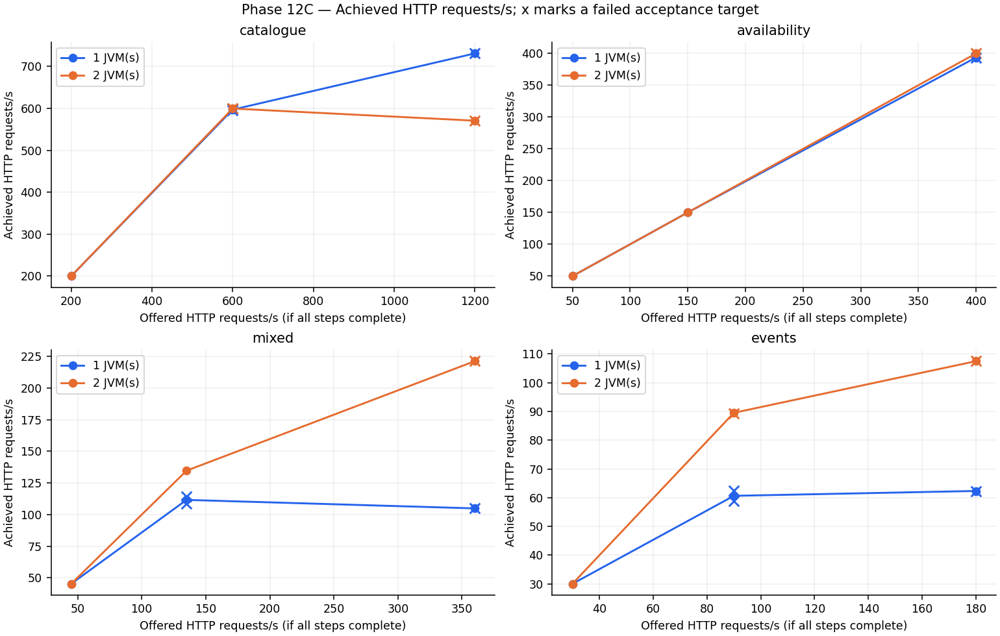
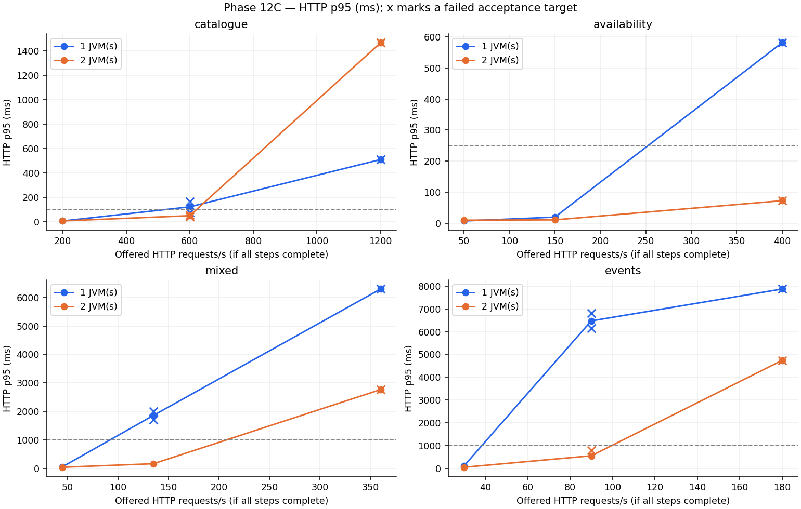
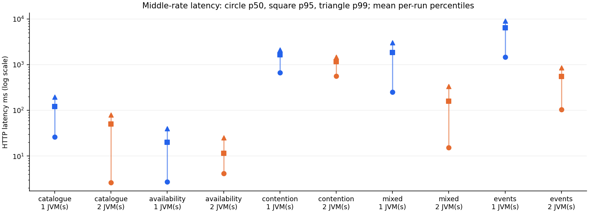
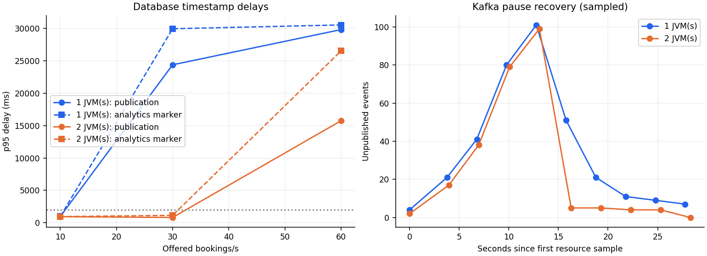

# Catalogue performance evidence — Phase 9

## Reproduce the comparison

Requirements: Java 21, the Maven wrapper, Python 3, and Docker Engine. The runner
uses Linux Docker host networking for k6 and loopback ephemeral ports for private
PostgreSQL/Redis containers. It never reads `.env` or uses the developer database.
Run from the repository root, with no other load test/test suite running:

```bash
bash mvnw clean verify
python3 performance/run-comparison.py --output performance/results/my-comparison.json
```

In the cloud environment, first source `/workspace/.setup/env.sh` and use the
Maven settings/cache overrides documented in [TESTING.md](TESTING.md). The runner
requires the built JAR, not a second Maven installation. It refuses to overwrite
an existing result. Optional flags are `--jar`, `--vus`, `--duration`, `--warmup`.
The images are `postgres:17.11-bookworm`, `redis:7.4-alpine`, and `grafana/k6:1.6.0`;
exact measured digests are in the JSON artifact. Docker pulls missing images.

`performance/catalogue.js` can also run with standalone k6 on other operating
systems against a separately prepared 100-show development dataset:

```bash
BASE_URL=http://localhost:8080 VUS=10 DURATION=30s SHOW_COUNT=100 \
  k6 run performance/catalogue.js
```

This standalone invocation writes `summary.json`; keep generated raw output out
of commits unless intentionally publishing measured evidence. Only the runner
provisions isolated data and measures PostgreSQL/Redis counters.

## Workload and measurement method

The runner starts dedicated PostgreSQL and Redis containers, applies unchanged
Flyway migrations through the application with the dev profile, and populates
exactly 100 shows sharing one movie/screen. No booking writes run during the test.
It restarts the same JAR for each run with `-Xms256m -Xmx512m
-XX:ActiveProcessorCount=4`. The JVM setting controls runtime processor assumptions;
it is not an exclusive four-core CPU allocation. All processes share this cloud
machine; PostgreSQL/Redis/k6 have no CPU quota configured by the runner.

Runs use disabled–enabled–enabled–disabled (ABBA) order to make order effects
visible. Each starts with an empty Redis, warms for 10 seconds, then measures
30 seconds of `GET /api/shows` using 10 virtual users with no think time. The
baseline uses `CATALOGUE_CACHE_ENABLED=false` on the same Phase 9 JAR; all other
application settings/workload remain identical. This isolates the cache switch,
not every code change between older phases. The list TTL stays at its default
30 seconds, so the measured cached workload includes an expiry and cold refill.

k6 checks both HTTP 200 and the 100-element DTO payload; thresholds require zero
HTTP errors and all checks passing. Throughput and latency come from k6's
`http_reqs` / `http_req_duration`; latency excludes DNS/TCP setup and does not
include client-side JSON checks, though those affect closed-workload throughput.
The runner resets `pg_stat_statements` after warmup, then counts matching
`SELECT ... movie_shows ...` calls. This is catalogue SELECT volume, not all SQL
statements, transactions, or a query-plan analysis. It takes deltas of Redis
`keyspace_hits` / `keyspace_misses` on the otherwise unused dedicated Redis.
A disabled-cache baseline has no cache observations, so its ratio is N/A.
The warmup, startup migrations, readiness probes, and setup SQL are excluded.

Runtime-generated database/JWT secrets and raw logs stay in process environment
or a temporary directory; they are not written to the aggregate result. Containers
and temporary files are removed when the runner exits. Do not target production
with the standalone workload or reuse a shared database for benchmark setup.

## Executed results

On **2026-10-13**, all four runs completed successfully. Source evidence:
[`2026-10-13-catalogue.json`](../performance/results/2026-10-13-catalogue.json).
That artifact records the base commit plus uncommitted-work flag, JAR SHA-256,
Java/OS details, visible CPU count, container digests, workload, and measurements.
The cache implementation was uncommitted as requested. The Maven correctness
suite had completed before benchmarking; it did not run concurrently.

| Run | Cache | Requests | Requests/s | Average ms | p95 ms | HTTP errors | Cache hits / misses | Catalogue SELECTs |
| --- | --- | ---: | ---: | ---: | ---: | ---: | ---: | ---: |
| 1 | Disabled | 56,665 | 1,888.57 | 4.072 | 8.588 | 0% | 0 / 0 | 56,665 |
| 2 | Enabled | 86,354 | 2,878.24 | 2.560 | 5.113 | 0% | 86,344 / 10 | 10 |
| 3 | Enabled | 88,363 | 2,944.81 | 2.509 | 5.083 | 0% | 88,353 / 10 | 10 |
| 4 | Disabled | 53,125 | 1,770.50 | 4.411 | 9.371 | 0% | 0 / 0 | 53,125 |

All response checks passed. Cached hit ratios were **99.9884%** and **99.9887%**.
Each cached run made ten database reads when its key expired; simultaneous misses
are not coalesced. The baseline executed one catalogue SELECT per request.

Across these observations, uncached throughput was **1,770–1,889 requests/s**
and cached throughput **2,878–2,945 requests/s**. Cached p95 was **5.08–5.11 ms**
versus **8.59–9.37 ms** uncached. These are run ranges, not pooled percentiles,
confidence intervals, or guaranteed production improvements.

### Calculated improvements

Using the arithmetic mean of the two run-level measurements in each configuration:

| Metric | Uncached run mean | Cached run mean | Measured change |
| --- | ---: | ---: | ---: |
| Throughput | 1,829.53 requests/s | 2,911.52 requests/s | **59.14% higher** |
| Average response time | 4.241 ms | 2.535 ms | **40.24% lower** |
| Per-run p95 latency | 8.979 ms | 5.098 ms | **43.23% lower** |

Throughput improvement is `(cached / uncached - 1) × 100`; latency reduction is
`(1 - cached / uncached) × 100`, using unrounded measurements. The p95 row is the
mean of two run-level p95 values, **not** a combined percentile of all requests.
Likewise, average latency here averages the two run means rather than pooling
individual observations. Raw per-run values remain available in the artifact.

Across two 30-second measured runs per configuration, catalogue SELECT calls fell
from **109,790 to 20**, a **99.9818% reduction**, while request counts increased
from **109,790 to 174,717**. Normalizing for completed requests, database reads fell
from **1.0 to 0.00011447 per request**: **99.9886% fewer SELECTs per request**.
The combined measured cache hit ratio was **99.9886%**. These counts cover the
catalogue SELECT only, not all PostgreSQL activity.

## Interpretation and limits

Redis reduced repeat SQL work for this hot, read-only catalogue list; the existing
entity graph already fetched the list in one query. Cache serialization still
costs CPU/memory, every hit has a network round trip, and the response remains
unpaged. There is no basis here for adding more indexes or caching inventory.

The experiment is short, single-machine, and single-application-instance. The
client, cache, database, and application compete for host resources. It measures
a warm hot key with 100 shows, not a realistic key distribution, cold startup,
large catalogues, mixed writes, remote-network latency, Redis outages under load,
or a saturation curve. A closed workload can hide queue growth/coordinated
omission under overload; these runs are not an open-loop capacity test. Two runs
per configuration and brief warmups do not establish statistical confidence,
long-term GC behavior, scalability, or an SLA. Further load scenarios belong to
later work. Functional outage and contention behavior is verified separately in
[TESTING.md](TESTING.md#phase-9-verification).


Phase 10 note: the comparison runner now explicitly disables Kafka workers in its
isolated catalogue benchmark. The results above remain the original Phase 9
measurements; they are not Kafka or Phase 10 throughput measurements.

## Phase 11: one versus two JVMs behind NGINX

Executed on 2026-10-13 with `performance/run-scaling.py` and `performance/scaling.js`.
**All 12 measured runs completed, with zero unexpected failures and no duplicate
bookings.** Raw k6 summaries, database counts, image/JAR hashes, JVM/pool snapshots,
and Docker resource samples are retained in
[2026-10-13-scaling.json](../performance/results/2026-10-13-scaling.json).
These are new Phase 11 measurements, not a rerun of the Phase 9 cache comparison.

```bash
bash mvnw clean verify
python3 performance/run-scaling.py --output /tmp/tbooker-scaling.json
```

### Equivalent workload and environment

For each workload the runner used ABBA order: **1, 2, 2, 1 JVMs**. Both setups used
the same NGINX, PostgreSQL, Redis, and Kafka containers on one Docker host (Docker
reported 5 CPUs and 35,743,784,960 bytes memory). Every run restarted the same app
image, reset the same disposable database/Redis fixtures, warmed catalogue reads
for 10 seconds, then measured for 30 seconds, with up to 30 seconds for in-flight
requests to finish. Fixture reset happened with apps stopped after projections
drained; normal graceful listener stop retained broker offsets. No development
volumes were used. Broker/cache/publisher/consumer workers remained enabled.

Each app had a 1-CPU quota, 768 MiB RAM limit, 128–384 MiB heap, and a 20-connection
pool. Two apps therefore have twice the application CPU/memory/pool budget;
shared service limits did not change. PostgreSQL had 1 CPU/512 MiB, Redis
0.5 CPU/128 MiB, Kafka 1 CPU/1 GiB, and NGINX 0.5 CPU/128 MiB. Verification settings
used 1-second expiry cleanup, 500-ms publication polling, and an 8-second lease
in both configurations (normal Compose defaults are 30s, 1s, and 30s).

- Catalogue: 20 closed-loop virtual users read the same 100-show DTO list.
- Mixed: 20 virtual users each issue eight catalogue reads, one unique-seat hold,
  and one UPI payment that must confirm a booking. A 12,000-seat fixture avoids
  intended conflicts. Signed JWTs are prepared beforehand; login/BCrypt is excluded.
- Contention: 100 virtual users repeatedly request one seat. Exactly one hold
  succeeds per run; remaining calls must conflict. No payments are sent here.
  This measures rejection throughput after the winner, not booking throughput.

### Measured comparison

RPS, p50, and p95 below are **arithmetic means of the two per-run measurements**
for each configuration. The latency figures are not pooled percentiles. Request,
conflict, and booking counts are sums over those two independent runs.

| Workload | JVMs | Requests/s | p50 ms | p95 ms | Unexpected error rate | Expected 409s |
| --- | ---: | ---: | ---: | ---: | ---: | ---: |
| Catalogue | 1 | 531.83 | 15.78 | 89.98 | 0% | 0 |
| Catalogue | 2 | 894.57 | 13.23 | 61.72 | 0% | 0 |
| Mixed paid booking | 1 | 102.84 | 94.23 | 956.46 | 0% | 0 |
| Mixed paid booking | 2 | 202.41 | 45.86 | 442.61 | 0% | 0 |
| Hot-seat contention | 1 | 115.48 | 660.58 | 2038.04 | 0% | 7,003 |
| Hot-seat contention | 2 | 178.10 | 490.04 | 1231.25 | 0% | 10,770 |

| Two JVMs versus one | Throughput change | p50 reduction | p95 reduction |
| --- | ---: | ---: | ---: |
| Catalogue | +68.21% | 16.19% | 31.41% |
| Mixed paid booking | +96.83% | 51.34% | 53.72% |
| Hot-seat contention | +54.23% | 25.82% | 39.59% |

Throughput change is `(two / one - 1) × 100`; latency reduction is
`(1 - two / one) × 100`. These are observed differences, not statistical
confidence intervals or guaranteed scaling factors.

### Resources and database observations

CPU is the mean of Docker samples, with 100% representing one logical core.
App memory is the largest sampled sum of container memory across active replicas;
it is not heap-only and not a continuous peak. Pool numbers are the maximum
sampled sums of per-JVM gauges (total / active / pending), collected sequentially.
The hard pool budget is 20 versus 40; snapshots can miss brief bursts.

| Workload | JVMs | App CPU % | App memory MiB | PostgreSQL CPU % | Pool total / active / pending | DB lock waiters |
| --- | ---: | ---: | ---: | ---: | --- | ---: |
| Catalogue | 1 | 96.2 | 367.4 | 1.5 | 7 / 1 / 0 | 0 |
| Catalogue | 2 | 202.4 | 754.5 | 1.2 | 16 / 4 / 0 | 0 |
| Mixed paid booking | 1 | 94.5 | 400.3 | 14.8 | 20 / 16 / 0 | 0 |
| Mixed paid booking | 2 | 178.9 | 788.6 | 24.6 | 29 / 12 / 0 | 1 |
| Hot-seat contention | 1 | 95.3 | 428.2 | 12.2 | 20 / 20 / 84 | 19 |
| Hot-seat contention | 2 | 182.4 | 814.8 | 17.0 | 40 / 40 / 63 | 39 |

All requested JVM heap/GC, pool, outbox, and native Kafka lag snapshots were
available; no sampling errors were recorded. Raw evidence also includes CPU/RAM
for Redis, Kafka, and NGINX. Shared outbox gauges describe the same database rows
and must not be summed across replicas. Native consumer lag is not end-to-end
projection delay.

| Workload | JVMs | HTTP requests | Confirmed bookings | SQL calls | SQL calls / HTTP request |
| --- | ---: | ---: | ---: | ---: | ---: |
| Catalogue | 1 | 31,920 | 0 | 579 | 0.0181 |
| Catalogue | 2 | 53,743 | 0 | 1,079 | 0.0201 |
| Mixed paid booking | 1 | 6,360 | 636 | 45,150 | 7.0991 |
| Mixed paid booking | 2 | 12,330 | 1,233 | 87,462 | 7.0934 |
| Hot-seat contention | 1 | 7,005 | 0 | 63,519 | 9.0677 |
| Hot-seat contention | 2 | 10,772 | 0 | 97,988 | 9.0965 |

SQL calls come from `pg_stat_statements` after resetting statistics before each
measured run. They include transactions, worker polling, readiness and monitoring
SQL; they are **not catalogue SELECT counts** and cannot be compared directly
with the Phase 9 table. More replicas also poll shared state more often. Adding
replicas is not a database-query reduction mechanism.

### Interpretation and limits

Application CPU samples approach the configured per-replica quotas. Adding a
second quota improved the measured workloads, while increasing memory, connection,
and shared-service usage. Hot-seat requests still serialize on one inventory row;
extra processes cannot create additional valid owners. Expected 409s are excluded
from unexpected failures and should not be presented as successful bookings.

These short local closed-loop runs do not establish production capacity, an SLA,
linear scaling, or multi-host availability. The load generator shares the host;
monitoring and health checks add overhead. Only catalogue reads warm up; payment
classes/JIT and broker/cache state are not fully steady-state. ABBA reduces simple
ordering bias but two repetitions cannot establish statistical significance.
Percentiles combine request types within each workload, not per-route service
levels. Closed-loop load can hide queue growth under overload. Samples are coarse,
GC observations cover snapshot intervals, and the test does not isolate Kafka
capacity or remote-network effects. No outage was injected during these timed
runs; failure correctness was tested separately in [TESTING.md](TESTING.md).

# Phase 12C — controlled capacity measurements

This experiment uses the unchanged application from `d5d57ca` (Phase 12B merged).
The earlier Phase 9 and Phase 11 evidence above remains historical evidence, not
a baseline for a code-speedup claim: request mixes, fixture shapes, resource
quotas, worker timings, and load models differ.

## Reproduction and evidence

From a clean checkout with Java 21, Docker/Compose, Python 3, and matplotlib for
charts:

```bash
./mvnw clean verify
python3 performance/phase12c/run.py --output performance/results/my-phase12c
python3 performance/phase12c/analyse.py performance/results/my-phase12c
```

The [runner instructions](../performance/phase12c/README.md) describe selective
runs, safe resume, prerequisites, and the predeclared
[plan](../performance/phase12c/plan.json). Each session creates a private Compose
project, random credentials, and disposable volumes. Fixture resets and Kafka
faults only touch that project's resources. No developer database or `.env` is
used. Never adapt these destructive fixture operations to a shared environment.

The retained [raw report](../performance/results/2026-10-14-phase12c/report.json)
includes the plan, source hashes, deployed JAR/image hashes, platform facts,
per-run HTTP summaries, SQL statistics, resource samples, and correctness checks.
Each job directory also retains compressed k6 metric points and per-event
timestamp evidence. Temporary JWTs and passwords are excluded; local console logs
remain ignored. [Generated tables](../performance/results/2026-10-14-phase12c/tables.md)
and [normalized JSON](../performance/results/2026-10-14-phase12c/analysis.json)
allow independent review without rerunning load.

## Environment and fairness

Docker reports five logical CPUs (AMD EPYC 9V74 virtual machine), 33.29 GiB RAM,
Linux x86_64 kernel 6.18.44, and Engine 28.4.0. This is a shared cloud host, not a
dedicated production machine. The load generator, database, broker, cache, proxy,
and JVMs all run on this host. Container quotas are the same in both configurations:

| Container | CPU quota | Memory limit | Additional setting |
| --- | ---: | ---: | --- |
| Each Spring Boot JVM | 1 core | 768 MiB | 128–384 MiB heap; Hikari max 20 |
| PostgreSQL | 1 core | 512 MiB | Same schema, indexes and shared volume per session |
| Redis | 0.5 core | 128 MiB | Default finite cache TTLs |
| Kafka | 1 core | 1 GiB | One broker, three booking-topic partitions |
| NGINX | 0.5 core | 128 MiB | Same proxy in both configurations |
| k6 | 1 core | 768 MiB | Pinned v1.6.0 image; real JWT verification |

The second JVM doubles the application CPU, memory, and connection budget; it
does not double shared-service resources. This is added-resource scaling, not
equal-total-resource efficiency. One-JVM runs stop app-b and route through the
same NGINX. The existing deployment images, SQL constraints, authentication,
payment transactions, and allocation locks are unchanged. Default worker timings
are restored after test-harness setup: 30-second reservation cleanup, 1-second
outbox polling, batch size 20 per replica, and a 30-second publication lease.

## Workloads and declared targets

Every run starts from equivalent private fixtures: 10 movies, three theatres
and screens, 100 shows, 80 seats/show, 8,000 show-seat rows and distinct load users.
Both apps stop before reset; previous events drain first. Each selected JVM then
restarts, and the workload warms for 10 seconds before a 30-second measurement.
Middle-rate runs use one/two/two/one JVM order. Low/high rates run once per
configuration; this is limited replication, not statistical confidence.

| Workload | Request mix per iteration | Offered iterations/s | p95 / p99 HTTP target |
| --- | --- | --- | --- |
| A catalogue | Movie, theatre, show list/detail reads, evenly rotated | 200 / 600 / 1,200 | 100 / 250 ms |
| B availability | One uncached 80-seat response, rotating shows | 50 / 150 / 400 | 250 / 500 ms |
| C contention | Hold the same seat, 100 closed-loop users | Response-paced | 2,500 / 5,000 ms |
| D mixed | Four catalogue reads, two seat reads, hold, UPI payment, confirmation | 5 / 15 / 40 | 1,000 / 2,000 ms |
| E pipeline | Hold, UPI payment, confirmation | 10 / 30 / 60 | 1,000 / 2,000 ms |

D has nine requests per complete iteration: 44.44% catalogue, 22.22% seat reads,
and 11.11% each hold/payment/confirmation. It checks that the second seat read
exposes the just-created hold. E has three requests/iteration. Both use unique
users, seats, and owner-scoped idempotency keys. Verified payment already confirms
the booking; explicit confirmation must recover that same booking. Login/BCrypt
and real provider latency are excluded. C measures conflict rejection, not
successful booking throughput; exactly one hold and all other requests returning
409 are required.

A/B/D/E use open arrival rate with 40 preallocated and at most 200 k6 VUs. Offered
rate is independent of response speed. All normal targets require <0.1% unexpected
HTTP errors, every response check passing, zero fixture exhaustion, and **zero
dropped iterations**. A dropped iteration never starts; its missing latency cannot
appear in the observed percentiles. A low p95 alone therefore cannot prove that
offered work was sustained.

Event-generating runs also require publication p95 <=2 seconds, each projection
timestamp p95 <=2.5 seconds, and <=40 unpublished events per active JVM at load
completion. Two recovery trials pause Kafka for approximately ten seconds while
offering ten bookings/second. Those intentionally exceed normal event latency
targets and require full eventual drain within the 120-second post-load check.
The plan was fixed before measurement, not fitted to the results.

## Interpreting the measurements

- Redis is empty before warmup and **partially warm** afterward. Default TTLs can
  expire during load. Hit ratios use counter deltas; a workload that does not use
  Redis reports N/A, not 0%. Availability and allocation continue to query
  PostgreSQL. SQL totals include worker polling, monitoring and transaction
  statements, unlike Phase 9's catalogue-SELECT count.
- PostgreSQL statistics are reset after warmup. The recorded SQL observation
  window includes generator startup and final monitoring. SQL/HTTP is an
  observation ratio, not a fixed request query budget.
- Docker CPU 100% is one core; sequential samples can miss peaks. Container RAM
  includes non-heap memory. Micrometer records heap, GC counter deltas, and pool
  active/pending counts. Cgroup counters give additional quota-throttling evidence.
  GC's maximum snapshot can include warmup; counter deltas are the measured-window
  evidence. Metric collection and plotting/control activity share host resources.
- Event delays exclude warmup bookings. `published_at - created_at` ends at the
  database mark after Kafka acknowledgment. `processed_at - created_at` ends at
  the consumer marker insertion inside its transaction, before projection commit.
  This is an end-to-end timestamp proxy, **not isolated listener duration or
  broker-to-commit latency**. No such isolated duration is fabricated.
- Publication throughput uses the recorded database observation interval, which
  differs from k6's HTTP interval. Shared outbox backlog is sampled once from
  PostgreSQL. Kafka client fetch lag and later committed-offset lag are distinct;
  neither includes events still waiting in the outbox.
- Arithmetic means of per-run percentiles are not pooled percentiles. At the
  same offered rate, spare capacity cannot increase throughput above demand; use
  latency, dropped work and higher-load behavior to evaluate added capacity.
  Do not interpret an open-arrival throughput ratio near one as failed scaling.

These short trials establish tested operating points and failures, not an exact
maximum sustainable rate or a production SLA. Unbracketed high-rate results,
run-to-run variation, shared-host interference, monitoring overhead, cold JIT,
partially warm caches, a finite generator budget, and the single shared database
and broker must remain part of any capacity claim.

## Catalogue overload: a high Redis hit ratio can be misleading

All catalogue requests that ran returned the expected response, but increasing
offered load exposed dropped work and cache-client timeouts:

| Offered HTTP/s | JVMs | Achieved HTTP/s | p95 ms | Dropped iterations | Redis server hit % | Cache get / put timeouts | SQL calls |
| --- | ---: | ---: | ---: | ---: | ---: | ---: | ---: |
| 200 | 1 | 199.99 | 7.29 | 0 | 99.700 | 0 / 0 | 122 |
| 200 | 2 | 200.01 | 7.79 | 0 | 99.700 | 0 / 0 | 197 |
| 1,200 | 1 | 731.06 | 510.51 | 13,723 | 99.923 | 756 / 293 | 1,683 |
| 1,200 | 2 | 570.69 | 1,467.16 | 18,635 | 99.899 | 2,644 / 1,252 | 5,518 |

Timeout counts come from measured-window `CatalogueCacheErrors` warning counts,
retained as [aggregate diagnostics](../performance/results/2026-10-14-phase12c/cache-diagnostics.json).
They count operations, not distinct requests: one request can fail both get and
put. Only runs listed in that supplement were observed. Server keyspace hits can
include replies the client did not receive before its 200 ms command deadline.
Cache failure therefore increases SQL activity despite a high server hit ratio.
The supported fallback still returned correct DTOs; it did not make overload free.

At the two-JVM 1,200-rate point, app-a/app-b averaged 75.9%/103.3% sampled CPU;
app-b was throttled in 307 of 319 cgroup periods. PostgreSQL averaged 5.1%, Redis
2.8%, NGINX 11.8%, and k6 43.8%. This points to application CPU/quota and client
queueing pressure before shared-service CPU saturation. It does not identify a
specific hot method without profiling, nor exclude short generator/host stalls.
The two-JVM high-rate trial was worse than the one-JVM trial and remains in the
comparison. Middle-rate repeats and high-rate observations do not support a claim
of linear scaling.

The raw k6 timing also distinguishes ramp effects from continuing overload:
the first one-JVM 600-rate run dropped all 50 iterations in approximately its
first 4.14 seconds; the first two-JVM 600-rate run dropped all 13 in its first
1.14 seconds. The two-JVM 1,200-rate run kept dropping work across the full
30 seconds. These observations retain the original whole-window target failures;
they do not redefine a passing window after seeing the results. Ten seconds of
warmup plus dynamically allocated VUs does not establish steady-state saturation.

Catalogue cache misses are not coalesced across callers or replicas. TTL expiry
and client timeouts can amplify database work. Future experiments should separate
cache get errors from server hit counters, profile serialization and Redis-client
CPU, and test bounded request admission and miss coalescing. No timeout, cache,
or application setting was tuned to hide the observed failures.

## Final comparison and capacity results

All **38 planned runs completed** on 2026-10-14: **21 met their declared targets,
17 missed performance targets, and none were skipped**. Correctness invariants
passed after every run. There were 234,579 measured HTTP requests, 9,641 committed
measured bookings, 17,646 expected conflicts, and 35,993 dropped open-arrival
iterations. Six overload trials recorded 132 client-side payment timeouts; these
are unexpected failures, not HTTP 409s. No infrastructure sampling errors occurred.

The comparison below uses arithmetic means of the two middle-rate repetitions
(and two contention runs) per configuration. Percentiles are run-level means,
not pooled distributions. Targets include dropped work and asynchronous delays,
so a row with acceptable average HTTP latency can still fail.

| Workload / offered iterations per second | JVMs | HTTP/s | p50 ms | p95 ms | p99 ms | Unexpected error % | Target passes |
| --- | ---: | ---: | ---: | ---: | ---: | ---: | ---: |
| A catalogue / 600 | 1 | 596.98 | 26.19 | 122.98 | 196.82 | 0 | 0/2 |
| A catalogue / 600 | 2 | 599.61 | 2.61 | 50.57 | 79.64 | 0 | 0/2 |
| B availability / 150 | 1 | 150.01 | 2.75 | 20.30 | 39.91 | 0 | 2/2 |
| B availability / 150 | 2 | 150.01 | 4.17 | 11.49 | 25.53 | 0 | 2/2 |
| C contention / 100 VUs | 1 | 127.90 | 677.51 | 1,667.48 | 2,132.81 | 0 | 2/2 |
| C contention / 100 VUs | 2 | 163.16 | 561.31 | 1,172.78 | 1,471.14 | 0 | 2/2 |
| D mixed / 15 | 1 | 111.56 | 254.56 | 1,857.50 | 3,080.40 | 0 | 0/2 |
| D mixed / 15 | 2 | 134.68 | 15.48 | 158.42 | 336.88 | 0 | 2/2 |
| E pipeline / 30 | 1 | 60.63 | 1,479.80 | 6,471.99 | 9,147.47 | 0.5808 | 0/2 |
| E pipeline / 30 | 2 | 89.52 | 103.72 | 549.65 | 861.47 | 0 | 1/2 |

At the repeated mixed rate, two JVMs achieved **20.72% more HTTP throughput and
91.47% lower p95**, using twice the application CPU/memory/pool budget. The RPS
ratio divided by that doubled CPU budget is 0.604. This is an observed ratio at
a fixed offered load, not a general scaling-efficiency estimate: demand caps
throughput, and the one-JVM configuration was overloaded. Contention rejection
throughput rose 27.57%; it still created only one hold per trial. Catalogue p95
fell 58.88% at the middle rate, but its high-rate scaling reversed as documented
above. All per-run observations and scaling formulas are in the generated tables.







### Highest passing tested operating points

Require **every repetition at that rate** to pass; do not select only the best run.
These are conservative whole-window observations, not exact maximum sustainable
throughputs. Finer rate searches and longer stable warmup/soak tests remain needed.

| Workload | One JVM: highest passing offered rate | Two JVMs: highest passing offered rate | Next tested rate |
| --- | --- | --- | --- |
| Catalogue | 200 HTTP/s | 200 HTTP/s | 600: both missed zero-drop target |
| Availability | 150 HTTP/s | 150 HTTP/s | 400: both missed zero-drop target |
| Mixed | 5 iterations/s (45 offered HTTP/s) | 15 iterations/s (135 offered HTTP/s) | 15 fails on one JVM; 40 fails on both |
| Event pipeline | 10 bookings/s (30 offered HTTP/s) | 10 bookings/s (30 offered HTTP/s) | 30: one JVM fails twice; two JVMs pass once |

At availability 400, two JVMs had 72.99 ms p95 versus 580.73 ms for one JVM, but
one dropped iteration still failed the strict target. At pipeline 30, the second
two-JVM run dropped four iterations and its notification timestamp p95 reached
3.79 seconds, exceeding the 2.5-second projection target. Neither is silently
reclassified as sustainable capacity.

## Resource pressure and database contention

At availability 400, one JVM averaged 91.3% CPU, reached 20 active pool connections
and 88 pending borrowers, with no observed database lock waiters. PostgreSQL
averaged 20.2% CPU. Two JVMs averaged 188.5% aggregate CPU, with at most ten active
connections and zero pending borrowers in the sampled snapshots; PostgreSQL
averaged 22.6%. This points to application-side CPU/connection occupancy pressure,
not exhausted database CPU. Increasing the pool alone is not a demonstrated fix.

At mixed 15, mean application CPU was 100.0% versus 188.1%; PostgreSQL was 17.3%
versus 19.2%. The one-JVM repetitions reached 38/46 pending borrowers; the two-JVM
repetitions sampled zero. SQL calls increased from **68,121 to 75,482** over the
two repetitions as more work completed. At event rate 30 they increased from
**98,315 to 138,756**. Extra replicas increase shared database pressure even when
PostgreSQL is not yet CPU-bound. Full SQL counts and normalized call ratios remain
in the tables; no query-reduction claim is made from this comparison.

Hot-seat contention is different: each one-JVM run reached 19 sampled database
lock waiters, and each two-JVM run reached 39. Pools filled to 20/40 connections.
The inventory row lock deliberately serializes that seat. Four trials made
17,650 requests: four successful holds (one per trial) and 17,646 expected 409s.
Additional JVMs improved rejection throughput, not the number of legitimate owners.

Heap, container RAM and GC are recorded separately. At availability 400, sampled
app RAM was 434.5 MiB for one JVM versus 739.2 MiB aggregate for two; heap peaks
were 100.6/143.2 MiB. GC pause counter deltas were 1.805/1.375 aggregate seconds.
The largest aggregate GC pause delta in any trial was 2.951 seconds. Short runs
and coarse snapshots cannot establish absence of memory leaks or isolate GC as
the primary cause of tail latency.

Across the observed pressure points, Redis, NGINX and the load generator did not
show sustained average CPU saturation. Transient stalls and shared-host scheduling
remain possible. The clearest recurring limits were per-JVM CPU quotas, connection
queueing, hot-row serialization, and contention between request and messaging work.
No isolated CPU profile, network saturation test or broker-only capacity test was
performed, so bottleneck attribution stops at that evidence.

## Kafka pipeline and recovery

At ten bookings/second, both configurations met normal HTTP and event targets.
At mixed 15, publication p95 averaged 3.86 seconds on one JVM versus 0.92 seconds
on two. The one-JVM projection p95 exceeded 20 seconds even while some published
outbox rows were already marked complete. Publication alone does not establish
consumer freshness. The report therefore also records missing committed consumer
markers (`2 × bookings - processed_events`), separately from Kafka fetch lag.

The single-JVM 30-booking/second trials ended their measurement with 506/465
unpublished events; eventual projection consistency was restored after load.
Two JVMs ended those trials with zero unpublished events, although one trial
still failed the notification-delay and dropped-work targets. At 60 bookings/s,
both configurations overloaded; one/two JVMs ended with 583/586 unpublished events.
The configured 20-claim batch per one-second poll is one possible publication
limit per replica, but actual throughput was also constrained by CPU and pool
competition. These are full application-pipeline measurements, not Kafka broker
capacity numbers.

Post-load committed-offset lag was zero for both groups in all write/contention/
recovery runs when the CLI finished querying it. This later snapshot does not
mean lag stayed zero under load: native aggregated fetch-lag snapshots reached
146 in the one-JVM mixed middle-rate trials. Before any events had been produced,
some catalogue/availability group offsets were uninitialized; their committed
lag is unavailable, not an invented zero.

| Ten-second broker pause | One JVM | Two JVMs |
| --- | ---: | ---: |
| Observed pause seconds | 10.036 | 10.080 |
| Bookings committed during pause | 100 | 100 |
| Full measured-run bookings | 301 | 301 |
| Unexpected HTTP errors / drops | 0 / 0 | 0 / 0 |
| Sampled peak unpublished events | 101 | 99 |
| Events requiring more than one publish attempt | 20 | 50 |
| Publication p95, entire measured run | 9.59 s | 8.72 s |
| Last affected-cohort marker timestamp after unpause | 4.40 s | 1.87 s |

Both fault trials verified actual pause/unpause timestamps and 100 new committed
bookings during the pause. Every affected event was eventually published and
projected exactly once in each database projection. Transport remains at-least-once;
the test does not claim exactly-once Kafka delivery. The cohort recovery figure
excludes later arrivals and ends at the last marker timestamp, before projection
commit. `drain_seconds` in the raw report starts only after post-load metrics and
the Kafka CLI query; it must not be described as total outage-recovery time.



## Failure behavior, correctness, and next measurements

The six overloaded write trials recorded only client status `0` for failed
requests, all on payment initiation. Local k6 console evidence identifies request
timeouts; counts and routes are retained in normalized JSON. Their payments still
committed, and post-load checks recovered the corresponding bookings. In the
one-JVM mixed 40 trial, 458 payments/bookings committed while only 395 explicit
confirmations completed at the client: the difference was 63 timed-out payment
responses. A client timeout does not imply rollback. Clients must retain the
same idempotency key or retrieve the existing reservation/payment outcome.
NGINX write replay and business behavior were not changed.

After every load trial, the runner waited for projections and asserted no
duplicate bookings or HELD reservations, BOOKED inventory agreement, verified
payment linkage, exactly one outbox fact and notification per booking, two
consumer markers per booking, and matching analytics. All **38 checks passed**,
including the overload trials. The separate full Maven regression suite passed
**251 tests, zero failures/errors/skips** before load; see [TESTING.md](TESTING.md#phase-12c-regression-verification--2026-10-14).
All runner-owned containers and volumes were removed after completion. Developer
data and earlier benchmark evidence were preserved.

Recommended follow-up experiments, not changes implemented in this phase:

1. Extend warmup until JVM/CPU behavior stabilizes, preallocate sufficient client
   VUs, refine rates between passing/failing points, and run longer independent
   repetitions and soak tests on a separate load-generator host.
2. Profile allocation/serialization and request-thread CPU before increasing pool
   sizes. Test bounded admission and explicit operational timeout budgets.
3. Measure cache get-error rates alongside Redis hits; evaluate miss coalescing,
   TTL jitter and fallback admission under CPU pressure.
4. Measure HTTP and outbox/consumer resource budgets separately. Evaluate worker
   scheduling/pool isolation or batch tuning with the same consistency checks,
   and monitor outbox age, missing projections and broker lag independently.
5. Retain the inventory lock and unique constraints. For popular seats, evaluate
   request admission and retry/backoff policies rather than promising that more
   JVMs remove serialization.

No production capacity guarantee, linear-scaling claim, new application feature,
or infrastructure redesign is implied by these measurements.
