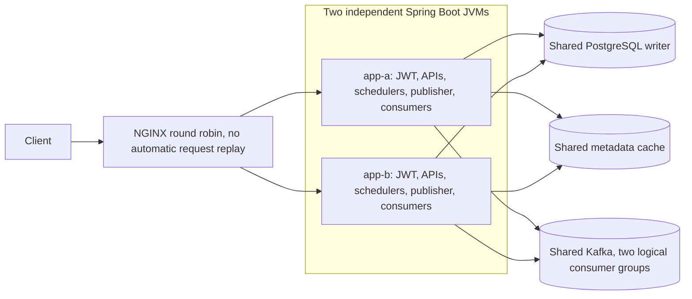

# Horizontal scaling and load balancing — Phase 11

## Deployment and request path

The same modular monolith runs in two independent JVM containers. Both use one
PostgreSQL writer, one disposable Redis catalogue cache, and one Kafka broker.
NGINX exposes the only host port, bound to loopback. There are no microservices,
sticky sessions, Kubernetes resources, or additional distributed locks.



All allocation checks and writes still use PostgreSQL locks, conditional updates,
and constraints. Redis never decides seat eligibility. Kafka never participates
in booking commits. Both JVMs run the existing service code; Phase 11 adds
infrastructure and metric attribution, not another allocation algorithm.

## Running locally

Phase 12B now builds the executable JAR from source inside a pinned Java 21 builder
and runs it as UID 10001 in a separate runtime stage. The filesystem is read only
except for `/tmp`; container capabilities are dropped. No host JAR is required.
Image packaging skips tests explicitly: run `./mvnw clean verify` separately or
verify CI for the same commit. See [DEPLOYMENT.md](DEPLOYMENT.md) for the complete
fresh-clone setup, environment contract, persistence checks, and troubleshooting.

```bash
cp .env.example .env
# Set DB_PASSWORD and a random Base64 JWT_SECRET in this private file.
# Optional: SPRING_PROFILES_ACTIVE=dev for a dedicated sample database.
docker compose -f compose.scaled.yaml config --quiet
docker compose -f compose.scaled.yaml up -d --build --wait --wait-timeout 240
curl --fail http://localhost:8080/actuator/health/readiness
docker compose -f compose.scaled.yaml ps
```

Do not combine `compose.scaled.yaml` with `compose.yaml`: they are separate local
workflows. The original `compose.yaml` still runs PostgreSQL/Redis/Kafka with
loopback ports for a Java process on the host. Stop an existing host application
or set `LB_PORT` before starting the scaled stack on the same port.

`docker compose -f compose.scaled.yaml down` retains PostgreSQL/Kafka volumes.
Only remove volumes intentionally on a disposable database. Both JVMs use the
same schema and Flyway history; Flyway coordinates concurrent startup migrations.
Phase 12B isolates the service network and pins image digests. The initial V7 upgrade still requires quiescing older booking writers as described
in [MESSAGING.md](MESSAGING.md). Phase 11 does not add a schema migration.

| Setting | Scaled default |
| --- | --- |
| `LB_PORT` | `8080`, bound to `127.0.0.1` |
| `DB_POOL_SIZE` | 20 per JVM, 40 potential application connections total |
| PostgreSQL `max_connections` | 160, including administrative/background headroom |
| `JWT_SECRET`, issuer, audience | Shared across both JVMs; no default signing secret |
| `INSTANCE_ID` | Fixed `app-a` / `app-b` metric tags |
| App resources | 1 CPU quota and 768 MiB memory per JVM |
| JVM | 128 MiB initial / 384 MiB maximum heap, 2 visible processors |
| PostgreSQL / Redis / Kafka / NGINX | 512 / 128 / 1024 / 128 MiB memory limits |
| `RESERVATION_CLEANUP_MS` / `OUTBOX_POLL_MS` | 30000 / 1000 ms |
| `OUTBOX_LEASE` | `PT30S` |

The container memory limits total 3.25 GiB; this excludes Docker, OS, build tools,
and k6. Budget at least 6–8 GiB for Docker plus host overhead, and several CPU
cores. These are development limits, not a production sizing recommendation or a
measured minimum. Adding a JVM also adds CPU quota, memory, and database connections;
the benchmark does not represent doubling performance at a fixed resource budget.

## NGINX routing, retries, and trust

`deploy/nginx/nginx.conf` uses HTTP/1.1 upstream keepalive and round robin. A shared
upstream zone holds passive failure state across NGINX workers. Docker DNS is
resolved periodically, so upstream names are not tied to startup-only addresses.
`max_fails=1 fail_timeout=5s` temporarily excludes a peer after a transport failure.
This is **not active readiness probing**. Docker health checks are separate and
NGINX does not remove a TCP-reachable backend merely because Docker says unhealthy.

`proxy_next_upstream off` disables every automatic replay, including GET retries.
A failed attempt may return 502/503/504 to its caller; later requests can use the
survivor. Periodic attempts after the passive timeout may fail again while a
backend remains unavailable. There is no zero-error failover claim. Clients must
choose safe retries: payment uses its original idempotency key, confirmation uses
the same reservation ID, and creating a hold still has no recovery key.

The verified SIGKILL run observed one 504 with an NGINX **connecting to upstream**
timeout and four 502s during restart; payment retries produced one 201 and five
200s for the same durable attempt. See the retained [raw report](../verification/results/2026-10-13-multi-instance.json).

Connect timeout is one second; upstream read/send timeouts are twenty seconds.
These bound individual connection or idle waits, not total request duration or
the lifetime of an already-running database transaction. An ambiguous response requires resource/key-based recovery. NGINX
uses neither sticky cookies nor IP hashing.

The edge overwrites incoming `Forwarded`/`X-Forwarded-*` values and forwards host,
scheme, and client address. Only the internal scaled app enables Spring forwarded
header processing. The app ports are not published, so ordinary host clients
cannot bypass this edge. Docker-network administrators remain trusted. The local
`X-Tbooker-Upstream` response header identifies the actual peer for verification;
remove that diagnostic header at a public edge. Access logs omit tokens, bodies,
and query strings.

JWTs are issued/validated with the same key, issuer, and audience on both JVMs.
Roles and ownership rules are unchanged; no shared session storage is needed.
Monitoring remains ADMIN-only. The stack uses local plaintext networking and does
not implement public TLS termination, broker ACLs, key rotation, or rate limiting.

## Background coordination and failure boundaries

| Component | Coordination across JVMs |
| --- | --- |
| Seat mutations | Lock the same inventory row first; sample database time after waiting; atomic writes and unique constraints decide the winner. |
| Expiry cleanup | Bounded `FOR UPDATE ... SKIP LOCKED` batches; competing workers skip locked seats. Delayed cleanup cannot extend confirmation rights. |
| Outbox publishers | PostgreSQL claim transactions assign leases and fencing tokens; sends happen outside transactions. Expired leases are reclaimable. |
| Notifications / analytics | Each JVM joins the same configured group for each projection. Kafka distributes partitions; marker and projection commit together before offsets. |
| Payment recovery | No scheduled reconciliation worker exists. Owner/key retry and reservation confirmation invoke the existing verified recovery workflow. |

After a crash, holds remain in PostgreSQL until cancellation, confirmation, or
expiry. A replacement JVM can validate the same JWT and access the owner's state.
A producer killed after Kafka acknowledgment but before PUBLISHED can resend;
durable consumer deduplication is still required. A consumer killed after its DB
commit but before offset commit can also receive the record again. Recovery may
wait for lease expiry and Kafka group membership timeout/rebalance.

Redis errors fall back to PostgreSQL and can increase SQL load. Kafka outages
accumulate outbox backlog while paid bookings commit. App containers depend on
PostgreSQL health at startup; Redis/Kafka need only be started, so an unhealthy
optional component does not block an explicit backend restart. `compose up --wait`
still checks the entire requested stack and can report a deployment health failure.

## Observability

All Micrometer meters carry `application=tbooker` and `instance=app-a|app-b`
(`local` for an unconfigured host JVM). Query each backend directly from the
trusted Docker network with an ADMIN JWT for per-instance snapshots. Repeated
requests to the load-balanced metrics URL may reach different instances; do not
treat that stream as one monotonic counter.

- `http.server.requests`: request COUNT, total time, and maximum by status/route.
  Booking conflicts are COUNT with `status:409` and the reservation/payment/
  booking route tag; no high-cardinality seat/user labels are introduced.
- `jvm.memory.used?tag=area:heap`, `jvm.gc.pause`: heap and GC observations.
- `hikaricp.connections.active`, `.pending`, `.max`: pool usage/waiters/capacity.
- `booking.outbox.pending`: each JVM samples the same backlog; do not sum it.
- Native Kafka consumer record-lag meters: fetch lag, not completed-projection lag.
- Docker stats: per-container CPU/memory, including PostgreSQL, Redis, Kafka,
  and NGINX. One hundred percent CPU means one busy logical core.

No dashboard or alert deployment is included. Metrics sampling adds load and can
miss short spikes; process counters reset after a restart. Benchmark p50/p95 come
from k6 client observations, not averages of server-side percentile estimates.

## Verification and benchmarks

The executable runners create fresh UUID-named Compose projects with private
volumes, ports, and temporary credentials. They never read the developer `.env`
or attach to an existing database. Broker pauses, process kills, fixture SQL, and
volume teardown operate only on those created resources.

```bash
python3 verification/multi_instance.py --output /tmp/tbooker-e2e.json
python3 performance/run-scaling.py --output /tmp/tbooker-scaling.json
```

The end-to-end suite uses 60 database connections per JVM only to prove all 100
HTTP contenders actually wait on the PostgreSQL seat lock at once. Ordinary
scaled operation and benchmarks use 20 per JVM. Failure tests include real
SIGKILL of a JVM after broker acknowledgment, observed through a test-only database
trigger blocking the subsequent state write. Test triggers are never installed
by application migrations.

The benchmark compares one versus two JVMs **through the same NGINX** in ABBA
order for catalogue, mixed paid-booking, and hot-seat contention workloads.
PostgreSQL fixtures and Redis are reset while apps are stopped; every run restarts
the same image and warms catalogue reads. Eight catalogue requests plus one hold
and one payment form a successful mixed iteration. Contention uses one seat: the
first request holds it and subsequent requests should conflict. Expected 409s are
reported separately from unexpected failures. Both workers and consumers remain
enabled during load.

Exact executed counts, failure observations, benchmark tables, and raw evidence
are recorded in [TESTING.md](TESTING.md) and [PERFORMANCE.md](PERFORMANCE.md).

## Remaining limits

This is a local multi-process demonstration, not multi-host HA certification.
NGINX, PostgreSQL, Redis, and Kafka each remain single instances. Database failover,
network partitions, disk loss, automatic scaling, deployment orchestration, and
TLS/broker security are outside this phase. Shared database locks remain the hot-seat
bottleneck; a second JVM cannot create two valid owners. More connection pools can
increase database pressure. Kafka has three partitions per topic, limiting useful
consumer parallelism per group. Analytics still serializes through one counter row.
