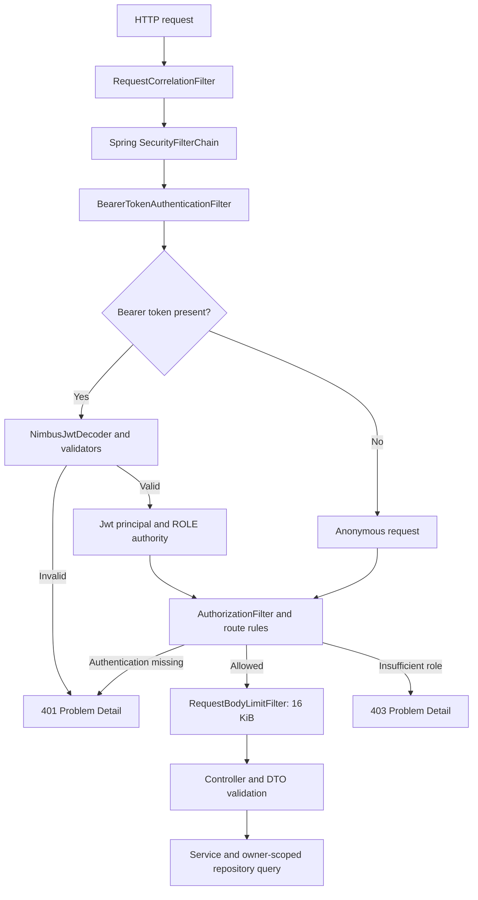

# Authentication, authorization and operational security

The application authenticates local accounts with BCrypt and issues short-lived
JWT bearer tokens. Spring Security protects booking routes and checks roles;
booking queries also enforce ownership. Catalogue reads and health remain public.
Redis caches public catalogue metadata only; it stores no credentials, JWTs, or
ownership data. Kafka handles internal booking events; production ACL/TLS setup is still required.
There is no real payment integration, external identity provider, or OAuth
authorization-server flow. ADMIN JWTs are required for Actuator metrics; health
remains public with component details hidden.

## Account and API lifecycle

1. `POST /api/auth/register` accepts `name`, `email`, and `password`. It returns
   `201` with `UserResponse` (`id`, `name`, `email`, `role`). Registration always
   assigns `USER`; submitting a `role` or another unknown field returns `400`.
2. Registration normalizes accepted email addresses to lowercase, checks for an
   existing account, and stores a salted BCrypt hash with cost 12. The existing
   unique index on `lower(email)` also resolves concurrent duplicate registrations
   to `409`. Registration does not issue a token or verify email ownership.
3. `POST /api/auth/login` accepts `email` and `password`. BCrypt checks the stored
   hash; successful login returns `accessToken`, `tokenType: "Bearer"`, and
   `expiresIn` in seconds. Unknown accounts, disabled legacy accounts, and wrong
   passwords receive the same generic `401`. Unknown/legacy accounts perform a
   BCrypt check against a process-generated dummy hash to reduce timing differences.
4. Protected requests send `Authorization: Bearer <accessToken>`. Tokens in
   query parameters or cookies are not accepted. No HTTP session is created.

Registration passwords must have at least 12 Java string characters and at most
72 UTF-8 bytes. Login also rejects passwords over BCrypt's 72-byte limit, avoiding
silent truncation of Unicode input. Passwords are never trimmed or case-folded.
Credential/token DTOs redact their `toString()` output; responses never contain
password hashes. Spring Security adds cache-control headers, including `no-store`.

## Spring Security filter chain



Spring's resource-server support handles bearer extraction and authentication.
`NimbusJwtDecoder` verifies the signature using only HS256 and validates issuer,
audience, expiry, optional not-before, issued-at, a positive `Long` subject, and
the allowed `USER`/`ADMIN` role claim. Expiry and issued-at are required. Timestamp
validation allows 30 seconds of clock skew. A supplied invalid token is rejected
even on a route that otherwise permits anonymous access.

`JwtAuthenticationConverter` maps the signed role claim to `ROLE_USER` or
`ROLE_ADMIN`. The authenticated principal is the validated `Jwt`; its `sub` is the
database user ID. The authorization filter checks route rules before controllers
run. `SecurityProblemHandler` returns generic `401`/`403` Problem Details for
filter failures; the authentication challenge is `WWW-Authenticate: Bearer`.
Controller advice handles login and domain errors separately.

Form login, HTTP Basic, logout, request caching, and session persistence are
disabled. CSRF is disabled because authentication is exclusively an explicitly
sent bearer header, with no cookie/session authentication. Revisit that decision
before adding authentication cookies. No permissive cross-origin policy has
been added. Error dispatches are allowed so genuine application errors can be
rendered without being replaced by authorization failures.

## Route policy and ownership

| Route / method | Access |
| --- | --- |
| POST `/api/auth/register`, `/api/auth/login` | Public |
| GET/HEAD catalogue routes | Public show list/detail/seats and movie/theatre list/detail only |
| Health endpoints | Public |
| GET `/actuator/metrics`, `/actuator/metrics/{name}` | ADMIN JWT only |
| POST `/api/shows/{showId}/bookings` | USER or ADMIN; creation now returns `409` |
| GET `/api/bookings`, `/api/bookings/{bookingId}` | USER or ADMIN, own bookings only |
| POST `/api/shows/{id}/reservations`; GET/DELETE `/api/reservations/{id}` | USER or ADMIN, own reservation only |
| POST `/api/reservations/{id}/confirmation` | USER or ADMIN, own hold and verified payment |
| POST `/api/reservations/{id}/payments` | USER or ADMIN, own active reservation or matching key replay |
| GET `/api/payments`, `/api/payments/{id}`, `/api/reservations/{id}/booking` | USER or ADMIN, owner-scoped |
| `/api/admin/**` | ADMIN, reserved namespace |
| POST/PUT/PATCH/DELETE catalogue paths | ADMIN, after the specific booking rule |
| Other unmatched requests | Denied by default |

Catalogue mutations are **not implemented**. The security policy reserves writes
under `/api/shows/**`, `/api/movies/**`, `/api/theatres/**`, `/api/screens/**`, and
`/api/seats/**`. Tests confirm an ordinary user's `POST /api/shows` receives `403`,
while an ADMIN passes authorization and receives `405` because no write handler
exists. No test-only production mutation endpoint was introduced.

Booking requests contain only `showSeatId`. A supplied `userId` is rejected as an
unknown property. The controller derives identity from the validated subject and
passes it to the appropriate service; it never trusts a body or query parameter for
ownership. Read queries filter by `user_id` in SQL. Detail lookup combines the
booking ID with the owner ID and returns `404` for missing or foreign bookings,
avoiding disclosure of another user's booking. ADMIN has no ownership bypass.
Booking lists are ordered by creation time descending, then ID descending, and
are currently unpaged.

Authentication occurs before reservation/payment orchestration. The legacy write
endpoint cannot bypass payment. Conditional inventory updates, READ_COMMITTED
isolation, atomic allocation, and `uq_bookings_show_seat` remain the safeguards. Signed requests still contend on the
same database row; JWT does not replace database concurrency control.

## JWT configuration and trust boundary

| Variable | Meaning |
| --- | --- |
| `JWT_SECRET` | Required Base64 encoding of at least 32 random bytes; no default. |
| `JWT_ISSUER` | Expected issuer, defaults to `tbooker`. |
| `JWT_AUDIENCE` | Expected audience, defaults to `tbooker-api`. |
| `JWT_TTL` | ISO-8601 duration, defaults to `PT15M`; supported range `PT1M`–`PT1H`. |

Generate a local key with `openssl rand -base64 32` and set it in your ignored
`.env`; inject production keys through environment-backed secret management.
Missing, malformed, or short keys fail startup. Test contexts generate a random
key at runtime and never require or persist a production key.

`TokenService` uses Nimbus through Spring's `JwtEncoder` to issue HS256 tokens
containing `iss`, `aud`, `sub`, `iat`, `nbf`, `exp`, `jti`, and `role`. Tokens omit
email and password data. JWT payloads are readable, not encrypted. Possession of
a valid token grants its privileges, so use TLS in deployment and protect tokens
from logs, browser script access, and accidental disclosure.

Nimbus JOSE + JWT 10.10 is explicitly pinned because the resource-server
dependency's transitive Nimbus version is older. Signature/claim handling remains
in the library and Spring adapters, not custom cryptography. Keep dependency
updates and vulnerability review part of later maintenance.

All instances validating HS256 tokens share a secret and therefore can also mint
tokens. This is suitable for the current single application trust boundary.
Asymmetric signing and managed public-key rotation would be preferable if future
independent services should validate tokens without being able to issue them.

## Migration and ADMIN provisioning

V4 adds `users.password_hash` and `users.role`, without changing IDs, emails,
existing bookings, or earlier migrations. `role` is non-null, defaults to `USER`,
and is constrained to `USER`/`ADMIN`. A non-null hash must have BCrypt's stored
format. Legacy and development sample users retain a null hash and cannot log
in. There is no shared default password and no public password-enrollment path
for legacy accounts in this phase; register a new account for local booking.

There is no public role-management or ADMIN-registration API. A trusted database
operator can promote an already registered account through a controlled operation:

```sql
UPDATE tbooker.users SET role = 'ADMIN' WHERE email = 'operator@example.test';
```

This example is an operator action, not part of ordinary application setup.
Re-login is required for a newly issued token to carry the updated role. Never
create a public endpoint accepting arbitrary role assignments.

## LLD patterns and HLD implications

- **Chain of Responsibility:** Spring Security filters perform token processing
  and authorization before the controller layer.
- **Strategy interfaces:** `PasswordEncoder`, `JwtEncoder`, and `JwtDecoder`
  supply framework-backed implementations through constructor injection; BCrypt
  and Nimbus are the configured choices. No custom factory hierarchy is needed.
- **Service Layer, Repository, DTO:** `AuthService` handles registration/login,
  `TokenService` creates tokens, and `BookingService` enforces owner-scoped reads.
  Controllers remain thin, and repositories own persistence queries.
- **Dependency injection and transaction proxies:** Spring provides collaborators
  and preserves service transaction boundaries. Error adapters separate filter
  authentication failures from domain exceptions.

Stateless validation avoids a shared session store for future application replicas.
It also removes an immediate session-revocation mechanism. Authorization has two
layers: route roles control operations, while owner-scoped queries prevent
insecure direct object reference access to booking records. Database constraints
remain authoritative for storage integrity.

## Verification and remaining limits

Integration tests exercise actual signed tokens, the security filter chain, and
Testcontainers PostgreSQL. They cover registration/hash storage, concurrent and
case-insensitive duplicates, login errors, malformed/expired/unsigned/wrong-key
tokens, issuer/audience/subject/role checks, missing credentials, privilege
injection, ownership, ADMIN rules, and legacy migration. Existing rollback and
20-request booking races now use real signed tokens as well. See [TESTING.md](TESTING.md)
for executed counts rather than inferring success from this list.

- No refresh tokens, logout revocation, token denylist, key overlap/rotation
  protocol, MFA, password reset, email verification, or self-service legacy
  account enrollment exists.
- Token role changes are not checked against the database on every request.
  Old privileges remain until expiry (plus clock skew) or signing-key replacement.
  A missing user still cannot book because the service verifies that user exists.
- No login/registration rate limiting or lockout is implemented. BCrypt mitigates
  offline guessing but costs CPU; registration also occupies a database transaction
  during hashing. A public deployment needs abuse controls and measurement.
- Duplicate registration deliberately reveals that an email is registered; login
  uses generic errors and dummy hashing but is not claimed to be constant-time.
- TLS termination, secret rotation operations, security audit events, recovery,
  and production monitoring remain deployment work. No penetration test or
  multi-instance security/performance guarantee is claimed.
- Existing booking limits still apply: no hold-creation idempotency, booking-specific
  database lock timeout, scheduling overlap check, confirmed-booking cancellation,
  real payment provider, or refunds. Payment keys and confirmation retries are supported.

## Reservation authorization (Phase 7)

`POST /api/shows/*/reservations`, `GET /api/reservations/*`,
`POST /api/reservations/*/confirmation`, and `DELETE /api/reservations/*` require
USER or ADMIN. These matchers precede the general ADMIN catalogue-mutation rule.
`ReservationController` derives the owner exclusively from the validated JWT
subject. Creation accepts only `showSeatId`; view/confirmation/cancellation use
owner-scoped queries and return `404` for foreign IDs, including ADMIN callers.
Confirmed bookings keep the existing owner-scoped read contract.

The JWT encoder/decoder, password checks, public show routes, and role conversion
are unchanged. Expiry is a database allocation rule, independent of JWT expiry:
a user still needs a valid token to operate on an active hold. Background cleanup
has no public HTTP endpoint. Hold quotas and abuse/rate limits are not implemented.

## Payment authorization and trust (Phase 8)

`PaymentController` accepts only method plus a bounded Idempotency-Key; owner comes
from `@AuthenticationPrincipal Jwt`. Payment status/history and reservation booking
reads are owner-scoped, with no ADMIN override. Unknown status/amount/owner fields
are rejected. Missing/invalid tokens fail in the existing resource-server chain.

`PaymentResultProcessor.process(id)` is internal, has no HTTP mapping, and treats
any notification as a hint to independently query the selected provider. The
mock receipt is checked against persisted command identity, amount/currency,
reference and version. A successful financial result alone cannot override an
expired/cancelled reservation or another owner's inventory. The confirmation
transaction rechecks both ownership and stored payment proof under the seat lock.

The trust boundary is the application/provider adapter and database permissions,
not an HTTP callback body or an unguessable numeric ID. Direct privileged SQL or
compromised application code can falsify mock proof. There are no card/UPI account
details, real transfers, provider credentials, PCI claims, or payment certification.
Real providers would require authenticated notifications, independent verification,
secret management, timeouts, reconciliation/refund procedures, and operational review.
The default-deny rule rejects public status mutation/callback paths; there is no
endpoint for a client to turn a deliberately PENDING mock receipt into SUCCESS.

## Phase 11 edge and replica trust

Both JVMs share the JWT key, issuer, and audience; no session affinity or shared
session database is introduced. PostgreSQL owner predicates remain unchanged.
The scaled Compose stack publishes only NGINX on loopback. App/database/cache/
broker ports stay inside the Docker network; administrators of that network are
trusted. Each app is non-root, read-only except `/tmp`, and drops capabilities.

NGINX overwrites client forwarding headers; Spring trusts forwarding only in the
scaled container configuration. This assumes requests reach the apps through that
edge. Access logs omit JWTs, bodies, and query strings. The diagnostic
`X-Tbooker-Upstream` header exposes an internal peer address and should be removed
at a public edge. Per-instance metrics still require ADMIN; never expose direct
unauthenticated metrics to compensate for load-balanced counters.

Automatic upstream retry is disabled, including writes. A timeout can leave an
ambiguous commit: retry a payment using its original key or inspect the existing
reservation; a new hold request is not generally retry-safe. TLS, rate limiting,
network policies, Redis authentication, broker ACL/SASL, token revocation, and key
rotation remain future operational work. See [SCALING.md](SCALING.md).

## Phase 12B deployment inputs

Both Compose configurations require a private database password; scaled Compose
also requires the shared JWT key. The example provides neither value. The build
context allowlist excludes `.env` and credentials; the final image contains no
build proxy settings or CA customization. Docker administrators can still read
container environment values, so this is not a production secret-management system.

The scaled service network is now explicitly internal; only NGINX joins a second
host-facing bridge and publishes loopback HTTP. PostgreSQL/Redis/Kafka and backend
ports remain unpublished. This does not replace TLS, Redis/broker authentication,
or production firewall policy. Deliberately changing `LB_BIND_ADDRESS` can expose
plaintext traffic outside the host. See [DEPLOYMENT.md](DEPLOYMENT.md).

## Phase 12D review: verified controls and confirmed gaps

The review started from `7423ae6`, the Phase 12C merge into main (PR #8).
Existing password/JWT and owner predicates were retained, not replaced. No
authentication bypass, cross-owner booking bypass or public payment-result write
was found in this source review and regression tests; this is not exhaustive
penetration testing.

| Area | Finding and disposition |
| --- | --- |
| Authentication | BCrypt cost 12 and byte limit; HS256-only Nimbus signatures; required expiry/issued-at, issuer/audience, positive Long subject and USER/ADMIN role checks. Existing invalid/expired/tampered/incorrect-role tests retained. |
| Authorization | Public exact catalogue routes; default deny; ADMIN-only metrics; owner-scoped reservation/payment/booking access even for ADMIN. Existing real-token tests cover these boundaries. |
| Payment integrity | Owner/key uniqueness and command binding, independent provider verification, stale/duplicate version handling, and paid-only confirmation remain intact. No new callback or automatic retry. |
| Confirmed request-size gap | NGINX already limited bodies, but direct JVM requests had no JSON-body bound. A post-security filter now buffers at most 16385 bytes and rejects over 16384 with 413, including chunked input before Jackson. This bounds body allocation, not request rate or total concurrent memory. |
| Confirmed logging exposure | Application handlers logged raw DB throwables, which can contain failing-row data. They now emit class/category summaries. Hibernate's raw SQL-error logger is off; ECS output omits throwable message and stack fields, including library exceptions. A test injects a private row sentinel and checks response/logs. |
| Confirmed log-volume gap | Cache outage warnings occurred for every cache operation. Warnings are now bounded per JVM while every failure is counted. Operational DB/payment/scheduler failures have per-operation limits. Framework/broker log volume still needs external retention controls. |
| Confirmed wait-budget gap | Pool acquisition used its 30-second default and PostgreSQL had no explicit lock/statement limits. Defaults are now 3-second acquisition, 5-second lock and 15-second statement waits; see the runbook for migration/operation limits. |
| Configuration / exposure | Only `.env.example` is tracked, with blank secrets. Required JWT/DB values stay outside images; scaled Compose exposes only loopback NGINX. Local Redis/Kafka remain unauthenticated on the trusted internal network. |

Invalid JSON/unknown DTO fields, invalid identifiers and validation failures keep
generic 400 Problem Details. Domain/known unique conflicts remain 409. Database
resource/timeout failures return 503; other integrity failures remain 500 without
SQL or rows. `X-Request-ID` appears in application Problem Details and request MDC,
which is cleared after each synchronous request. NGINX replaces incoming IDs.
Direct clients may supply a 32-character lowercase hex diagnostic ID; it is not
proof of origin or a unique transaction key. IDs are never metric tags.

ECS logs retain timestamp, level, logger, exception type and safe summary, at the
cost of losing stack details in normal console output. This protects known SQL
throwable paths, not arbitrary secrets placed in future log messages. Do not log
DTO bodies or enable wire/SQL debug. DLT records/diagnostic headers and database
rows remain restricted operational data. The edge logs paths; never put secrets
in URL paths.

### Dependency review limits

Resolved runtime versions were inspected on 2026-10-14: Boot 3.5.16, Spring Security
6.5.11, Framework 6.2.19, Tomcat 10.1.55, Nimbus 10.10, Logback 1.5.34,
PostgreSQL JDBC 42.7.11, Kafka client 3.9.2 and Netty 4.1.135.Final. The OSV Maven
advisory lookup was blocked by the environment proxy (`403 Forbidden`). No
successful advisory or container-image vulnerability scan is claimed; no CVE was
confirmed or dismissed on that evidence. Repeat current SCA and image scans in an
allowed environment, triage reachable advisories, then update managed versions
and pins with regression tests. No speculative dependency upgrade was made.

### Remaining limitations and future priorities

These missing controls and operational risks are distinct from a demonstrated
exploit in the reviewed code:

- Local HTTP has no TLS, brute-force/registration rate limit, hold quota or global
  admission control. BCrypt is deliberately expensive; registration hashes while
  holding a transaction/connection. Abuse can exhaust CPU/pools.
- JWT logout/revocation, rotation, refreshed roles and disabled/deleted-user lookup
  during authentication are absent. Service-layer user checks are not global
  revocation; existing tokens remain valid until expiry.
- Runtime and migrations share the DB bootstrap role. Separate least-privilege
  roles, secret management, backups/restoration, broker ACLs/SASL/TLS and Redis
  authentication remain production prerequisites.
- Body bounds and idle timeouts do not prevent every slow-client/high-concurrency
  denial of service. The filter supports blocking JSON; future multipart,
  streaming or asynchronous request bodies require a separate review.
- Unpaged responses, cache stampedes, one DB/broker/edge, finite Kafka retention,
  historical table growth and absence of durable metric history/alerts remain.
- Automated reconciliation/refunds, generic hold-create idempotency, durable cache
  invalidation and HA failover are absent. A timeout does not prove a write failed.
  Use existing payment/confirmation retry semantics after checking persisted state.

These changes improve local safeguards and diagnosis; they do not establish
production readiness. [RUNBOOK.md](RUNBOOK.md) covers operations and
[TESTING.md](TESTING.md) records executed verification and its limits.
